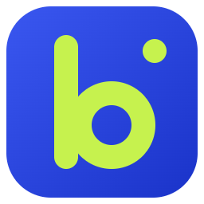
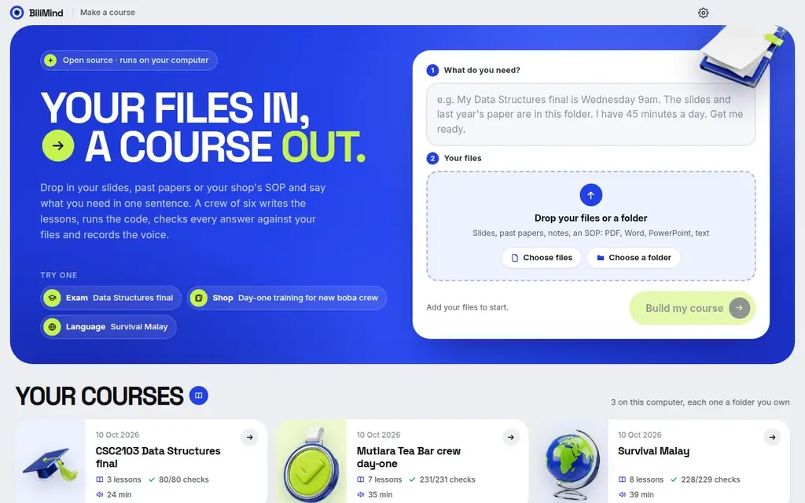
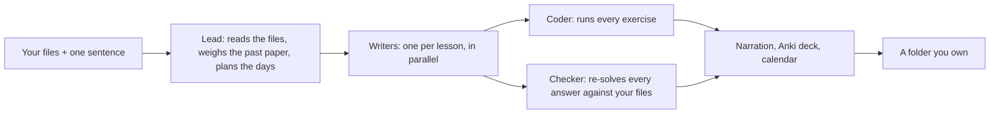

<p align="center">
  
</p>

<h1 align="center">BiliMind Desktop</h1>

<p align="center">
  <b>Turn your own slides, notes and past papers into a narrated course, with every answer checked against your files.</b><br>
  A desktop app for Windows, macOS and Linux. Your files stay on your computer, and it runs on your own AI key.
</p>

<p align="center">
  <a href="https://github.com/Odilient/bilimind-desktop/releases/latest"></a>
  <a href="https://github.com/Odilient/bilimind-desktop/actions/workflows/ci.yml"></a>
  <a href="LICENSE"></a>
  
</p>

<p align="center">
  <a href="https://github.com/Odilient/bilimind-desktop/releases/latest"><b>Download</b></a> ·
  <a href="https://odilient.github.io/bilimind-desktop/courses/ds-final/">Try a course in your browser</a> ·
  <a href="#run-from-source">Run from source</a> ·
  <a href="https://github.com/Odilient/bilimind-desktop/discussions">Discussions</a> ·
  <a href="https://bilimind.com">bilimind.com</a>
</p>

<p align="center">
  
  <br><sub>The app's own window replaying a recorded run (sped up): one sentence and a folder in, a checked course out.</sub>
</p>

## What it does

1. **Drop in your files.** Lecture slides, a past exam paper, notes, or a shop's SOP: PDF, Word, PowerPoint,
   Markdown, text or HTML.
2. **Say what you need in one sentence.** "My Data Structures final is Wednesday 9am. The slides and last
   year's paper are in this folder. I have 45 minutes a day. Get me ready."
3. **Watch it build.** A crew of agents reads the files, weighs topics by last year's marks, plans your days,
   writes the lessons, runs the code exercises, re-checks every quiz answer against your files and records
   the narration. It asks you nothing along the way. In our runs a course took 3 to 5 minutes and cost
   between $0.02 and $0.09 in AI calls.
4. **Study it, offline.** The course is a folder on your computer: one `index.html` that works in any browser,
   plus Markdown notes, an Anki deck and a review calendar.

## Features

- **Lessons in the format the knowledge needs.** A procedure gets a walkthrough, a formula gets a worked
  example, a language gets speaking drills (22 block types in all).
- **Every auto-marked answer is checked against your files.** The Checker solves each question again from your
  sources. An answer your files contradict is rejected with the exact quote and rewritten, and the quote has
  to match your file word for word. Anything your files do not cover is labelled "Beyond your slides".
- **Code exercises that run.** The model solution must pass every test and the starter code must fail at
  least one, or the exercise is fixed or switched off with a reason.
- **A study plan sized to your days**, weighted by the past paper's marks when you add one, with a reason for
  every topic it cut.
- **Narration with sentence highlighting**, in Microsoft Edge's free online voices (English, Malay and Burmese
  voices; other languages use a multilingual voice).
- **An assistant beside every lesson** that answers from the lesson, the course or all your files, cites the
  file, slide or page and the quote for each point, and shows what each answer cost.
- **Files you own:** `index.html`, `plan.md`, `REPORT.md` (every check, rejection, time and cost), lesson notes
  in Markdown, `deck.csv` for Anki and `reviews.ics` for your calendar.
- **Spending caps:** each course stops at $0.25 of AI cost and each day at $2, by default.
- **Also a command line and a WorkBuddy skill.** The same engine runs as one `bilimind.mjs` file on Node 22+
  ([apps/cli](apps/cli/)), and as a skill and Expert Team for WorkBuddy ([skills/bilimind](skills/bilimind/)).

| | |
|---|---|
|  |  |
|  |  |

## Try a course it made

These play in your browser, no install: [Data Structures final](https://odilient.github.io/bilimind-desktop/courses/ds-final/)
(5 PDFs, 63 pages, 3 lessons for the 3 days left) ·
[Boba shop: day one for new crew](https://odilient.github.io/bilimind-desktop/courses/boba-day-one/)
(an SOP and a hygiene regulation, narrated in English and Malay) ·
[Survival Malay](https://odilient.github.io/bilimind-desktop/courses/bm-survival/) (speaking drills, 20 minutes a day).
Each one has a report of what the agents did: [ds-final](showcase/courses/ds-final/REPORT.md),
[boba-day-one](showcase/courses/boba-day-one/REPORT.md), [bm-survival](showcase/courses/bm-survival/REPORT.md).

## Install

Download from the [latest release](https://github.com/Odilient/bilimind-desktop/releases/latest):

| System | File | First launch |
|---|---|---|
| **Windows** 10 and 11, x64 | `BiliMind-Desktop-<version>-x64-setup.exe` (installer) or `…-x64-portable.exe` (no install) | SmartScreen may say "Windows protected your PC": click **More info**, then **Run anyway**. |
| **macOS**, Apple silicon | `BiliMind-Desktop-<version>-mac-arm64.dmg` | Drag the app to Applications. If macOS says it cannot be opened, go to **System Settings → Privacy & Security** and click **Open Anyway**, or run `xattr -dr com.apple.quarantine "/Applications/BiliMind Desktop.app"`. |
| **macOS**, Intel | `BiliMind-Desktop-<version>-mac-x64.dmg` | As above. |
| **Linux**, x64 | `BiliMind-Desktop-<version>-linux-x86_64.AppImage` | `chmod +x BiliMind-Desktop-*.AppImage` and run it. |
| **Debian, Ubuntu**, x64 | `BiliMind-Desktop-<version>-linux-amd64.deb` | `sudo apt install ./BiliMind-Desktop-*.deb` |

`SHA256SUMS.txt` in each release lists the checksums.

> **The builds are not code-signed yet.** We have no Windows certificate and no Apple Developer ID, so
> Windows and macOS warn on first launch. The macOS app carries an ad-hoc signature only and is not notarized.
> Every installer is built from this repository by [the release workflow](.github/workflows/release.yml), and
> you can [build your own](#run-from-source).

macOS and Linux builds are new in 0.2.0. CI builds them, the Linux app passes our launch test, and the Windows
app is the one we have used most. If something breaks on your system, please
[open an issue](https://github.com/Odilient/bilimind-desktop/issues/new/choose); Mac owners, see
[#8](https://github.com/Odilient/bilimind-desktop/issues/8).

Then open **Settings**, pick a provider and paste your key (next section), drop in your files, type a
sentence and click **Build my course**.

## Bring your own key

BiliMind talks to the AI provider you choose, with your key. Your files' text goes straight to that provider,
not through us.

| Provider | Models it uses by default | Key |
|---|---|---|
| **DeepSeek** (direct API) | `deepseek-flash` for fast steps, `deepseek-v4-pro` for reasoning | [platform.deepseek.com](https://platform.deepseek.com/api_keys) |
| **OpenRouter** | `deepseek/deepseek-v4-flash` and `deepseek/deepseek-v4-pro`; any OpenRouter model can be set in the config file | [openrouter.ai/keys](https://openrouter.ai/keys) |
| **BiliMind free** | the same DeepSeek models, through a proxy the team pays for, no key | none. **It is paused right now**; while it is off, the app asks for your own key |

The key is saved in your config file (below) and never shown in the window again; the app shows only its last
four characters. Settings has a **Test** button that checks the key and the balance. To change the models or
the caps, edit the file:

```json
{
  "provider": "openrouter",
  "keys": { "openrouter": "sk-or-..." },
  "models": { "openrouter": { "fast": "deepseek/deepseek-v4-flash", "smart": "deepseek/deepseek-v4-pro" } },
  "caps": { "run_usd": 0.25, "day_usd": 2 }
}
```

`DEEPSEEK_API_KEY`, `OPENROUTER_API_KEY` and `BILIMIND_PROVIDER` work as environment variables too. Local models
(Ollama, LM Studio) and more providers are on the [roadmap](#roadmap) ([#5](https://github.com/Odilient/bilimind-desktop/issues/5)). More detail:
[docs/DEVELOPERS.md](docs/DEVELOPERS.md#ai-providers-and-the-config-file).

## Where your files live

| What | Where |
|---|---|
| Your courses | `Documents/BiliMind/<course>/` (change it in Settings). Delete the folder and the course is gone. |
| What a course holds | `index.html`, `course.json`, `plan.md`, `REPORT.md`, `deck.csv`, `reviews.ics`, `lessons/*.md`, `audio/*.mp3`, `sources/` (copies of your files, so citations open at the right page) and `crew/` (every agent's step, with its time and cost). The format: [docs/course-format.md](docs/course-format.md). |
| Your original files | Read, never changed. |
| Your key and settings | `~/.bilimind/config.json` on macOS and Linux, `%USERPROFILE%\.bilimind\config.json` on Windows. Plain text, readable by your user account; the same file the CLI uses. |
| What you spent | `~/.bilimind/ledger.jsonl`: one line per AI call (time, course, step, model, tokens, cost). No content. |

**What leaves your computer:** the text of your files and the prompts, sent to the AI provider you chose (to
write the course and to answer the assistant); the lesson narration text, sent to Microsoft Edge's online
voices; and a request for the current time from `api.deepseek.com` and Bing, so plans use the right date if
your clock is off. There is no account, no analytics and no telemetry. A course you have built opens with no
internet at all.

## Run from source

You need [Node.js](https://nodejs.org) 22 or newer (CI uses 24), Git, and pnpm 10 (`corepack enable` sets it up
from `package.json`).

```bash
git clone --depth 1 https://github.com/Odilient/bilimind-desktop.git
cd bilimind-desktop
corepack enable
pnpm install
pnpm start          # builds the course player and the app, then opens the window
```

Other commands:

```bash
pnpm dev            # the app with the renderer on Vite (hot reload)
pnpm test           # 338 tests (Vitest) across the packages
pnpm typecheck
pnpm dist           # installers for the OS you are on, in apps/desktop/release/
```

**Linux:** if `pnpm start` stops with "The SUID sandbox helper binary was found, but is not configured
correctly" (Ubuntu 24.04 and later), run `ELECTRON_DISABLE_SANDBOX=1 pnpm start` for development. The packaged
AppImage and `.deb` handle this themselves.

**No key yet?** `pnpm dev` opens the app with the three showcase courses in the library, so you can study
them. Open the `renderer:` URL it prints in a browser to get the whole UI with a mock that replays a recorded
run, which is how [docs/img/demo.webp](docs/img/demo.webp) was made.

How the pieces fit, the config file, the test mode and the repository layout:
[docs/DEVELOPERS.md](docs/DEVELOPERS.md). The main-to-window API: [apps/desktop/CONTRACT.md](apps/desktop/CONTRACT.md).

## How it works



The engine ([packages/engine](packages/engine/)) is TypeScript on Node. It reads files with no native
dependencies, searches your text without embeddings, and keeps every step in `crew/log.jsonl`. The desktop app
([apps/desktop](apps/desktop/)) is Electron with a Vue renderer; the course page ([packages/player](packages/player/))
is Vue built into one self-contained HTML file. More: [docs/how-it-works.md](docs/how-it-works.md).

## Why you can trust it

Our own runs, as the app recorded them on one laptop (sample folder: a Data Structures module, 5 PDFs, 63 pages):

| Run | Lessons | Checks passed | Wrong answers rejected | Code tests | Narration | AI cost | Time |
|---|---|---|---|---|---|---|---|
| App, run 1 | 3 | 91/91 | 0 | 8/8 | 18.5 min | $0.036 | 3 min 23 s |
| App, run 2 | 3 | 98/100 | 0 | 4/4 | 32 min | $0.049 | 4 min 42 s |
| App, run 3 (packaged) | 3 | 79/80 | 2 | 13/13 | 24.4 min | $0.032 | 3 min 37 s |

Every step's time and cost: [desktop-run-timings.json](hackathon/proof/desktop-run-timings.json). The three
showcase courses started as the same kind of run and were then reviewed by our team; every hand change is in
[showcase/courses/_notes](showcase/courses/_notes/). It can still be wrong: a lesson that fails its checks twice
is dropped, and scanned pages with no text layer cannot be read. Read `REPORT.md` before you trust a course with
an exam.

## How it compares

A fair comparison with Google's NotebookLM and the open-source tools closest to it, as of October 2026. Each one
is better than BiliMind at something.

| | **BiliMind Desktop** | [NotebookLM](https://notebooklm.google.com) (now Gemini Notebook) | [Open Notebook](https://github.com/lfnovo/open-notebook) | [DeepTutor](https://github.com/HKUDS/DeepTutor) | [SurfSense](https://github.com/MODSetter/SurfSense) |
|---|---|---|---|---|---|
| Runs | Desktop app on your computer | Google's cloud (web and mobile) | Self-hosted (Docker) | Self-hosted (Docker or pip) | Desktop app on your computer |
| Setup | Installer for Windows, macOS, Linux | None, a Google account | Docker Compose | Python and Node, or Docker | Installer for Windows, macOS, Linux |
| Models | Your key: DeepSeek or OpenRouter | Gemini only | 20+ providers, local models too | Many providers, local models too | Any OpenAI-compatible, local models too |
| What you get | An ordered course to a date: lessons, plan, checked quizzes | Chat with sources, plus generated overviews, reports, mind maps, flashcards, quizzes | Notebooks with sources, notes, chat and podcasts | Chat, living "books", mastery paths, practice | Chat and agents that research and edit your documents |
| Answers checked against your files | Every auto-marked answer re-solved, quote verified word for word | Chat answers cite passages | Chat cites whole sources | Grounded answers with citations | Cited answers |
| Spaced review | Anki deck and a review calendar to your exam | Flashcards and quizzes, no scheduler | No | Scheduled practice | Flashcards and quizzes |
| Audio | Narration of every lesson | Audio overviews in 80+ languages, video overviews | Multi-speaker podcasts | Audio overviews | Podcasts |
| Output | A folder of plain files | Stays in Google | Its database (SurrealDB) | Its data folder; books export to Markdown | Files on disk |
| Licence | AGPL-3.0 | Proprietary (free tier) | MIT | Apache-2.0 | Apache-2.0 |

Where the others are ahead today: NotebookLM needs no key and its audio and video overviews are far richer.
Open Notebook, DeepTutor and SurfSense run local models and many more providers. DeepTutor has more ways to study
(memory, knowledge bases, many modes), and SurfSense reads scanned PDFs with OCR. BiliMind's bet is narrower: one
sentence in, a course built to your deadline out, checked against your files and kept as files you own.

## Roadmap

What we plan next, roughly in order. Comments and pull requests welcome on any of them.

- Local models and any OpenAI-compatible endpoint (Ollama, LM Studio, OpenAI, Groq), set up from Settings ([#5](https://github.com/Odilient/bilimind-desktop/issues/5)).
- Keys in the operating system's keychain instead of a plain-text file ([#6](https://github.com/Odilient/bilimind-desktop/issues/6)).
- Code-signed Windows installers and a notarized macOS app ([#9](https://github.com/Odilient/bilimind-desktop/issues/9)).
- More sources: EPUB first ([#4](https://github.com/Odilient/bilimind-desktop/issues/4)), then scanned PDFs (OCR) and web links.
- Your own time zone and language everywhere: the CLI's dates ([#1](https://github.com/Odilient/bilimind-desktop/issues/1)) and native narrator voices for more languages ([#2](https://github.com/Odilient/bilimind-desktop/issues/2)).
- Windows on ARM and Linux arm64 ([#7](https://github.com/Odilient/bilimind-desktop/issues/7)), and the macOS build tried on real Macs ([#8](https://github.com/Odilient/bilimind-desktop/issues/8)).

See all [open issues](https://github.com/Odilient/bilimind-desktop/issues) and the [changelog](CHANGELOG.md).

## Contributing

Bug reports, ideas and pull requests are welcome. Start with [CONTRIBUTING.md](CONTRIBUTING.md); issues labelled
[good first issue](https://github.com/Odilient/bilimind-desktop/labels/good%20first%20issue) are a good way in.
Questions and ideas go to [Discussions](https://github.com/Odilient/bilimind-desktop/discussions). Please follow
the [Code of Conduct](CODE_OF_CONDUCT.md), and report security problems privately as described in
[SECURITY.md](SECURITY.md).

## BiliMind Desktop and bilimind.com

BiliMind Desktop is the free, open-source, local-first edition. [bilimind.com](https://bilimind.com) is our hosted
product, with accounts, sharing and courses that need no key; it is a separate codebase and not in this repository.
*Bilim* means knowledge in Uzbek.

Made by the BiliMind team: Oybek, Ulugbek, Sharif and Abdugaffor Odilov.

## License

[GNU Affero General Public License v3.0 only](LICENSE) (AGPL-3.0-only). The sample source folders in
[showcase/sources](showcase/sources/) carry their own licences (each folder has a `LICENSE.md`).

**History:** BiliMind Desktop began at Dormathon 2026 (10 and 11 October) as "BiliMind for WorkBuddy"; the entry,
its proof and the WorkBuddy skill notes are in [hackathon/](hackathon/README.md) and [docs/workbuddy.md](docs/workbuddy.md).
