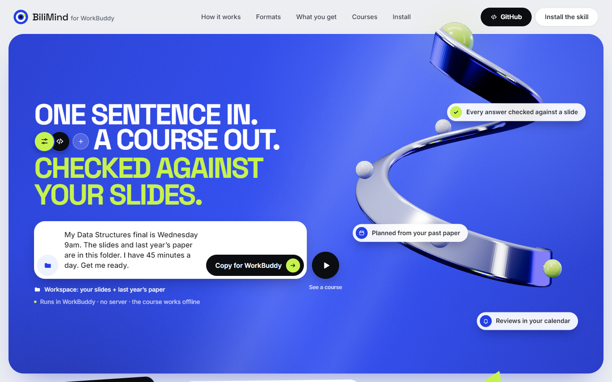
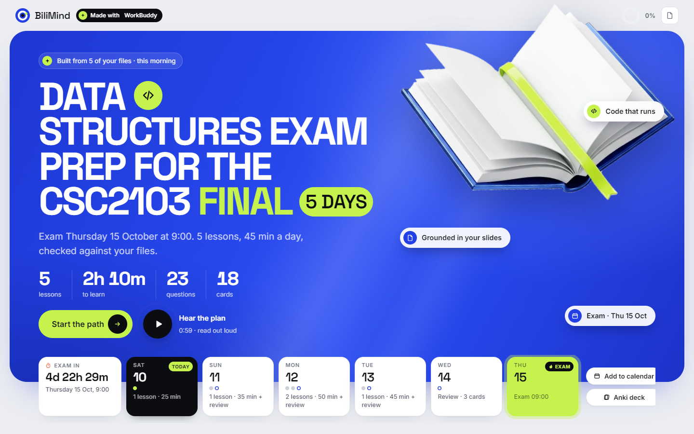
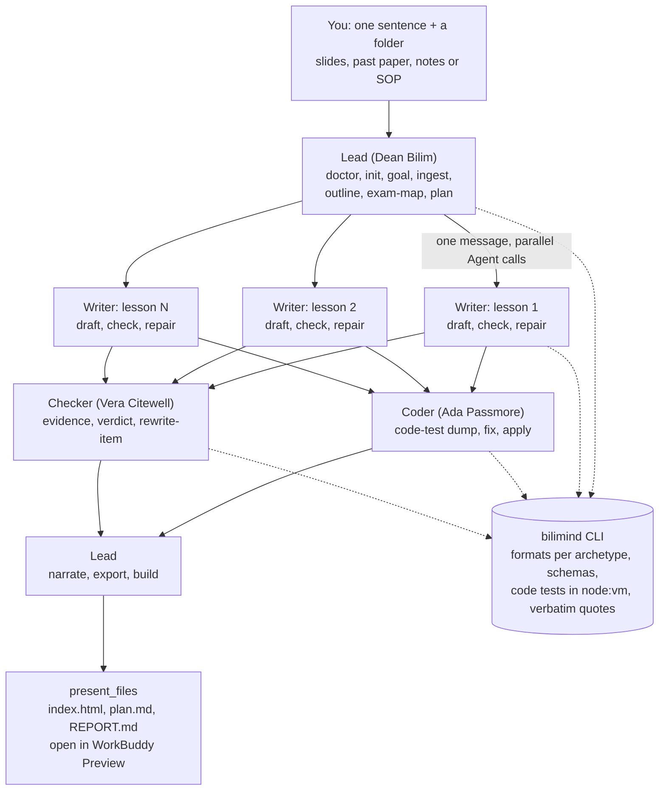

# BiliMind for WorkBuddy

**One sentence in. A course out. Checked against your slides.**

BiliMind for WorkBuddy is a WorkBuddy skill and Expert Team ("BiliMind Crew") that turns one sentence and a
folder of your own files (lecture slides, a past-year exam paper, notes, or a shop's SOP) into a study plan
sized to the days you have left and an interactive course you can open offline. A Lead agent reads the goal
and the past paper, decides what to keep and what to cut, then sends Writer sub-agents to write the lessons
in parallel. A Coder tests every code exercise and a Checker checks every quiz answer against a verbatim
quote from your files. The `bilimind` CLI enforces the rules: lesson formats per kind of knowledge, schemas,
code tests, and quotes. The agents decide; the code enforces. You get `index.html`, `plan.md`, `REPORT.md`,
a review calendar (`reviews.ics`), an Anki deck (`deck.csv`) and Markdown notes, all in a folder you own.

Built by team **Opus Magnum (#58), Taylor's University branch**, for **Dormathon 2026, Track 2: WorkBuddy
agentic solutions**.

- Repository: https://gitlab.com/avinmaster/bilimind-workbuddy
- Deployed site: https://bilimind-workbuddy-55b817.gitlab.io/
- Slides (PDF): {{SLIDES_PDF_LINK}}
- How, where and when we used WorkBuddy: [docs/workbuddy.md](docs/workbuddy.md)





The second image is the home page of a course the pipeline generated from the sample Data Structures folder
(`showcase/sources/ds-final`), opened from `file://` in headless Edge.

## How it works in WorkBuddy

You type one message in WorkBuddy, with the workspace set to your folder:

> My Data Structures final is Wednesday 9am. The slides and last year's paper are in this folder.
> I have 45 minutes a day. Get me ready.

The skill never asks a question back. Anything it has to assume (time zone, start date) is written into
`plan.md`.



1. **Lead** (the skill's main thread, or the team lead `bilimind-crew-team-lead`): reads the sentence (exam
   date and time, minutes a day, audience, language), reads the folder (which file is the past paper, which
   pages are scans), weights topics by past-paper marks, keeps and cuts lessons with a reason for each, and
   writes the plan. It shows progress as a nine-step WorkBuddy task checklist.
2. **Writers**, one per kept lesson, launched in one message so they run in parallel (at most 6). Each runs
   `draft`, reads the `check` report and repairs its own lesson for up to two rounds.
3. **Coder** and **Checker** in parallel. The Coder dumps each JavaScript exercise to real files, runs the
   tests, fixes whichever side is wrong (solution, starter or test) and applies the fix. The Checker rules
   every quiz answer supported, contradicted or not covered, with a quote that the CLI verifies word for word
   against the cited chunk. Contradicted items are rewritten; items not in your files get a visible
   "Beyond your slides" label.
4. **Lead** again: narration (Edge TTS), exports, build, then `present_files` opens the course in
   WorkBuddy's Preview panel.

More detail: [docs/how-it-works.md](docs/how-it-works.md). Output format: [docs/course-format.md](docs/course-format.md).

## Install in WorkBuddy

You need the WorkBuddy desktop app and a DeepSeek or OpenRouter API key (next section). WorkBuddy bundles
Node 22, which the skill uses.

### Option A: the skill

The skill folder is `skills/bilimind/`. It must contain the built `scripts/bilimind.mjs` and
`templates/player.html` (see [Development](#development) if you start from a fresh clone).

- **Copy the folder.** WorkBuddy watches its user-skills folder, so a copy installs the skill live:

  ```powershell
  powershell -ExecutionPolicy Bypass -File skills\bilimind\install.ps1
  ```

  This copies the skill to `%USERPROFILE%\.workbuddy-ai\skills\bilimind` (or `%WORKBUDDY_CONFIG_DIR%\skills\bilimind`)
  and leaves out dev-only files. You can also copy the folder there by hand.
- **Upload a zip.** `node skills/bilimind/scripts/zip-skill.mjs` writes `skills/dist/bilimind-skill.zip`
  with `SKILL.md` at its root. In WorkBuddy, upload it as a skill ("Upload skill"; the web app at workbuddy.ai/app calls it "Add Skill").

Then open a task in WorkBuddy, set the workspace to your folder, and type your sentence. The skill triggers
on words such as exam, final, lecture slides, past paper, revision, onboarding, SOP or study plan.

### Option B: the Expert Team "BiliMind Crew"

`workbuddy/bilimind-crew/` is a WorkBuddy Expert Team package: a lead (Dean Bilim, Exam Strategist) and three
members (Paige Turner, Lesson Writer; Ada Passmore, Exercise Tester; Vera Citewell, Slide Fact-Checker). It
wraps the same skill, so each role gets its own member card in WorkBuddy.

1. `node skills/bilimind/scripts/zip-skill.mjs --team` syncs the playbooks into the agent files and writes
   `skills/dist/bilimind-crew.zip`.
2. Copy `workbuddy/bilimind-crew` to
   `%USERPROFILE%\.workbuddy-ai\plugins\marketplaces\my-experts\plugins\bilimind-crew`.
3. Validate and register it with WorkBuddy's own `expert-manager` scripts (`validate_expert.py`,
   `register_expert.py`). Run them from inside WorkBuddy, so the session marker is written and the team
   appears in "My Experts". Step-by-step notes: `hackathon/EXPERT-TEAM.md`.

## Keys (bring your own)

Text generation uses your own key for **DeepSeek** (direct API) or **OpenRouter**. Narration uses Microsoft
Edge's online voices and needs no key.

Put the key in `~/.bilimind/config.json` (on Windows `%USERPROFILE%\.bilimind\config.json`). WorkBuddy's shell
does not see variables you set in your own terminal, so the file is the reliable way.

```json
{
  "provider": "deepseek",
  "keys": {
    "deepseek": "sk-...",
    "openrouter": "sk-or-..."
  },
  "reserve_usd": 0
}
```

- `provider`: `deepseek` or `openrouter`. If it is missing, the CLI picks DeepSeek when that key exists,
  else OpenRouter. You only need one key.
- Optional: `models` (`{"deepseek": {"fast": "...", "smart": "..."}}`), `caps` (`{"run_usd": 0.25, "day_usd": 2}`,
  the defaults) and `reserve_usd`. The CLI refuses a call that would take the provider balance below
  `reserve_usd`; the built-in default is $3 (DeepSeek) and $4 (OpenRouter), kept from our demo-day setup,
  so set it to `0` for normal use.
- Environment variables also work: `DEEPSEEK_API_KEY`, `OPENROUTER_API_KEY`, and `BILIMIND_PROVIDER` to force
  a provider.
- **Never commit a key.** The file lives in your home folder, outside the repo. `.env` and `.env.*` are
  git-ignored. The skill's rules forbid the agents from reading, printing or copying the key.

`node skills/bilimind/scripts/bilimind.mjs doctor` reports whether a key is present (never the key itself),
the balance, today's spend and the Edge TTS check.

## Run from the CLI

Inside WorkBuddy the agents run these commands. You can run them yourself too. Every command prints exactly
one JSON line (`{"ok":true,"cmd":...,"data":{...},"cost_usd":...,"ms":...}` or `{"ok":false,...,"hint":...}`).

```bash
BM="node skills/bilimind/scripts/bilimind.mjs"

$BM doctor
$BM init --src "C:/path/to/folder" --sentence "My Data Structures final is Wednesday 9am ..." --as Lead
# COURSE = data.course from the line above
$BM goal --course "$COURSE" --as Lead --deadline 2026-10-14 --exam-time 09:00 \
    --minutes-per-day 45 --audience student --lang en --code-lang js --assume "Time zone Asia/Kuala_Lumpur"
$BM ingest   --course "$COURSE" --as Lead
$BM outline  --course "$COURSE" --as Lead
$BM exam-map --course "$COURSE" --as Lead
$BM plan     --course "$COURSE" --as Lead --keep k1,k2,k3 --cut "k4=No marks in the past paper"
$BM draft    --course "$COURSE" --as "Writer k1" --lesson k1
$BM check    --course "$COURSE" --as "Writer k1" --lesson k1
$BM code-test --course "$COURSE" --as Coder --lesson k1
$BM evidence --course "$COURSE" --as Checker --lesson k1
$BM verdict  --course "$COURSE" --as Checker --file rulings.json
$BM narrate  --course "$COURSE" --as Lead
$BM export   --course "$COURSE" --as Lead
$BM build    --course "$COURSE" --as Lead
```

Other commands: `status` (what is done, what to run next), `note` (log a decision), `rewrite-item`,
`fact-check`, `plant` and `plant-score` (a benchmark that plants wrong answers for the Checker to find), and
`due` and `grade` (review loop, P2). `run` is a developer harness that runs the whole pipeline without agents,
for tests and regression; the skill never uses it. Global flags: `--course`, `--as`, `--no-cache`,
`--model`, `--max-usd`. From a clone you can also run the CLI unbundled: `node apps/cli/src/main.ts <command>`
(Node 24).

## Outputs

Everything lands in `<workspace>/bilimind-out/<slug>/`. The folder works offline and needs no account.

| File | What it is | Opens in |
|---|---|---|
| `index.html` | The course: path, lessons, runnable JavaScript exercises, quizzes with citation chips, narration with sentence highlighting, "Due today", and the receipts of what was checked | WorkBuddy Preview, any browser, offline |
| `plan.md` | Assumptions, past-paper weights, kept and cut topics with reasons, day-by-day plan, review dates | WorkBuddy, Obsidian, any Markdown viewer |
| `REPORT.md` | What each agent did, every check, rejections and rewrites, code fixes, cost, wall time | WorkBuddy, any Markdown viewer |
| `reviews.ics` | Study blocks and spaced reviews dated backwards from the exam | Google Calendar, Outlook, Apple Calendar |
| `deck.csv` | Flashcards and cloze items (or short-answer quiz items when there are none) | Anki (File > Import) |
| `lessons/*.md` | One note per lesson with citation callouts | Obsidian |
| `course.json`, `review/state.json`, `audio/`, `img/`, `sources/` | Course data, the FSRS review schedule, narration, images, copies of your files | used by the page |
| `crew/` | The crew's workbench: goal, ingest, outline, exam map, drafts, checks, verdicts, the log | for inspection |

## Measured so far

Only numbers we measured on our own runs:

- Unattended pipeline (`run`, DeepSeek direct, sample Data Structures folder): two runs took 268 s and 289 s,
  and cost $0.046 and $0.047 in text-model calls. About 4.5 to 5 minutes and about $0.05 per course.
- Showcase courses, built with the agent workflow (a Lead, one Writer per lesson in parallel, a Coder and
  a Checker), from each course's `REPORT.md`:

  | Course | Lessons | Checks passed | Code tests | Rejected / rewritten | Anki cards | Narration | Text cost | Wall time |
  |---|---|---|---|---|---|---|---|---|
  | Data Structures final | 3 | 80/80 | 14/14 (1 fixed by the Coder) | 3 / 3 | 8 | 24.3 min | $0.040 | 16 min 55 s |
  | Boba Shop: Day One | 7 | 231/231 | none | 1 / 1 | 64 | 34.7 min | $0.094 | 17 min 29 s |
  | Bahasa Melayu survival | 8 | 228/229 (1 still flagged) | none | 3 / 3 | 72 | 39.2 min | $0.055 | 14 min 53 s |

- WorkBuddy credits per course: {{CREDITS_PER_COURSE}}.
- Tests: core 55, engine 172 (2 live-TTS tests skipped), player 72, CLI 12, skill 12, all passing at the
  integration gate.

## Repository layout

```
packages/core      shared types, course.json schema (bilimind.course/1), archetypes and formats, graders, FSRS
packages/engine    ingest, outline, exam map, planner, drafts, checks, code tests, verdicts, TTS, exports, build
packages/player    the offline course page (Vue + Vite, built into one self-contained HTML template)
apps/cli           the bilimind CLI (commander); bundled by esbuild into skills/bilimind/scripts/bilimind.mjs
skills/bilimind    the WorkBuddy skill: SKILL.md, references/ (writer, coder, checker, planning playbooks),
                   scripts/ (built CLI bundle, zip tool), templates/player.html, install.ps1
workbuddy/bilimind-crew   the Expert Team package: plugin.json, settings.json, agents/, avatars/, skills/
showcase           sample source folders (with licences) and the courses built from them
site               the landing page (plain HTML/CSS/JS), with the showcase courses and the skill zip
docs               this documentation
hackathon          Dormathon plan, research, spike notes, Expert Team notes
```

## Development

Requirements: Node 22 or newer (Node 24 runs the TypeScript sources directly), pnpm 10.

```bash
pnpm i
pnpm test          # all packages (vitest)
pnpm typecheck
node --test skills/bilimind/test/
```

Build order after any engine or player change:

```bash
pnpm -F @bilimind/player build                   # 1. player -> packages/player/dist/player.html
node apps/cli/scripts/bundle.mjs                 # 2. CLI bundle (node22) + template -> skills/bilimind/
node skills/bilimind/scripts/zip-skill.mjs --team   # 3. sync the Expert Team, write bilimind-crew.zip
node skills/bilimind/scripts/zip-skill.mjs       #    write bilimind-skill.zip
node site/scripts/assemble.mjs                   # 4. copy showcase courses and the skill zip into site/
```

`node apps/cli/scripts/verify-bundle.mjs` checks the bundle. `node site/scripts/verify.mjs` checks the
landing page in headless Edge.

## Built at Dormathon vs. from BiliMind

BiliMind already existed as a web app (Laravel + Nuxt) built by the same team. From it we reused the
**pedagogy**: the lesson prompts and the rules that map each kind of knowledge (archetype) to its lesson
formats.

Built during Dormathon (10-11 October 2026), in this repository:

- the Node engine port (ingest, outline, planner, drafts, validators, TTS, exports, build);
- the WorkBuddy skill and the BiliMind Crew Expert Team;
- the Checker loop (evidence packets, verbatim-quote verdicts, rewrites) and the Coder loop (dump, fix, apply);
- the past-paper planner (exam map, topic weights, keep and cut with reasons, reviews dated back from the exam);
- the offline cobalt course player;
- the exports (`plan.md`, `REPORT.md`, `reviews.ics`, `deck.csv`, `lessons/*.md`);
- the landing site.

## Licence

GNU Affero General Public License v3.0 only (AGPL-3.0-only). See [LICENSE](LICENSE). The sample source
folders in `showcase/sources/` carry their own licences (each folder has a `LICENSE.md`).

## Team

Opus Magnum (#58), Taylor's University branch: Oybek Odilov, Ulugbek Odilov, Sharif Odilov and
Abdugaffor Odilov.

*Bilim* means knowledge in Uzbek.
