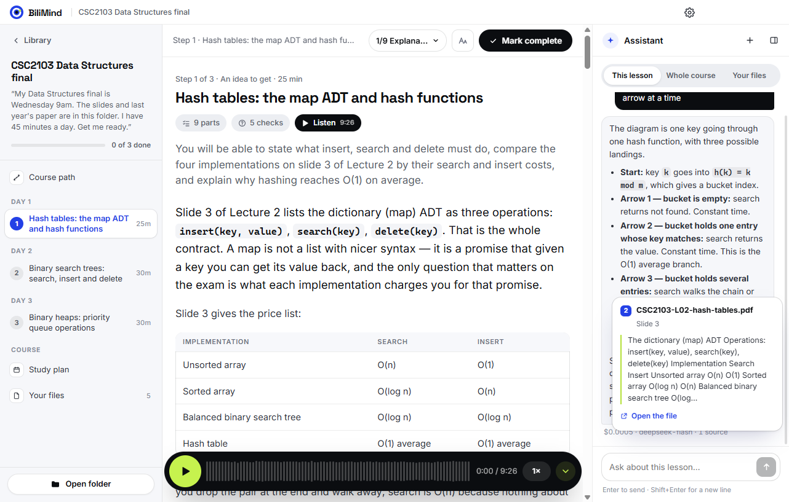
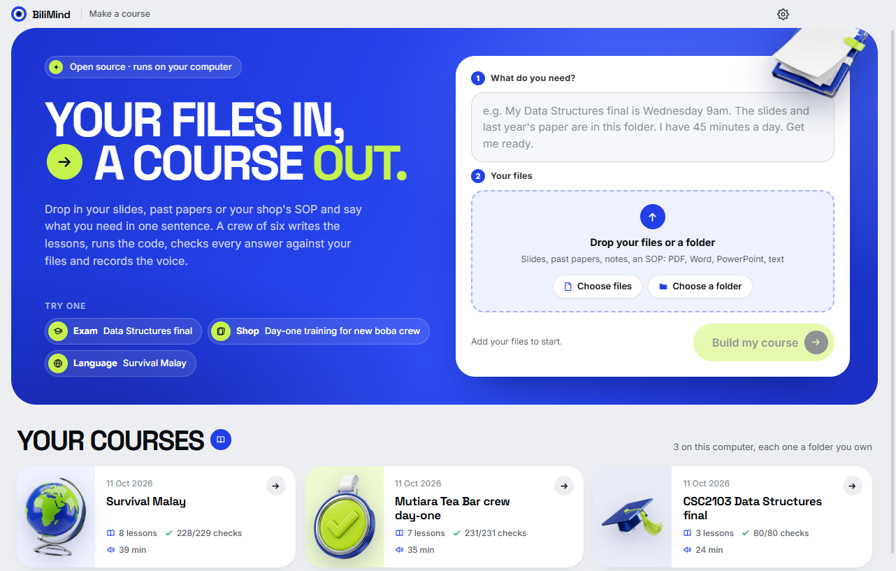
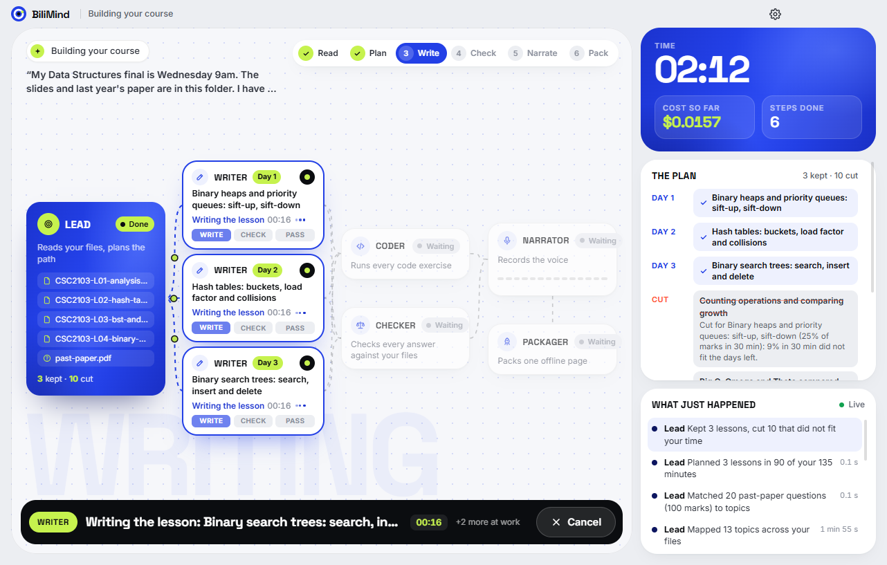
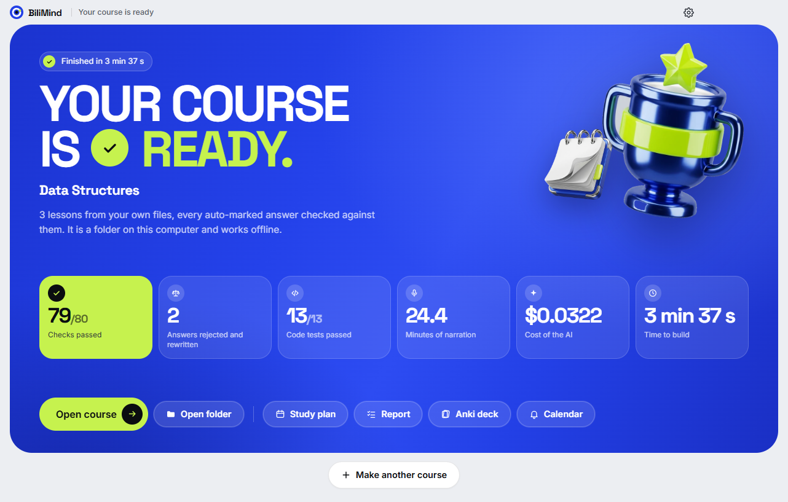

# BiliMind Desktop

**Drop in your files, type one sentence, get a course checked against them.**

BiliMind Desktop is a Windows app for two kinds of people: students with an exam coming, and small
businesses that keep training new staff. You drop in your lecture slides and last year's paper, or your
shop's SOP, and say what you need in one sentence. A few minutes later you have a narrated course:
lessons, quizzes checked against your own files, code exercises that run, a study plan sized to your
days, flashcards and a review calendar. It is free, needs no account and no key, the finished course
works offline, and the code is open source.

### [Download for Windows](https://github.com/Odilient/bilimind-desktop/releases/latest)

**Try a course it made, in your browser, no install:**
[Data Structures final](https://odilient.github.io/bilimind-desktop/courses/ds-final/) ·
[Boba shop: day one for new crew](https://odilient.github.io/bilimind-desktop/courses/boba-day-one/) ·
[Survival Malay](https://odilient.github.io/bilimind-desktop/courses/bm-survival/)

[Website](https://odilient.github.io/bilimind-desktop/) ·
[Pitch deck (PDF)](https://odilient.github.io/bilimind-desktop/downloads/BiliMind-Desktop-Deck.pdf) ·
[How we used WorkBuddy](docs/workbuddy.md) ·
[For judges: Dormathon 2026, Track 2](#dormathon-2026--track-2)

## What it does

1. **Drop your files.** Lecture slides, a past exam paper, notes or an SOP. A whole folder or a few files.
2. **Type one sentence.** "My Data Structures final is Wednesday 9am. The slides and last year's paper
   are in this folder. I have 45 minutes a day. Get me ready."
3. **Get your course.** BiliMind reads your files, plans your days, writes the lessons, tests the code,
   checks the answers against your files and records the narration. You watch each step as it happens.
   It asks you nothing along the way. In our runs in the app, a course took about 3 to 5 minutes.

## What you get

- **Lessons in the format that fits.** A procedure gets a walkthrough, a formula gets a worked example,
  a language gets speaking drills.
- **Narration.** Every lesson is read aloud, and the page highlights the sentence being read.
- **Quizzes checked against your files.** Anything your files do not cover is labelled "Beyond your slides".
- **Code exercises that run**, for programming subjects.
- **An assistant beside every lesson.** Ask a question and it answers from your files, with the file,
  the slide or page and the quote for each point. It shows what each answer cost.
- **A study plan** sized to the days you have, weighted by last year's marks when you add a past paper.
- **An Anki deck** (`deck.csv`) and **a review calendar** (`reviews.ics`).
- **A folder you own** in `Documents\BiliMind`. The course is one `index.html` that opens in any browser
  and works offline.

## One engine, many ways to use it

| Way | For whom | How to start | Link |
|---|---|---|---|
| **BiliMind Desktop** (Windows app) | Everyone. This is the main way. | Download, drop your files, type one sentence | [Download](https://github.com/Odilient/bilimind-desktop/releases/latest) |
| **Inside WorkBuddy** | WorkBuddy users | Install the BiliMind skill or the "BiliMind Crew" Expert Team (a Lead, Writers, a Coder and a Checker), then type the same sentence; WorkBuddy's agent runs the crew | [skills/bilimind](skills/bilimind/), [workbuddy/bilimind-crew](workbuddy/bilimind-crew/), [install steps](docs/DEVELOPERS.md#workbuddy-skill-and-expert-team) |
| **Command line** | Power users, scripts, automation | One file, `bilimind.mjs`, with Node 22 or newer. Every step is its own command (`init`, `ingest`, `outline`, `exam-map`, `plan`, `draft`, `check`, `code-test`, `narrate`, `build` and more) | [apps/cli](apps/cli/), [bilimind.mjs](skills/bilimind/scripts/bilimind.mjs) |
| **The course itself** | Anyone you share it with | Open `index.html` in any browser, offline, or put it online like our three demo courses. `deck.csv` goes into Anki, `reviews.ics` into your calendar, `plan.md` is the study plan | [The three demo courses](#made-for) |
| **BiliMind free** (the AI service) | Nobody opens it | The app and the command line use it by default, so nobody needs a key. Open source; its key lives only on the server | [server/free-proxy](server/free-proxy/) |
| **bilimind.com** | | Our separate online product, with accounts. It is not in this repo | [bilimind.com](https://bilimind.com) |

## Made for

Three courses BiliMind made, playable on the website. After the run, our team reviewed each one (see
[Why you can trust it](#why-you-can-trust-it)).

**A student before an exam.** "My Data Structures final is Wednesday 9am. The slides and last year's paper
are in this folder. I have 45 minutes a day. Get me ready." From 4 lecture decks and a past paper (63
pages), BiliMind planned 3 lessons for the 3 days left, chosen by last year's marks, with a reason for
every topic it cut. 14 code tests, 3 answers rejected against the slides and rewritten, 24 minutes of
narration, $0.04.
[Open the course](https://odilient.github.io/bilimind-desktop/courses/ds-final/) ·
[what the agents did](showcase/courses/ds-final/REPORT.md)

**A bubble-tea shop training new crew.** "We hire new crew every few weeks at Mutiara Tea Bar. Turn our
SOP folder into a day-one course they must pass before their first shift, narrated in English and Malay."
From the shop's SOP and a one-page food-hygiene regulation: 7 lessons, from handwashing to building a
drink to the sticker, 64 Anki cards, 35 minutes of narration, $0.09.
[Open the course](https://odilient.github.io/bilimind-desktop/courses/boba-day-one/) ·
[what the agents did](showcase/courses/boba-day-one/REPORT.md)

**An international student learning Malay.** 20 minutes a day for 2 weeks: ordering at the mamak, Grab,
campus. 8 lessons with speaking drills read by a Malaysian voice, $0.06.
[Open the course](https://odilient.github.io/bilimind-desktop/courses/bm-survival/) ·
[what the agents did](showcase/courses/bm-survival/REPORT.md)

## Why you can trust it

- **Every auto-marked answer is solved again against your files.** If your files contradict it, it is
  rejected with the exact quote from your slide or page, and rewritten. The quote must match your file word
  for word, so the checker cannot invent evidence.
- **Every code exercise is run.** The model solution must pass every test, and the starting code must fail
  at least one. A broken exercise is fixed or switched off with a reason.
- **Every course comes with a report** (`REPORT.md`): every check, every rejected answer, what was cut and
  why, the time and the cost.

Real runs, on our own laptop:

| Run | Your files | Lessons | Checks passed | Wrong answers rejected | Code tests | Narration | AI cost | Time |
|---|---|---|---|---|---|---|---|---|
| App, run 1 | Data Structures, 5 PDFs (63 pages) | 3 | 91/91 | 0 | 8/8 | 18.5 min | $0.036 | 3 min 23 s |
| App, run 2 | same | 3 | 98/100 | 0 | 4/4 | 32 min | $0.049 | 4 min 42 s |
| App, run 3 (packaged app) | same | 3 | 79/80 | 2 | 13/13 | 24.4 min | $0.032 | 3 min 37 s |
| [App, fresh install, no key (BiliMind free)](hackathon/proof/free-provider-fresh-install-run.txt) | same | 2 of 3 planned | 52/53 | 0 | 4 runs, all ok | 10.9 min | $0.016 | 5 min 10 s |
| Demo: [Data Structures final](showcase/courses/ds-final/REPORT.md) | 5 PDFs (63 pages) | 3 | 80/80 | 3 | 14/14 | 24.3 min | $0.040 | 19 min 39 s |
| Demo: [Boba shop day one](showcase/courses/boba-day-one/REPORT.md) | 2 files (21 pages) | 7 | 231/231 | 1 | no code | 34.7 min | $0.094 | 24 min 39 s |
| Demo: [Survival Malay](showcase/courses/bm-survival/REPORT.md) | 2 files (12 pages) | 8 | 228/229 | 3 | no code | 39.2 min | $0.055 | 30 min 1 s |

The app runs are as the app recorded them, with no review afterwards (every step's time and cost:
[desktop-run-timings.json](hackathon/proof/desktop-run-timings.json)). In the fresh-install run one lesson
failed its draft twice, so the app dropped it and finished the other two. The three demo courses started as
the same kind of run, then our team reviewed them with an AI coding agent (re-planning, fixing exercises,
correcting lesson text). Their steps are in each course's `crew/log.jsonl`, and every hand change is
described in [showcase/courses/_notes](showcase/courses/_notes/). That review is why they took longer.

## Free and private

- **Free by default.** "BiliMind free" is the AI the app uses out of the box: no account, no key. The team
  pays for it; our runs cost between $0.016 and $0.094 a course. Its code is open
  ([server/free-proxy](server/free-proxy/)) and its AI key lives only on that server.
- **Your files stay on your computer.** To write the course and to answer your questions, text from your
  files is sent to the AI (through BiliMind free, or straight to the provider if you use your own key).
  Narration text goes to Microsoft Edge's online voices. The course, your files and the report stay in
  your folder.
- **Your own key, if you want.** DeepSeek or OpenRouter, in Settings. Then your text goes straight to that
  provider. The key is kept in `%USERPROFILE%\.bilimind\config.json` and never shown in the app.
- **Spending limits.** Each course stops at $0.25 and each day at $2 by default.

## Dormathon 2026 · Track 2

> **Team Opus Magnum (#58), Taylor's University**
> Oybek Odilov · Abdugaffor Odilov · Ramil Khutlimuratov · Gameel Al-Bazeeli
>
> Track 2 (WorkBuddy Track, "Agentic Solutions"): can your AI agent use WorkBuddy to solve a real problem
> and actually get things done?

**How it meets the Track 2 criteria**

| Criterion | What we built | Evidence |
|---|---|---|
| 1. Problem relevance | Two real bottlenecks: a student turning a pile of slides into a plan before an exam, and a shop training new crew every few weeks from its SOP. One sentence in, a checked course out in minutes, for cents | The [three demo courses](#made-for) and their sentences; market check: [workbuddy-market-validation.md](hackathon/proof/workbuddy-market-validation.md) |
| 2. Autonomous workflow | A Lead reads the goal and files, weights the past paper, plans the days, keeps and cuts topics with a reason each (in the app by marks per minute; in WorkBuddy the agent decides); Writers work in parallel; a Coder and a Checker verify; failed checks trigger a re-draft, a lesson that fails twice is dropped and the run continues. No questions to the user | [run.ts](packages/engine/src/run.ts), [desktop-run-timings.json](hackathon/proof/desktop-run-timings.json), [crew/log.jsonl](showcase/courses/ds-final/crew/log.jsonl), [plan.md](showcase/courses/ds-final/plan.md) |
| 3. WorkBuddy integration | BiliMind ships as a WorkBuddy skill: WorkBuddy's agent is the Lead, launches Writer sub-agents in parallel, runs the `bilimind` command line that enforces schemas, tests and quotes, previews with `present_files` and can publish with `workbuddy_sites_deploy`. Also an Expert Team validated with WorkBuddy's `validate_expert.py`. We used WorkBuddy for our first deck, market research and a comparison. The same engine also runs as the Windows app and the command line. The courses in this repo were built by the app and the command line, not inside WorkBuddy | [SKILL.md](skills/bilimind/SKILL.md), [bilimind-crew](workbuddy/bilimind-crew/), [EXPERT-TEAM.md](hackathon/EXPERT-TEAM.md), [docs/workbuddy.md](docs/workbuddy.md) (task links and screenshots) |
| 4. Reliability and verification | Built-in checks on every lesson, answers re-solved against your files with word-for-word quotes, code run against tests, a report per course; 338 automated tests | [REPORT.md](showcase/courses/ds-final/REPORT.md), [rulings](showcase/courses/ds-final/crew/evidence/), [verdicts](showcase/courses/ds-final/crew/verdicts/), [verdict.ts](packages/engine/src/verdict.ts), [codework.ts](packages/engine/src/codework.ts) |
| 5. Live execution | A packaged Windows app; one sentence runs end to end with no further input; a fresh install with no key built a course; three courses play on the website; the same engine works from WorkBuddy and the command line | [Download](https://github.com/Odilient/bilimind-desktop/releases/latest), [film](https://odilient.github.io/bilimind-desktop/vid/bilimind-desktop.mp4), [deck](https://odilient.github.io/bilimind-desktop/downloads/BiliMind-Desktop-Deck.pdf), [screenshots](docs/img/) |

**One sentence, end to end.** After "My Data Structures final is Wednesday 9am. The slides and last year's
paper are in this folder. I have 45 minutes a day. Get me ready." the crew, with no further input:
reads the goal (exam Wednesday 14 October, 09:00, 45 minutes a day) → reads the 5 files and finds the past
paper → outlines the topics → maps the past paper's marks to topics → keeps 3 lessons and cuts the rest
with a reason each → 3 Writers draft in parallel and check their lessons → the Coder runs the exercises →
the Checker rules on every answer → narration → Anki deck and calendar → the course. Trace with times and
costs: [desktop-run-timings.json](hackathon/proof/desktop-run-timings.json).

**How we used WorkBuddy** ([details, task links and screenshots](docs/workbuddy.md)):

| Where in WorkBuddy | What we did |
|---|---|
| Slides Creation | Made our first pitch deck from a written brief, then corrected it slide by slide |
| Deep Research | Checked demand on both halves of Track 2 (students, small businesses), competitors and risks |
| Plain chat | Sent our student sentence to WorkBuddy without BiliMind, to see the gap |
| Skills and Expert Teams | Shipped BiliMind as a skill and as the "BiliMind Crew" Expert Team |

**Built at Dormathon and before.** BiliMind existed before Dormathon as a web app (bilimind.com). From it we
reused the teaching approach: the lesson prompts and the rules that match each kind of knowledge to a
lesson format. The desktop app, the engine, the checks, the planner, the course player, BiliMind free and
the WorkBuddy skill and team were built during Dormathon (10-11 October 2026), with AI coding agents.

## FAQ

**I'm on a Mac or Linux.** The app is Windows only for now. Every course opens in any browser, on any
computer or phone, so you can try the three demo courses above. The command line needs Node 22 or newer;
we have tested it on Windows only.

**Is it really free?** Yes. The app is free and open source, and BiliMind free pays for the AI. It has a
rate limit; when it is busy the app says so, and you can wait or add your own key.

**Does it need the internet?** To build a course and to ask the assistant, yes: the AI and the narration
voices are online. A finished course opens without the internet.

**What files work?** PDF, Word (`.docx`), PowerPoint (`.pptx`), text and Markdown (`.txt`, `.md`) and web
pages (`.html`). Save older `.doc` and `.ppt` files in the new format first. Scanned pages with no text
layer cannot be read.

**Where does my course go?** To `Documents\BiliMind\<course>\` (you can change it in Settings). It holds
`index.html`, `plan.md`, `REPORT.md`, `deck.csv`, `reviews.ics`, the narration and the lesson notes. Delete
the folder and the course is gone.

## Licence

GNU Affero General Public License v3.0 only (AGPL-3.0-only). See [LICENSE](LICENSE). The sample source
folders in `showcase/sources/` carry their own licences (each folder has a `LICENSE.md`).

For developers (how it works, building from source, the command line, the WorkBuddy skill):
[docs/DEVELOPERS.md](docs/DEVELOPERS.md).

*Bilim* means knowledge in Uzbek.
