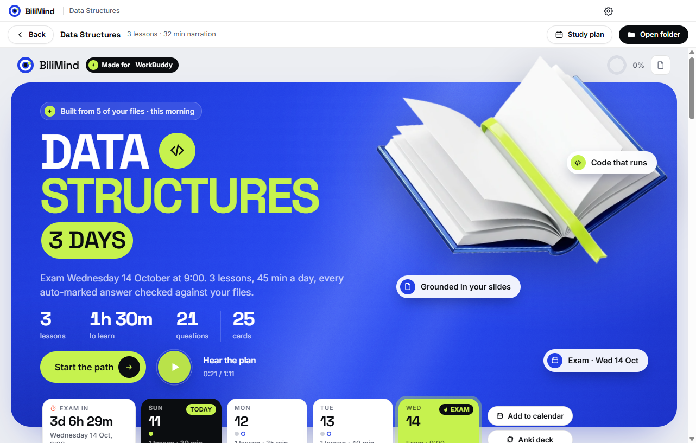
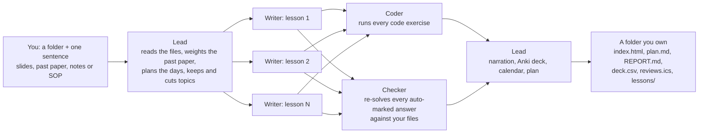

# BiliMind Desktop

**Drop in your files. Get a course, checked against them.**

BiliMind Desktop is an open-source Windows app that turns a folder of your own files and one sentence into a
narrated, interactive course you keep. A student with an exam in three days drops in the lecture slides and
last year's paper, types "My Data Structures final is Wednesday 9am, I have 45 minutes a day", and gets a
study plan sized to those days, lessons weighted by the past paper's marks, code exercises that run, quizzes
whose answers were re-checked against the slides, narration, an Anki deck and a review calendar. A small
business does the same with its SOP: a bubble-tea shop that hires new crew every few weeks turns its
operations manual into a day-one course with a pass mark. Everything runs on your machine with your own AI
key, and everything it makes lands in a normal folder you own.

Built by team **Opus Magnum (#58), Taylor's University branch**, for **Dormathon 2026, Track 2**: "How can AI
help students and small businesses solve real business problems and operate more effectively?"

## Download

- **Windows (installer or portable):** https://github.com/Odilient/bilimind-desktop/releases/latest
- **Website:** https://odilient.github.io/bilimind-desktop/
- **Source:** https://github.com/Odilient/bilimind-desktop

No account, no login, no server of ours. You bring a DeepSeek or OpenRouter key (see [Bring your own key](#bring-your-own-key)).

## Screenshots




## How it works



1. **Lead** reads your files (which one is the past paper, which pages are scans), works out the goal from
   your sentence (exam date and time, minutes a day, audience, language), weights each topic by the past
   paper's marks, keeps and cuts topics with one reason each, and plans the days you have.
2. **Writers**, one per lesson, write in parallel. The kind of knowledge decides the lesson format: a
   procedure gets a walkthrough, a formula gets a worked example, a language gets speaking drills.
3. **Coder** runs every code exercise. Nothing ships unless the reference solution passes every test and the
   starter fails at least one; a broken exercise is fixed or switched off with a reason.
4. **Checker** re-solves every auto-marked answer against your files. An answer your files contradict is
   rejected with the exact quote from the slide or page, and rewritten. The quote is verified word for word,
   so the Checker cannot invent evidence. Anything not in your files is labelled "Beyond your slides".
5. **Narration** with Microsoft Edge's free online voices, one cue per sentence, so the page highlights what
   is being read.
6. **Your files**: an Anki deck (`deck.csv`), a review calendar dated back from the exam (`reviews.ics`),
   `plan.md`, `REPORT.md` (every check, every rejection, the cost) and Markdown notes, all in
   `Documents\BiliMind\<course>\`. The course is one `index.html` that works offline.

More detail: [docs/how-it-works.md](docs/how-it-works.md). Output format: [docs/course-format.md](docs/course-format.md).

## Bring your own key

Text generation uses your own key for **DeepSeek** (direct API) or **OpenRouter**; paste it into the app's
settings. Narration needs no key. Measured cost: **about $0.05 per course** (two unattended runs on the
sample Data Structures folder: $0.046 and $0.047, 268 s and 289 s).

The key is stored in `%USERPROFILE%\.bilimind\config.json`, the same file the CLI and the WorkBuddy skill
read. It never reaches the app's window, and the app never logs it.

```json
{
  "provider": "deepseek",
  "keys": { "deepseek": "sk-...", "openrouter": "sk-or-..." }
}
```

Optional fields: `models`, `caps` (`{"run_usd": 0.25, "day_usd": 2}` by default) and `reserve_usd` (a
balance floor; set it to `0` for normal use). Environment variables `DEEPSEEK_API_KEY`,
`OPENROUTER_API_KEY` and `BILIMIND_PROVIDER` also work. Never commit a key: `.env` and `.env.*` are
git-ignored.

## Measured so far

Only numbers we measured on our own runs.

- Unattended pipeline (DeepSeek direct, sample Data Structures folder): 268 s and 289 s, $0.046 and $0.047
  in text-model calls. About 4.5 to 5 minutes and about $0.05 per course; narration adds a little time.
- The desktop app itself, three runs clicked through its own window (DeepSeek, narration on, the same
  sample folder; two in the dev build, one in the packaged exe): 3 min 23 s, 4 min 42 s and 3 min 37 s,
  $0.036, $0.049 and $0.032, checks 91/91, 98/100 and 79/80. Every step's time and cost:
  [hackathon/proof/desktop-run-timings.json](hackathon/proof/desktop-run-timings.json).
- Showcase courses, built with the agent workflow (a Lead, one Writer per lesson in parallel, a Coder and a
  Checker), from each course's `REPORT.md` in `showcase/courses/`:

  | Course | Lessons | Checks passed | Code tests | Rejected / rewritten | Anki cards | Narration | Text cost | Wall time |
  |---|---|---|---|---|---|---|---|---|
  | Data Structures final | 3 | 80/80 | 14/14 (1 fixed by the Coder) | 3 / 3 | 8 | 24.3 min | $0.040 | 19 min 39 s |
  | Mutiara Tea Bar: crew day one | 7 | 231/231 | none | 1 / 1 | 64 | 34.7 min | $0.094 | 24 min 39 s |
  | Bahasa Melayu survival | 8 | 228/229 (1 still flagged) | none | 3 / 3 | 72 | 39.2 min | $0.055 | 30 min 1 s |

  An example rejection from the Data Structures course: the answer key said 49 goes to slot 9; the Checker
  quoted slide 11 ("49 → 9 taken, try 0: 2 probes"), rejected it and rewrote the question.
- Tests: core 55, engine 195 (2 live-voice tests skipped), player 73, CLI 12, skill 12, all passing at the
  last integration gate.

## Develop and build

Requirements: Node 22 or newer (Node 24 runs the TypeScript sources directly), pnpm 10, Windows for the
installer.

```bash
pnpm i
pnpm --filter @bilimind/player build     # the offline course player -> packages/player/dist/player.html
pnpm --filter @bilimind/desktop build    # renderer, main, preload and worker -> apps/desktop/dist/
pnpm --filter @bilimind/desktop start    # run the app
pnpm --filter @bilimind/desktop dist     # Windows portable + NSIS installer (electron-builder)
pnpm test                                # all packages (vitest)
pnpm typecheck
```

Pushing a tag such as `v0.1.0` to GitHub builds the installers and attaches them to a release.

## Repository layout

```
apps/desktop       the Electron app (main, preload, worker running the engine, Vue renderer); CONTRACT.md
apps/cli           the bilimind CLI; bundled into skills/bilimind/scripts/bilimind.mjs
packages/core      shared types, course.json schema (bilimind.course/1), archetypes and formats, graders, FSRS
packages/engine    ingest, outline, exam map, planner, drafts, checks, code tests, verdicts, narration, exports, build
packages/player    the offline course page (Vue + Vite, built into one self-contained HTML file)
skills/bilimind    the WorkBuddy skill (extra)
workbuddy/bilimind-crew   the WorkBuddy Expert Team package (extra)
showcase           sample source folders (with licences) and the courses built from them
site               the website
docs               this documentation
hackathon          Dormathon pitch runbook, slides brief, research and notes
```

## Also available

The same engine ships in two more forms. They are extras; the desktop app is the product.

- **CLI.** `node apps/cli/src/main.ts <command>` (Node 24) or the bundled
  `node skills/bilimind/scripts/bilimind.mjs <command>`. Every command prints one JSON line. `doctor` checks
  the key (never printing it), the balance and the narration voices; `run` builds a whole course unattended.
- **WorkBuddy skill and Expert Team.** `skills/bilimind/` is a WorkBuddy skill and `workbuddy/bilimind-crew/`
  is an Expert Team (Lead, Writer, Coder, Checker) validated with WorkBuddy's own `validate_expert.py`, so a
  WorkBuddy user gets the same course from one sentence. Install: `powershell -ExecutionPolicy Bypass -File
  skills\bilimind\install.ps1`; team notes in `hackathon/EXPERT-TEAM.md`.

## Dormathon 2026

- **Team:** Opus Magnum (#58), Taylor's University branch: Oybek Odilov, Abdugaffor Odilov, Ramil
  Khutlimuratov and Gameel Al-Bazeeli.
- **Track 2:** How can AI help students and small businesses solve real business problems and operate more
  effectively? BiliMind Desktop covers both halves: a student preparing for an exam from their own slides,
  and a small business onboarding new staff from its own SOP.
- **How we used WorkBuddy:** the pitch deck was made in WorkBuddy's Slides Creation, we checked the market
  with WorkBuddy's Deep Research, we compared plain WorkBuddy on the same student request, and we shipped BiliMind as a WorkBuddy skill and Expert Team too.
  Details, links and screenshots: [docs/workbuddy.md](docs/workbuddy.md).
- **Built at Dormathon vs. before:** BiliMind already existed before Dormathon as a web app (Laravel +
  Nuxt) that Oybek and Abdugaffor Odilov work on. From it we reused the pedagogy: the lesson prompts and the rules that map each kind of knowledge to
  its lesson formats. The Node engine, the Checker and Coder loops, the past-paper planner, the offline
  player, the exports, the WorkBuddy skill and team, and the desktop app were built during Dormathon
  (10-11 October 2026), with AI coding agents.

*Bilim* means knowledge in Uzbek.

## License

GNU Affero General Public License v3.0 only (AGPL-3.0-only). See [LICENSE](LICENSE). The sample source
folders in `showcase/sources/` carry their own licences (each folder has a `LICENSE.md`).
