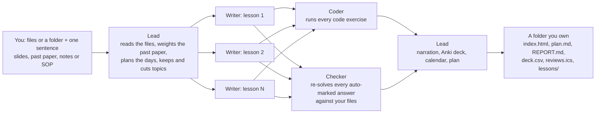

# BiliMind Desktop for developers

How it works, how to build it, and where everything lives. For what the app is and how to use it, see the
[README](../README.md).

## How it works



1. **Lead** reads your files (which one is the past paper, which pages are scans), works out the goal from
   your sentence (exam date and time, minutes a day, audience, language), weights each topic by the past
   paper's marks, keeps and cuts topics with one reason each, and plans the days you have. In the app and
   the CLI's `run`, keep and cut are computed (marks per minute over the days available,
   `chooseLessons` in [packages/engine/src/run.ts](../packages/engine/src/run.ts)). The skill is
   written so that the host's own agent is the Lead and decides with
   [references/planning.md](../skills/bilimind/references/planning.md).
2. **Writers**, one per lesson, write in parallel (up to 4 at a time in the app; the skill asks for up to 6). The
   kind of knowledge decides the lesson format: a procedure gets a walkthrough, a formula gets a worked
   example, a language gets speaking drills. A lesson that fails its checks is re-drafted once with the
   failures as notes. A draft that fails twice is dropped and the run goes on with the other lessons.
3. **Coder** runs every code exercise. Nothing ships unless the reference solution passes every test and the
   starter fails at least one; a broken exercise is fixed or switched off with a reason.
4. **Checker** re-solves every auto-marked answer against your files. An answer your files contradict is
   rejected with the exact quote from the slide or page, and rewritten. The quote is verified word for word,
   so the Checker cannot invent evidence. Anything not in your files is labelled "Beyond your slides".
5. **Narration** with Microsoft Edge's free online voices, one cue per sentence, so the page highlights what
   is being read.
6. **Your files**: an Anki deck (`deck.csv`), a review calendar dated back from the exam (`reviews.ics`),
   `plan.md`, `REPORT.md` (every check, every rejection, the cost) and Markdown notes, all in
   `Documents/BiliMind/<course>/`. The course is one `index.html` that works offline.

Every step is logged to `<course>/crew/log.jsonl` (agent, command, result, time, cost). Example:
[showcase/courses/ds-final/crew/log.jsonl](../showcase/courses/ds-final/crew/log.jsonl).

More detail: [how-it-works.md](how-it-works.md). Output format: [course-format.md](course-format.md).
The window talks to the main process through an in-process API on `app://bilimind/api/*`:
[apps/companion/README.md](../apps/companion/README.md).

## The course workspace and the assistant

A finished course opens in a workspace: lessons by day on the left, the lesson in the middle, an assistant
on the right. The assistant answers from the open lesson, the whole course or all your files. It searches
the text of your files (no embeddings), sends about 12,000 characters of excerpts to the provider's fast
model, and answers with numbered citations (file, slide or page, quote). When your files do not cover the
question, it says so and answers after "Beyond your files:". Each answer shows its cost and is written to
`<course>/crew/assistant.jsonl` and the spend ledger.

## AI providers and the config file

**BiliMind free** is the key-less option: the app talks to `https://desktop-api.bilimind.com/v1`, an
OpenAI-compatible Cloudflare Worker run by the team ([server/free-proxy](../server/free-proxy/)). **It is paused
at the moment**, behind one switch, `FREE_TIER_ON = false` in
[packages/engine/src/config.ts](../packages/engine/src/config.ts): nothing picks it by default, a fresh install
resolves to DeepSeek, and the app asks for a key (naming DeepSeek and OpenRouter, with links) before the first
build. `BILIMIND_FREE=1` turns it on for one process, for tests. The Worker's own OpenRouter key is a Worker secret, never in
the app, this repo or your computer. The app sends no `Authorization` header, only
`X-BiliMind-Client: desktop/<version>`. Guards in the Worker: two models only, a price pin, `max_tokens`
capped, a 600 KB body cap, 120 requests a minute per IP, no CORS, and a kill switch. When it is busy or
paused the app says so and suggests adding your own key.

Your own key: **DeepSeek** (direct API) or **OpenRouter**; pick it in Settings and paste the key.
Then text goes straight to that provider, not through BiliMind. Narration needs no key.

The key is stored in `~/.bilimind/config.json` (`%USERPROFILE%\.bilimind\config.json` on Windows), the same
file the CLI and the skill read. It is plain text, readable by your user account. It never reaches the
app's window, and the app never logs it. `BILIMIND_HOME` points the app and the CLI at another folder.

```json
{
  "provider": "deepseek",
  "keys": { "deepseek": "sk-...", "openrouter": "sk-or-..." }
}
```

`"provider"` is `"deepseek"`, `"openrouter"` or `"bilimind"` (free, no key; ignored while the free tier is
paused). With a key and no provider the app and the CLI use that key's pool; with no key at all they use
`"bilimind"` while it is on, and `"deepseek"` (which then asks for a key) while it is paused.

Optional fields: `models`, `caps` (`{"run_usd": 1, "day_usd": 2}` by default) and `reserve_usd` (a
balance floor; set it to `0` for normal use; BiliMind free has none). Environment variables `DEEPSEEK_API_KEY`,
`OPENROUTER_API_KEY` and `BILIMIND_PROVIDER` also work; `BILIMIND_FREE_URL` (or `"free_base_url"`) points
BiliMind free at another server, for tests. Never commit a key: `.env` and `.env.*` are git-ignored.

## Measured runs

One real folder build on DeepSeek: one PDF, 5 lessons, 165 seconds, $0.038. One rubric mark: $0.0004.

## Develop and build

Requirements: Node 22 or newer (Node 24 runs the TypeScript sources directly; CI uses 24) and pnpm 10
(`corepack enable`). Each OS builds its own installers.

```bash
pnpm i
pnpm --filter @bilimind/player build     # the offline course player -> packages/player/dist/player.html
pnpm --filter @bilimind/companion spa    # the app's screens -> apps/companion/spa/
pnpm --filter @bilimind/companion build  # main, preload and worker -> apps/companion/dist/
pnpm --filter @bilimind/companion start  # run the app
pnpm --filter @bilimind/companion dist   # installers for this OS: Windows NSIS, macOS dmg, Linux AppImage + deb
pnpm test                                # all packages (vitest)
pnpm typecheck
```

Every push and pull request runs install, typecheck, tests, the build and (on Linux) the app end to end, on Linux,
Windows and macOS ([.github/workflows/ci.yml](../.github/workflows/ci.yml)). Pushing a tag such as `v0.2.0`
builds the installers on all three OSes plus the one-file CLI and attaches them, with `SHA256SUMS.txt`, to a
GitHub release whose notes are [.github/release-notes.md](../.github/release-notes.md)
([.github/workflows/release.yml](../.github/workflows/release.yml)). A tag with a suffix (`v0.3.0-rc.1`) makes a
pre-release. The website in `site/` is published to
GitHub Pages by [.github/workflows/pages.yml](../.github/workflows/pages.yml), which copies the showcase
courses to `/courses/<slug>/` ([site/scripts/assemble.mjs](../site/scripts/assemble.mjs)).

End-to-end checks: [apps/companion/test/e2e.mjs](../apps/companion/test/e2e.mjs) (`pnpm e2e` after `pnpm spa` and
`pnpm build`, or with `BILIMIND_E2E_EXE=<packaged app>`). It drives the real app with nothing on screen, against a
fake AI provider.

On Ubuntu 24.04 and later, the development Electron stops with "The SUID sandbox helper binary was found, but
is not configured correctly", because the OS blocks the user namespaces Chromium's sandbox uses. For
development, run with `ELECTRON_DISABLE_SANDBOX=1`. The packaged apps handle it: the AppImage's launcher adds
`--no-sandbox` only in that case ([scripts/after-pack.cjs](../apps/companion/scripts/after-pack.cjs)), and the
`.deb` installs an AppArmor profile ([resources/apparmor-profile.tpl](../apps/companion/resources/apparmor-profile.tpl)).

## Tests

Vitest. `pnpm test` on 21 October 2026: core 55, engine 198 (plus 2 live-voice tests skipped), player 73
and CLI 12, all passing, on Linux, Windows and macOS in CI. `skills/bilimind/test` checks every command and flag in the playbooks against the
built CLI.

## Repository layout

```
apps/companion     the Electron app: a Nuxt SPA, an in-process API on SQLite, and a worker running the engine
apps/cli           the bilimind CLI; bundled into skills/bilimind/scripts/bilimind.mjs
packages/core      shared types, course.json schema (bilimind.course/1), archetypes and formats, graders, FSRS
packages/engine    ingest, outline, exam map, planner, drafts, checks, code tests, verdicts, narration, exports, build
packages/player    the offline course page (Vue + Vite, built into one self-contained HTML file)
server/free-proxy  BiliMind free: the Cloudflare Worker behind desktop-api.bilimind.com
skills/bilimind    a skill built on the CLI
showcase           sample source folders (with licences) and the courses built from them
site               the website (GitHub Pages)
docs               this documentation
```

## The command line

`node apps/cli/src/main.ts <command>` (Node 24) or the bundled single file
`node skills/bilimind/scripts/bilimind.mjs <command>` (Node 22 or newer). Every command prints one JSON line.
Commands: `doctor`, `init`, `goal`, `ingest`, `outline`, `exam-map`, `plan`, `note`, `draft`, `check`,
`code-test`, `fact-check`, `evidence`, `verdict`, `rewrite-item`, `narrate`, `export`, `build`, `status`,
`due`, `grade`, `plant`, `plant-score` and `run`. `doctor` checks the provider (never printing a key) and the
narration voices; `run` builds a whole course unattended. CI runs the CLI's tests on Linux, Windows and
macOS.
