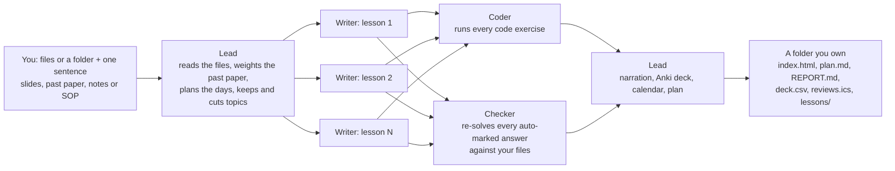

# BiliMind Desktop for developers

How it works, how to build it, and where everything lives. For what the app is and how to use it, see the
[README](../README.md).

## How it works



1. **Lead** reads your files (which one is the past paper, which pages are scans), works out the goal from
   your sentence (exam date and time, minutes a day, audience, language), weights each topic by the past
   paper's marks, keeps and cuts topics with one reason each, and plans the days you have. In the app and
   the CLI's `run`, keep and cut are computed (marks per minute over the days available,
   `chooseLessons` in [packages/engine/src/run.ts](../packages/engine/src/run.ts)). The WorkBuddy skill is
   written so that WorkBuddy's own agent is the Lead and decides with
   [references/planning.md](../skills/bilimind/references/planning.md).
2. **Writers**, one per lesson, write in parallel (up to 4 at a time in the app; the WorkBuddy skill asks for up to 6). The
   kind of knowledge decides the lesson format: a procedure gets a walkthrough, a formula gets a worked
   example, a language gets speaking drills. A lesson that fails its checks is re-drafted once with the
   failures as notes. A draft that fails twice is dropped and the run goes on with the other lessons.
3. **Coder** runs every code exercise. Nothing ships unless the reference solution passes every test and the
   starter fails at least one; a broken exercise is fixed or switched off with a reason.
4. **Checker** re-solves every auto-marked answer against your files. An answer your files contradict is
   rejected with the exact quote from the slide or page, and rewritten. The quote is verified word for word,
   so the Checker cannot invent evidence. Anything not in your files is labelled "Beyond your slides".
5. **Narration** with Microsoft Edge's free online voices, one cue per sentence, so the page highlights what
   is being read.
6. **Your files**: an Anki deck (`deck.csv`), a review calendar dated back from the exam (`reviews.ics`),
   `plan.md`, `REPORT.md` (every check, every rejection, the cost) and Markdown notes, all in
   `Documents/BiliMind/<course>/`. The course is one `index.html` that works offline.

Every step is logged to `<course>/crew/log.jsonl` (agent, command, result, time, cost). Example:
[showcase/courses/ds-final/crew/log.jsonl](../showcase/courses/ds-final/crew/log.jsonl).

More detail: [how-it-works.md](how-it-works.md). Output format: [course-format.md](course-format.md).
The main-to-window contract of the desktop app, including the course workspace and the assistant:
[apps/desktop/CONTRACT.md](../apps/desktop/CONTRACT.md).

## The course workspace and the assistant

A finished course opens in a workspace: lessons by day on the left, the lesson in the middle, an assistant
on the right. The assistant answers from the open lesson, the whole course or all your files. It searches
the text of your files (no embeddings), sends about 12,000 characters of excerpts to the provider's fast
model, and answers with numbered citations (file, slide or page, quote). When your files do not cover the
question, it says so and answers after "Beyond your files:". Each answer shows its cost and is written to
`<course>/crew/assistant.jsonl` and the spend ledger. Details: the "Course workspace" section of
[apps/desktop/CONTRACT.md](../apps/desktop/CONTRACT.md).

## AI providers and the config file

**BiliMind free** is the key-less option: the app talks to `https://desktop-api.bilimind.com/v1`, an
OpenAI-compatible Cloudflare Worker run by the team ([server/free-proxy](../server/free-proxy/)). **It is paused
at the moment**, behind one switch, `FREE_TIER_ON = false` in
[packages/engine/src/config.ts](../packages/engine/src/config.ts): nothing picks it by default, a fresh install
resolves to DeepSeek, and the app asks for a key (naming DeepSeek and OpenRouter, with links) before the first
build. `BILIMIND_FREE=1` turns it on for one process, for tests. The Worker's own OpenRouter key is a Worker secret, never in
the app, this repo or your computer. The app sends no `Authorization` header, only
`X-BiliMind-Client: desktop/<version>`. Guards in the Worker: two models only, a price pin, `max_tokens`
capped, a 600 KB body cap, 120 requests a minute per IP, no CORS, and a kill switch. When it is busy or
paused the app says so and suggests adding your own key.

Your own key: **DeepSeek** (direct API) or **OpenRouter**; pick it in Settings and paste the key.
Then text goes straight to that provider, not through BiliMind. Narration needs no key.

The key is stored in `~/.bilimind/config.json` (`%USERPROFILE%\.bilimind\config.json` on Windows), the same
file the CLI and the WorkBuddy skill read. It is plain text, readable by your user account. It never reaches the
app's window, and the app never logs it. `BILIMIND_HOME` points the app and the CLI at another folder.

```json
{
  "provider": "deepseek",
  "keys": { "deepseek": "sk-...", "openrouter": "sk-or-..." }
}
```

`"provider"` is `"deepseek"`, `"openrouter"` or `"bilimind"` (free, no key; ignored while the free tier is
paused). With a key and no provider the app and the CLI use that key's pool; with no key at all they use
`"bilimind"` while it is on, and `"deepseek"` (which then asks for a key) while it is paused.

Optional fields: `models`, `caps` (`{"run_usd": 0.25, "day_usd": 2}` by default) and `reserve_usd` (a
balance floor; set it to `0` for normal use; BiliMind free has none). Environment variables `DEEPSEEK_API_KEY`,
`OPENROUTER_API_KEY` and `BILIMIND_PROVIDER` also work; `BILIMIND_FREE_URL` (or `"free_base_url"`) points
BiliMind free at another server, for tests. Never commit a key: `.env` and `.env.*` are git-ignored.

## Measured runs

Only numbers we measured on our own runs.

- Unattended CLI pipeline (DeepSeek direct, sample Data Structures folder): 268 s and 289 s, $0.046 and
  $0.047 in text-model calls.
- The desktop app, three runs clicked through its own window (DeepSeek, narration on, the same sample
  folder; two in the dev build, one in the packaged exe): 3 min 23 s, 4 min 42 s and 3 min 37 s, $0.036,
  $0.049 and $0.032, checks 91/91, 98/100 and 79/80. Every step's time and cost:
  [hackathon/proof/desktop-run-timings.json](../hackathon/proof/desktop-run-timings.json).
- The three showcase courses in [showcase/courses](../showcase/courses/) each started as an unattended run
  of the same pipeline (bundled CLI, DeepSeek direct), then had a review pass by our team with an AI coding
  agent acting as Lead, Coder, Checker and lecturer: re-planning, fixing exercises and tests, correcting
  lesson text, ruling on answers with verbatim quotes. Every change is in the course's `crew/log.jsonl` and
  in [showcase/courses/_notes](../showcase/courses/_notes/), including the bugs the pass found in the engine.

## Develop and build

Requirements: Node 22 or newer (Node 24 runs the TypeScript sources directly; CI uses 24) and pnpm 10
(`corepack enable`). Each OS builds its own installers.

```bash
pnpm i
pnpm --filter @bilimind/player build     # the offline course player -> packages/player/dist/player.html
pnpm --filter @bilimind/desktop build    # renderer, main, preload and worker -> apps/desktop/dist/
pnpm --filter @bilimind/desktop start    # run the app
pnpm --filter @bilimind/desktop dist     # installers for this OS: Windows portable + NSIS, macOS dmg + zip, Linux AppImage + deb
pnpm test                                # all packages (vitest)
pnpm typecheck
```

Every push and pull request runs install, typecheck, tests, the build and a hidden-window smoke test on Linux,
Windows and macOS ([.github/workflows/ci.yml](../.github/workflows/ci.yml)). Pushing a tag such as `v0.2.0`
builds the installers on all three OSes plus the one-file CLI and attaches them, with `SHA256SUMS.txt`, to a
GitHub release whose notes are [.github/release-notes.md](../.github/release-notes.md)
([.github/workflows/release.yml](../.github/workflows/release.yml)). A tag with a suffix (`v0.3.0-rc.1`) makes a
pre-release. The website in `site/` is published to
GitHub Pages by [.github/workflows/pages.yml](../.github/workflows/pages.yml), which copies the showcase
courses to `/courses/<slug>/` ([site/scripts/assemble.mjs](../site/scripts/assemble.mjs)).

Test mode for screenshots and end-to-end checks: `BILIMIND_E2E=1` creates hidden windows and
`BILIMIND_CDP_PORT` opens a debugging port; see
[apps/desktop/scripts/e2e-main.mjs](../apps/desktop/scripts/e2e-main.mjs) (`node scripts/e2e-main.mjs` after a build,
or `--exe <packaged app>`). It needs a display; on a Linux server use `xvfb-run -a`.

On Ubuntu 24.04 and later, the development Electron stops with "The SUID sandbox helper binary was found, but
is not configured correctly", because the OS blocks the user namespaces Chromium's sandbox uses. For
development, run with `ELECTRON_DISABLE_SANDBOX=1`. The packaged apps handle it: the AppImage's launcher adds
`--no-sandbox` only in that case ([scripts/after-pack.cjs](../apps/desktop/scripts/after-pack.cjs)), and the
`.deb` installs an AppArmor profile ([resources/apparmor-profile.tpl](../apps/desktop/resources/apparmor-profile.tpl)).

## Tests

Vitest. `pnpm test` on 21 October 2026: core 55, engine 198 (plus 2 live-voice tests skipped), player 73
and CLI 12, all passing, on Linux, Windows and macOS in CI. `skills/bilimind/test` checks every command and flag in the playbooks against the
built CLI.

## Repository layout

```
apps/desktop       the Electron app (main, preload, worker running the engine, Vue renderer); CONTRACT.md
apps/cli           the bilimind CLI; bundled into skills/bilimind/scripts/bilimind.mjs
packages/core      shared types, course.json schema (bilimind.course/1), archetypes and formats, graders, FSRS
packages/engine    ingest, outline, exam map, planner, drafts, checks, code tests, verdicts, narration, exports, build
packages/player    the offline course page (Vue + Vite, built into one self-contained HTML file)
server/free-proxy  BiliMind free: the Cloudflare Worker behind desktop-api.bilimind.com
skills/bilimind    the WorkBuddy skill
workbuddy/bilimind-crew   the WorkBuddy Expert Team package
showcase           sample source folders (with licences) and the courses built from them
site               the website (GitHub Pages)
pitch              the pitch deck (PDF and its HTML source)
docs               this documentation
hackathon          Dormathon proof, runbook, slides brief, research and notes
```

## The command line

`node apps/cli/src/main.ts <command>` (Node 24) or the bundled single file
`node skills/bilimind/scripts/bilimind.mjs <command>` (Node 22 or newer). Every command prints one JSON line.
Commands: `doctor`, `init`, `goal`, `ingest`, `outline`, `exam-map`, `plan`, `note`, `draft`, `check`,
`code-test`, `fact-check`, `evidence`, `verdict`, `rewrite-item`, `narrate`, `export`, `build`, `status`,
`due`, `grade`, `plant`, `plant-score` and `run`. `doctor` checks the provider (never printing a key) and the
narration voices; `run` builds a whole course unattended. CI runs the CLI's tests on Linux, Windows and
macOS.

## WorkBuddy skill and Expert Team

`skills/bilimind/` is a WorkBuddy skill and `workbuddy/bilimind-crew/` is an Expert Team ("BiliMind Crew":
a Lead, Writers, a Coder and a Checker) validated with WorkBuddy's own `validate_expert.py` and registered
with `register_expert.py` on our laptop, where it shows in My Experts. How it is meant to run: WorkBuddy's
agent acts as the Lead: it makes a nine-item task checklist, launches one Writer sub-agent per lesson in
parallel, then the Coder and the Checker in parallel, runs the bundled `bilimind.mjs` for every step (the
same engine as the desktop app; the CLI enforces formats, schemas, tests and verbatim quotes), and ends with
`present_files`, which opens the course in WorkBuddy's Preview panel. It publishes with
`workbuddy_sites_deploy` only when the user asks. Three demo courses were built by the app and the CLI;
`showcase/courses/ds-workbuddy/` was built inside WorkBuddy from one sentence ([how](../hackathon/proof/workbuddy-run/)). The playbook: [skills/bilimind/SKILL.md](../skills/bilimind/SKILL.md).

Install the skill (Windows, PowerShell):

```powershell
powershell -ExecutionPolicy Bypass -File skills\bilimind\install.ps1
```

It copies the skill into `%WORKBUDDY_CONFIG_DIR%\skills\bilimind` (by default
`%USERPROFILE%\.workbuddy-ai\skills\bilimind`), the folder WorkBuddy watches. The skill is also a zip on
the website: [bilimind-skill.zip](https://odilient.github.io/bilimind-desktop/downloads/bilimind-skill.zip).
Expert Team notes: [hackathon/EXPERT-TEAM.md](../hackathon/EXPERT-TEAM.md),
[workbuddy/bilimind-crew/README.md](../workbuddy/bilimind-crew/README.md). How we used WorkBuddy during the
event: [workbuddy.md](workbuddy.md).

## Built at Dormathon and before

BiliMind already existed before Dormathon as a web app (Laravel + Nuxt, bilimind.com) that the BiliMind team
(Oybek, Ulugbek, Sharif and Abdugaffor Odilov) works on. From it we reused the pedagogy: the lesson prompts and the rules that map each
kind of knowledge to its lesson formats. The Node engine, the Checker and Coder loops, the past-paper
planner, the offline player, the exports, the WorkBuddy skill and team, BiliMind free and the desktop app
were built during Dormathon (10-11 October 2026), with AI coding agents.
