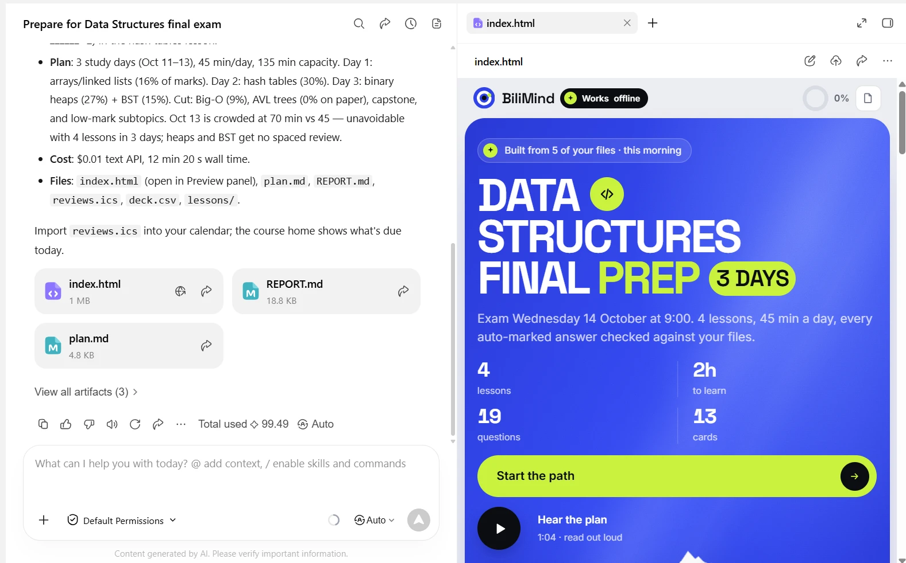

# Dormathon 2026: BiliMind for WorkBuddy

BiliMind Desktop started as our entry to **Dormathon 2026** (10 and 11 October 2026), Track 2 (WorkBuddy Track,
"Agentic Solutions"). This page keeps the entry as it was submitted; the rest of this folder holds the plans,
runbooks, spikes and the proof we collected. The product README is [../README.md](../README.md).

## The entry

> **Team Opus Magnum (#58), Taylor's University**
> Oybek Odilov · Abdugaffor Odilov · Ramil Khutlimuratov · Gameel Al-Bazeeli
>
> Track 2 (WorkBuddy Track, "Agentic Solutions"): can your AI agent use WorkBuddy to solve a real problem
> and actually get things done?

**How it meets the Track 2 criteria**

| Criterion | What we built | Evidence |
|---|---|---|
| 1. Problem relevance | Two real bottlenecks: a student turning a pile of slides into a plan before an exam, and a shop training new crew every few weeks from its SOP. One sentence in, a checked course out in minutes, for cents | The [three demo courses](../README.md#try-a-course-it-made) and their sentences; market check: [workbuddy-market-validation.md](proof/workbuddy-market-validation.md) |
| 2. Autonomous workflow | A Lead reads the goal and files, weights the past paper, plans the days, keeps and cuts topics with a reason each (in the app by marks per minute; in WorkBuddy the agent decided: it re-ran `plan` with a different lesson order and logged why it kept the first); Writers work in parallel; a Coder and a Checker verify; failed checks trigger a re-draft, a lesson that fails twice is dropped and the run continues. No questions to the user | [run.ts](../packages/engine/src/run.ts), [desktop-run-timings.json](proof/desktop-run-timings.json), [crew/log.jsonl](../showcase/courses/ds-final/crew/log.jsonl), [plan.md](../showcase/courses/ds-final/plan.md) |
| 3. WorkBuddy integration | WorkBuddy orchestrates the whole run: its agent and sub-agents decide and run every step, and the `bilimind` command line they call does the file work and the checks (its writing calls use BiliMind free). From one sentence, WorkBuddy's agent loaded the bilimind skill, made a 9-step checklist, ran the Lead's steps through the `bilimind` command line, launched 4 Writer sub-agents in the same second, then the Coder and the Checker in parallel, and opened the finished course with `present_files`: 14 min 47 s, no further input (4 lessons, 103/106 checks, 16/16 code tests, 23 min of narration). It also ships as the "BiliMind Crew" Expert Team, which passes WorkBuddy's own `validate_expert.py` and is registered in My Experts. We also used WorkBuddy for our first deck, market research and a comparison | [the run in WorkBuddy](proof/workbuddy-run/), [screenshots](proof/workbuddy-run/screenshot-1-request-and-summary.png), [its tool calls](proof/workbuddy-run/session-tool-calls.json), [the course](https://odilient.github.io/bilimind-desktop/courses/ds-workbuddy/), [SKILL.md](../skills/bilimind/SKILL.md), [docs/workbuddy.md](../docs/workbuddy.md) |
| 4. Reliability and verification | Built-in checks on every lesson, answers re-solved against your files with word-for-word quotes, code run against tests, a report per course; 338 automated tests | [REPORT.md](../showcase/courses/ds-final/REPORT.md), [rulings](../showcase/courses/ds-final/crew/evidence/), [verdicts](../showcase/courses/ds-final/crew/verdicts/), [verdict.ts](../packages/engine/src/verdict.ts), [codework.ts](../packages/engine/src/codework.ts) |
| 5. Live execution | A packaged Windows app; one sentence runs end to end with no further input; a fresh install with no key built a course; one sentence in WorkBuddy built a course with no further input; three courses play on the website; the same engine also runs from the command line, which the WorkBuddy skill calls | [Download](https://github.com/Odilient/bilimind-desktop/releases/tag/v0.1.0), [film](https://odilient.github.io/bilimind-desktop/vid/bilimind-desktop.mp4), [deck](https://odilient.github.io/bilimind-desktop/downloads/BiliMind-Desktop-Deck.pdf), [screenshots](../docs/img/) |

**One sentence, end to end.** After "My Data Structures final is Wednesday 9am. The slides and last year's
paper are in this folder. I have 45 minutes a day. Get me ready." the crew, with no further input:
reads the goal (exam Wednesday 14 October, 09:00, 45 minutes a day) → reads the 5 files and finds the past
paper → outlines the topics → maps the past paper's marks to topics → keeps 3 lessons and cuts the rest
with a reason each → 3 Writers draft in parallel and check their lessons → the Coder runs the exercises →
the Checker rules on every answer → narration → Anki deck and calendar → the course. Trace with times and
costs: [desktop-run-timings.json](proof/desktop-run-timings.json).

**How we used WorkBuddy** ([details, task links and screenshots](../docs/workbuddy.md)):

| Where in WorkBuddy | What we did |
|---|---|
| Slides Creation | Made our first pitch deck from a written brief, then corrected it slide by slide |
| Deep Research | Checked demand on both halves of Track 2 (students, small businesses), competitors and risks |
| Plain chat | Sent our student sentence to WorkBuddy without BiliMind, to see the gap |
| Skills and Expert Teams | Shipped BiliMind as a skill and as the "BiliMind Crew" Expert Team, validated with WorkBuddy's own `validate_expert.py` |
| A Craft task with the BiliMind skill | One sentence in, a finished course in WorkBuddy's preview 14 min 52 s later, with no further input ([proof and screenshots](proof/workbuddy-run/)) |

**Built at Dormathon and before.** BiliMind existed before Dormathon as a web app (bilimind.com). From it we
reused the teaching approach: the lesson prompts and the rules that match each kind of knowledge to a
lesson format. The desktop app, the engine, the checks, the planner, the course player, BiliMind free and
the WorkBuddy skill and team were built during Dormathon (10-11 October 2026), with AI coding agents.

## One engine, many ways to use it (as submitted)

| Way | For whom | How to start | Link |
|---|---|---|---|
| **BiliMind Desktop** (Windows app) | Everyone. This is the main way. | Download, drop your files, type one sentence | [Download](https://github.com/Odilient/bilimind-desktop/releases/tag/v0.1.0) |
| **Inside WorkBuddy** | WorkBuddy users | Install the BiliMind skill or the "BiliMind Crew" Expert Team (a Lead, Writers, a Coder and a Checker), then type the same sentence, starting with "Use the bilimind skill." (we ran the skill; the Expert Team is validated and registered) WorkBuddy's agent leads the crew: it plans, launches the Writers in parallel, then the Coder and the Checker, and opens the course in its preview. Tested: one sentence, a 4-lesson course in 15 minutes | [the run in WorkBuddy](proof/workbuddy-run/), [skills/bilimind](../skills/bilimind/), [workbuddy/bilimind-crew](../workbuddy/bilimind-crew/), [install steps](../docs/DEVELOPERS.md#workbuddy-skill-and-expert-team) |
| **Command line** | Power users, scripts, automation | One file, `bilimind.mjs`, with Node 22 or newer. Every step is its own command (`init`, `ingest`, `outline`, `exam-map`, `plan`, `draft`, `check`, `code-test`, `narrate`, `build` and more) | [apps/cli](../apps/cli/), [bilimind.mjs](../skills/bilimind/scripts/bilimind.mjs) |
| **The course itself** | Anyone you share it with | Open `index.html` in any browser, offline, or put it online like our three demo courses. `deck.csv` goes into Anki, `reviews.ics` into your calendar, `plan.md` is the study plan | [The three demo courses](../README.md#try-a-course-it-made) |
| **BiliMind free** (the AI service) | Nobody opens it | The app and the command line use it by default, so nobody needs a key. Open source; its key lives only on the server | [server/free-proxy](../server/free-proxy/) |
| **bilimind.com** | | Our separate online product, with accounts. It is not in this repo | [bilimind.com](https://bilimind.com) |

## Measured runs (as submitted)

Real runs, on our own laptop:

| Run | Your files | Lessons | Checks passed | Wrong answers rejected | Code tests | Narration | AI cost | Time |
|---|---|---|---|---|---|---|---|---|
| App, run 1 | Data Structures, 5 PDFs (63 pages) | 3 | 91/91 | 0 | 8/8 | 18.5 min | $0.036 | 3 min 23 s |
| App, run 2 | same | 3 | 98/100 | 0 | 4/4 | 32 min | $0.049 | 4 min 42 s |
| App, run 3 (packaged app) | same | 3 | 79/80 | 2 | 13/13 | 24.4 min | $0.032 | 3 min 37 s |
| [App, fresh install, no key (BiliMind free)](proof/free-provider-fresh-install-run.txt) | same | 2 of 3 planned | 52/53 | 0 | 4 runs, all ok | 10.9 min | $0.016 | 5 min 10 s |
| [Inside WorkBuddy, one sentence](../showcase/courses/ds-workbuddy/REPORT.md) | same | 4 | 103/106 | 0 | 16/16 | 23.2 min | $0.013 | 14 min 47 s |
| Demo: [Data Structures final](../showcase/courses/ds-final/REPORT.md) | 5 PDFs (63 pages) | 3 | 80/80 | 3 | 14/14 | 24.3 min | $0.040 | 19 min 39 s |
| Demo: [Boba shop day one](../showcase/courses/boba-day-one/REPORT.md) | 2 files (21 pages) | 7 | 231/231 | 1 | no code | 34.7 min | $0.094 | 24 min 39 s |
| Demo: [Survival Malay](../showcase/courses/bm-survival/REPORT.md) | 2 files (12 pages) | 8 | 228/229 | 3 | no code | 39.2 min | $0.055 | 30 min 1 s |

The app runs are as the app recorded them, with no review afterwards (every step's time and cost:
[desktop-run-timings.json](proof/desktop-run-timings.json)). In the fresh-install run one lesson
failed its draft twice, so the app dropped it and finished the other two. The three demo courses started as
the same kind of run, then our team reviewed them with an AI coding agent (re-planning, fixing exercises,
correcting lesson text). Their steps are in each course's `crew/log.jsonl`, and every hand change is
described in [showcase/courses/_notes](../showcase/courses/_notes/). That review is why they took longer. The run inside WorkBuddy was not edited afterwards ([how it ran](proof/workbuddy-run/)); its time is from the request to the finished course, and its AI cost counts the command line's calls only, not WorkBuddy's own model.

## What is in this folder

| Path | What |
|---|---|
| [PLAN.md](PLAN.md) | The plan for the weekend |
| [RUNBOOK.md](RUNBOOK.md) | The demo-day runbook |
| [SPIKE.md](SPIKE.md), [spike/](spike/) | The WorkBuddy skill and Expert Team spike |
| [EXPERT-TEAM.md](EXPERT-TEAM.md) | The "BiliMind Crew" Expert Team design |
| [SLIDES-BRIEF.md](SLIDES-BRIEF.md) | The brief for the pitch deck ([../pitch/](../pitch/)) |
| [research/](research/) | Market and competitor research from the weekend |
| [proof/](proof/) | Screenshots, session records, run timings and the WorkBuddy run |
| [publish-public.sh](publish-public.sh) | How the private GitLab history was filtered into the public GitHub repo (GitHub is canonical since 20 October 2026) |
| [../docs/workbuddy.md](../docs/workbuddy.md) | How, where and in what scenario we used WorkBuddy |
