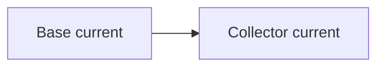

# Inventory: Lesson block types ("27 formats") + code sandbox

> Research slice for BiliMind Desktop. Source: `frontend/app/components/blocks/*`, `frontend/app/sandbox/*`, `frontend/app/components/sandbox/*`, `frontend/app/composables/useCodeRunner*`, backend block schemas / `BlockPayloadNormaliser`.
> Status: IN PROGRESS (skeleton written first; sections filled as completed).

## 1. Feature checklist (BLK-xx)

_pending_

## 2. Architecture: registry, shell, renderer

### 2.1 The 27 block types (canonical list)

Source of truth: `backend/app/Enums/BlockType.php` (PHP backed enum) mirrored by `frontend/app/types/api.ts` `BlockType` union and the `REGISTRY` in `frontend/app/components/blocks/BlockRenderer.vue`. A type added in one place without the others fails `vue-tsc` (`Record<BlockType, Component>` and `Record<BlockType, BlockPresentation>` are exhaustive).

| # | type (wire value) | Label (`BlockType::label()`) | Component | Group (backend predicate) | Presentation voice / frame / measure / eyebrow |
|---|---|---|---|---|---|
| 1 | `explainer` | Explainer | ExplainerBlock | narrative | prose / none / text / — |
| 2 | `key_points` | Key points | KeyPointsBlock | narrative | prose / rule / text / — |
| 3 | `example` | Example | ExampleBlock | narrative | prose / none / text / — |
| 4 | `resource` | Resources | ResourceBlock (+ResourceCard) | carriesResources | aside / rule / text / "Go deeper" |
| 5 | `video` | Videos | VideoBlock | carriesResources | object / card / wide / — |
| 6 | `quiz` | Quiz | QuizBlock (+AssessmentItem) | carriesAssessments | task / card / text / "Check yourself" |
| 7 | `exam` | Exam | ExamBlock | carriesAssessments | task / card / text / "Exam" |
| 8 | `project` | Project | ProjectBlock | carriesAssessments | task / card / text / "Project" |
| 9 | `flashcards` | Flashcards | FlashcardsBlock | interactive | task / none / text / "Practice" |
| 10 | `code` | Code exercise | CodeBlock (+CodeSandbox) | carriesAssessments + interactive | task / card / text / "Exercise" |
| 11 | `reflection` | Reflection | ReflectionBlock | — | aside / rule / text / "For you · never graded" |
| 12 | `walkthrough` | Walkthrough | WalkthroughBlock | — | object / card / text / "Steps" |
| 13 | `checklist` | Checklist | ChecklistBlock | — | object / card / text / "Checklist" |
| 14 | `diagram` | Diagram | DiagramBlock (Mermaid) | — | object / card / wide / — |
| 15 | `comparison` | Comparison | ComparisonBlock | — | object / card / wide / — |
| 16 | `scenario` | Scenario | ScenarioBlock | interactive | task / card / text / "Decide" |
| 17 | `reference_table` | Reference table | ReferenceTableBlock | — | object / card / wide / "Reference" |
| 18 | `worked_example` | Worked example | WorkedExampleBlock | — | prose / none / text / — |
| 19 | `playground` | Playground | PlaygroundBlock | interactive | task / card / wide / "Try it" |
| 20 | `annotated_media` | Annotated image | AnnotatedMediaBlock | interactive + carriesResources | object / card / wide / — |
| 21 | `timeline` | Timeline | TimelineBlock | — | aside / rule / text / "How it got here" |
| 22 | `analogy` | Analogy | AnalogyBlock | narrative | aside / rule / text / "Analogy" |
| 23 | `audio` | Listen | AudioBlock | interactive | aside / rule / text / "Listen" |
| 24 | `speaking` | Speak | SpeakingBlock | interactive | task / card / text / "Say it" |
| 25 | `dialogue` | Role-play | DialogueBlock | interactive | task / card / text / "Role-play" |
| 26 | `illustration` | Illustration | IllustrationBlock | — | object / card / text / "Illustration" (kept on purpose: a generated image must never read as a photo) |
| 27 | `misconception` | Common misconception | MisconceptionBlock | narrative | aside / rule / text / "Common misconception" |

Backend predicates (`BlockType`):
- `carriesAssessments()`: quiz, exam, project, code. These own rows in `assessments` and carry `assessment_ids` in payload (always written as `[]` by the normaliser; filled by the synchroniser when assessments are persisted).
- `isNarrative()`: explainer, key_points, example, analogy, misconception.
- `isInteractive()`: scenario, playground, flashcards, annotated_media, code, audio, speaking, dialogue (used by EXPAND "variety accounting").
- `carriesResources()`: resource, video, annotated_media (only these may carry off-platform URLs, and only via verified `resource_id`s; the model never writes a URL).

### 2.2 Block envelope (`BlockBase<T, P>`)

```ts
interface BlockBase<T extends BlockType, P> {
  id: number; node_id: number; position: number; type: T; payload: P;
  source_material_ids: number[] | null;   // RAG grounding: "Grounded in N of your materials"
  rewriting?: boolean;                    // EDIT: model is rewriting this block now
  rewrite_error?: string | null;          // EDIT: why the last rewrite failed
  created_at?: string; updated_at?: string;
}
```

### 2.3 BlockRenderer (dispatch + crash isolation)

- Props: `block`, `assessments` (all assessments of the node), `attempts: Record<assessmentId, Attempt[]>`, `readonly`, `language` (course BCP-47-ish tag for TTS voice), `level` (beginner/... to pitch role-play).
- Emits `graded(GradedPayload)` only for INTERACTIVE = {quiz, exam, project, code}.
- Bindings by type: assessed types get `{block, assessments, attempts, readonly}`; `reflection` and `illustration` get `{block, readonly}` (illustration: a read-only viewer must never trigger a paid render); `audio` gets `{block, language}`; `speaking`/`dialogue` get `{block, language, level}`; everything else `{block}`.
- Unknown type or render exception -> `UnknownBlock`. `onErrorCaptured` sets `crashed=true`, returns false (stops propagation) so one malformed payload takes down one block, never the lesson. In dev the error message is shown ("This part of the lesson could not be displayed: <msg>."); in prod the message is hidden. Crash state resets when `block` prop changes.
- Root element: `<div id="block-{id}" class="lesson-section">` - the anchor for search deep-links (`#block-{id}`) and the scroll-margin carrier (keeps hits clear of the sticky header).

### 2.4 BlockShell (the frame every block sits in)

- Props: `type` (drives eyebrow/frame/measure via `BLOCK_PRESENTATION`), `title?` (model-authored heading, 18px h3 under the eyebrow), `label?` (override eyebrow; essentially unused), `tone` = default|success|warn|danger (state, e.g. finished checklist = success), `badge?` + `badgeTone` (neutral|accent|success|warn|danger pill e.g. "Passed", "2 of 4 tests"), `sourceMaterialIds`.
- Header: 5px dot (accent colour ONLY for voice `task` - the single "do this" signal), eyebrow text, badge, `actions` slot (right-aligned buttons such as Shuffle/Reset/Clear/counters).
- Frame: `rule` = hairline top border; `card` = rounded bordered box with shadow, coloured by `tone`; `none` = nothing.
- Footer when `sourceMaterialIds.length`: "Grounded in N of your material(s)" with a file icon.
- Measure `wide` (diagram, comparison, reference_table, annotated_media, video, playground) breaks the reading measure; code deliberately is NOT wide (container query instead).
- `VOICE_NOUN` (outline fallback names): prose->"Explanation", aside->"Note", object->"Figure", task->"Practice". Unknown types present as `{object, null label, card, text}` - quiet, never a warning.

### 2.5 Deep-link anchoring (`useBlockAnchor.ts`)

- `anchorBlock(id)`: polls every 100ms up to 6s for `#block-{id}` that is NOT inside an `[inert]` (hidden workspace tab) ancestor, then `scrollIntoView({block:'start'})` (smooth unless `prefers-reduced-motion`) and flashes an accent ring (box-shadow `0 0 0 8px accent-soft, 0 0 0 9px accent-line`) for 1400ms. Module-level single pending timer (new request supersedes old).
- `useBlockAnchor()` watches `route.hash` matching `/^#block-(\d+)$/` (installed in app.vue) for pasted/reloaded deep links.

### 2.6 Archetype -> format mapping (who picks which blocks)

The outline model picks a `ConceptArchetype` per node; code (not the model) maps it to MANDATORY formats (`formats()`), an OPTIONAL menu (`optionalFormats()`), and preferred assessment kinds. `plannedBlockTypes()` = mandatory formats + `quiz` (unless a mandatory format already carries assessments, e.g. performance->project). NodeExpander rejects a lesson missing a mandatory format and re-asks.

| Archetype | Mandatory | Optional (plus common: key_points, video, resource, audio, speaking, dialogue) | Assessment kinds bias |
|---|---|---|---|
| procedural | walkthrough, checklist | example, code, diagram | ordering, short_answer, project |
| conceptual | explainer, diagram, analogy | example, reflection, scenario, illustration, misconception | short_answer, mcq, essay |
| factual | flashcards, reference_table | explainer, example, timeline | cloze, mcq, multi_select |
| discriminative | comparison, example | reference_table, scenario, explainer, illustration, misconception | multi_select, short_answer, mcq |
| diagnostic | scenario, diagram | checklist, example, reference_table, misconception | short_answer, ordering, multi_select |
| quantitative | worked_example, playground | explainer, code, reference_table | numeric, code, short_answer |
| spatial | diagram, annotated_media | explainer, walkthrough, reference_table, illustration | mcq, short_answer, cloze |
| evolutionary | timeline, explainer | comparison, reflection, example | ordering, short_answer, mcq |
| performance | project, checklist | walkthrough, example, reflection | project, essay |
| safety_critical | checklist, scenario | reference_table, walkthrough, annotated_media, illustration | multi_select, short_answer, ordering |
| communicative | speaking, dialogue | flashcards, explainer, example | short_answer, cloze, mcq |

Per-archetype `writingNote()` steers (verbatim intent): procedural = number every step, put the failure next to it, checklist checkable in the field; conceptual = diagram carries mechanism, analogy must name where it BREAKS; factual = flashcards cue->answer never paragraph, reference table sorted for lookup; discriminative = axes that decide the choice, each item a `best_for`; diagnostic = scenario starts from the symptom, diagram is a decision tree; quantitative = each worked step shows expression before result, playground must have something worth discovering (threshold/reversal/diminishing return) named in guidance; spatial = diagram IS the lesson, each hotspot says more than its label; evolutionary = each event states what changed AND what problem it solved; performance = brief allows two different good answers, rubric distinguishes; safety_critical = concrete consequences, scenario at the tempting shortcut; communicative = real utterances, dialogue goal reachable only by producing target language, AI corrects gently after the exchange.

Illustration and misconception are never mandatory (illustration costs ~$0.04/render; misconception needs a real wrong belief, so it is offered only where one exists).

## 3. Per-block spec

Conventions used below:
- **Payload** = the persisted JSON after `BlockPayloadNormaliser::normalise()` (backend `app/Services/Course/BlockPayloadNormaliser.php`). Aliases = alternative keys the normaliser accepts from the model and folds into the canonical key. `text()` = trimmed non-empty string or numeric, else null. `stringList(max)` = trimmed non-empty strings, capped.
- **Drop rule** = when the normaliser returns `null` (block discarded; NodeExpander re-asks if it was a mandatory format).
- **State** = client-side interaction state. Unless stated, it is LOCAL and ephemeral (never persisted, resets when `block.id` changes).
- Every component renders an italic faint "empty" message when its core payload is missing ("This explainer came back empty. Regenerate the lesson to fill it in.", "No steps were generated for this walkthrough.", etc.) rather than crashing.

### 3.1 `explainer` — prose (BLK-01)
- Payload: `{ markdown: string }`. Drop if `markdown` empty.
- Render: full Markdown (see `Markdown.vue`, section 3.29). A LEADING `# Heading` line is split off by `leadingHeading()` (in `composables/useLessonSections`) and promoted to the BlockShell `title`, so the block's headline sits where every other block's title sits; the lesson outline uses the same split to name the section.
- No eyebrow (default voice). Grading: none. Read by "Listen to whole lesson" TTS (`markdown`).

### 3.2 `key_points` — summary (BLK-02)
- Payload: `{ points: string[] }` (max 12). Drop if empty.
- Render: list with hairline rules between rows (no box, to avoid "skip straight here"), accent `◆` bullet, each point rendered with inline Markdown (`renderInline`: code, bold, links). Grading: none. TTS: points joined by ". ".

### 3.3 `example` — titled example (BLK-03)
- Payload: `{ title: string (default "Worked example"), markdown: string }`. Drop if `markdown` empty.
- Render: BlockShell title = `title`, body Markdown.

### 3.4 `analogy` — analogy + where it breaks (BLK-04)
- Payload: `{ markdown: string, breaks_down_when: string }`. Aliases: `analogy_markdown` -> markdown, `limits` -> breaks_down_when. Drop if EITHER missing ("an analogy without its limit is a misconception with good PR").
- Render: prose at body size, then an accent-soft callout box "Where the analogy breaks down" with `breaks_down_when` (the part that must survive skimming). Eyebrow "Analogy", hairline frame.

### 3.5 `misconception` — refutation text (BLK-05)
- Payload: `{ belief, why_it_seems_right, what_is_true, tell: string|null }`. Aliases: `misconception`->belief, `grain_of_truth`->why_it_seems_right, `correction_markdown`->what_is_true, `how_to_catch_it`->tell. Drop if any of the first three missing.
- Render order and weight are the pedagogy: (1) belief as quiet reported speech: italic, muted, left border, in curly quotes - never bold, never a heading; (2) `why_it_seems_right` plain; (3) accent callout "What is actually true" with Markdown body (the ONLY loud element); (4) optional "How to catch yourself — {tell}".
- TTS reads belief then what_is_true, deliberately SKIPPING `why_it_seems_right` (aloud it sounds like an argument for the wrong answer).

### 3.6 `walkthrough` — numbered procedure with tickable steps (BLK-06)
- Payload: `{ intro: string|null, steps: [{ n, title, detail_markdown, warning: string|null, check: string|null }] }`. Step aliases: `detail`/`markdown`->detail_markdown, `verify`->check. Missing title -> "Step {i+1}". Steps without detail skipped. `n` is RENUMBERED 1..N (no gaps). Max 12 steps; drop if < 3.
- Interaction: each step's number circle is a toggle button (`aria-pressed`); done steps show a check, success colour, and the step body dims to 55% opacity. Header action shows `done/total`. Vertical rail joins step circles (not after the last). Warning renders as a warn-soft box with alert icon; check renders as faint line with check icon.
- State: local `Set<n>`, never persisted ("a working aid, not progress"). Resets on block change.

### 3.7 `checklist` — field checklist (BLK-07)
- Payload: `{ title: string (default "Before you move on"), items: [{ text (<=300 chars), why: string|null }], note: string|null }`. Accepts bare strings or `{text, why}`. Max 14; drop if < 3.
- Interaction: each row is a button toggling a checkbox; checked text gets line-through + faint. Header shows `checked/total` and a "Clear" ghost button (only when something is checked). When ALL checked, BlockShell `tone="success"` (green card). Optional `note` under a rule.
- State: local, deliberately unsaved ("persisting would show last job's ticks on this job's list").

### 3.8 `timeline` — chronological events (BLK-08)
- Payload: `{ events: [{ when (<=60 chars, free text e.g. "1970s", "v2.0"), title, detail: string|null }] }`. Aliases: `date`/`year`->when, `event`->title, `description`->detail. Max 12; drop if < 3.
- Render: vertical rail with accent dots, `when` in small tabular numerals above a bold title and muted detail. Not interactive. Eyebrow "How it got here".

### 3.9 `worked_example` — stepwise derivation with progressive reveal (BLK-09)
- Payload: `{ problem_markdown, steps: [{ expression, explanation }], answer: string|null, common_mistakes: string[] (max 5) }`. Aliases: `problem`->problem_markdown; step `math`/`code`->expression, `why`->explanation. A step needs at least one of the two (missing one becomes ""). Max 12 steps; drop if < 2 or no problem.
- Interaction: shows step 1 only; "Next step" reveals one more (counter `shown/total`); header "Show all" ghost button (hidden once all are shown). After all steps: if `answer`, a "Show the answer" link reveals "Answer {answer}" in an accent band. `common_mistakes` render only after all steps shown, under a red "Common mistakes" eyebrow with x icons. Expression is monospace, `pre-wrap`.
- State: local `shown` (starts 1) and `answerShown`. Grading: none.

### 3.10 `comparison` — X vs Y matrix (BLK-10)
- Payload: `{ intro: string|null, axes: string[] (2..6), items: [{ name, values: string[] (padded/truncated to axes.length with "—"), best_for: string|null }] }`. Item alias `title`->name, `use_when`->best_for. Max 5 items; drop if axes < 2 or items < 2.
- Render: responsive. >= sm: real table (corner cell blank, axes as uppercase column headers, item name as row header, cells via inline Markdown), then a "best for" list (target icon, **name** — best_for). < sm: one card per item, axes as `dt/dd` pairs, best_for at the bottom. Table scrolls inside its own box. Wide measure.

### 3.11 `reference_table` — filterable lookup table (BLK-11)
- Payload: `{ title: string|null, columns: string[] (2..8), rows: string[][] (padded to columns.length with ""), note: string|null }`. Rows may arrive as lists OR objects keyed by column header (normaliser maps them). Rows with all-empty cells dropped. Max 20 rows; drop if columns < 2 or rows < 2.
- Interaction: when rows > 4, a "Filter…" text field (search icon) appears in the header; case-insensitive substring match on any cell; "Nothing matches “q”." when empty. First column bold/nowrap. Narrow: one card per row (first cell as card title, rest as dt/dd). Optional note.

### 3.12 `diagram` — Mermaid (BLK-12)
- Payload: `{ format: 'mermaid', source, caption: string|null, alt_text: string|null }`. Aliases: `mermaid`/`code`->source, `alt`->alt_text; alt_text falls back to caption. Code fences around source are stripped.
- Server validation (`isPlausibleMermaid`): non-empty, <= 6000 chars, <= 60 lines, first token of line 1 in {flowchart, graph, sequencediagram, statediagram, statediagram-v2, classdiagram, erdiagram, journey, gantt, pie, mindmap, timeline, quadrantchart, gitgraph, requirementdiagram} (case-insensitive), no `<script|iframe|object|embed`, balanced `[] () {}` counts, even number of `"`. Drop otherwise.
- Client: dynamic `import('mermaid')` (only on pages with a diagram); `initialize({ startOnLoad:false, securityLevel:'strict', theme:'base', themeVariables:{ background:#ffffff, primaryColor:#f3f8dd, primaryBorderColor:#dcecab, primaryTextColor:#14161c, secondaryColor:#faf7f0, secondaryBorderColor:#e3e0d6, tertiaryColor:#f5f2ea, tertiaryBorderColor:#e8e5dc, lineColor:#9a9b9e, textColor:#2b2d33, fontSize:13px }, fontFamily:'"Instrument Sans", …', flowchart:{ htmlLabels:false, curve:'basis' } })`. Render id `bilimind-diagram-{blockId}-{globalCounter}` (module-global counter, because the workspace mounts each lesson twice). Pulse skeleton while rendering. On parse failure: show `alt_text` in a bordered box, else "This diagram could not be drawn." Caption below. `role="img"` + `aria-label` (alt_text ?? caption ?? "Diagram"). Phone (< 40rem): SVG keeps natural width and scrolls horizontally (labels never shrink).

### 3.13 `scenario` — branching decision exercise (BLK-13)
- Payload: `{ setup_markdown, steps: [{ id, prompt, options: [{ id, text, outcome_markdown: string|null, correct: bool, next_id: string|null }] }], debrief_markdown: string|null }`. Aliases: `setup`->setup_markdown, step `question`->prompt, option `label`->text, `outcome`->outcome_markdown, `debrief`->debrief_markdown. Step id default `s{i+1}`, option id default `a`,`b`,… (duplicates dropped). Options 2..5 per step (steps with < 2 options dropped), max 6 steps, drop if none. Exactly one `correct` per step (extras forced false). `next_id` pointing at an unknown step is REPAIRED to null (= scenario ends), never a dead end.
- Interaction: setup prose; current step prompt + option buttons. Choosing appends `{step, option}` to the path; path entries render as green (correct, check icon) or amber (wrong, x icon) cards showing the prompt, chosen text, and `outcome_markdown`. Navigation follows `next_id` (null/unknown -> finished). When finished, debrief (accent card, sparkles "Debrief") is shown; if there were wrong turns: "You took N wrong turn(s) on the way — worth running it again now you know where they were." Header "Start over" button once a choice exists.
- Grading: deliberately NOT graded (`correct` is in the payload because it is practice; nothing is scored). Debrief held back until the end (reading the principle first gives the answer away).

### 3.14 `flashcards` — flip deck (BLK-14)
- Payload: `{ cards: [{ front, back }] }`, max 20; drop if empty. Writing note: cue -> answer, never cue -> paragraph.
- Interaction: 3D flip card (rotateX 180deg, 0.45s, `perspective:1400px`, no transition under reduced-motion); FRONT/BACK corner labels; prev/next (wraps around); "Again" (removes from known, advances) / "Got it" (adds to known, advances; button turns success when current is known); header "{known}/{total} known" + "Shuffle" (Fisher-Yates; then "Deck shuffled. Restore original order" link); green progress bar = known/total. Keyboard when the deck is focused: Space/Enter flip, ArrowLeft/Right move, S shuffle, K mark known.
- State: local only (`order`, `cursor`, `flipped`, `known`, `shuffled`). (Spaced repetition of cards is a separate product feature, see the review/SRS slice.)

### 3.15 `playground` — sliders bound to a formula (BLK-15)
- Payload: `{ inputs: [{ key, label, min, max, step, default, unit: string|null }] (1..4), formula_js: "function compute(i) { ... return ...; }", output_label (default "Result"), output_unit: string|null, guidance_markdown: string|null }`. Aliases: `formula`->formula_js, `guidance`->guidance_markdown, input `name`->key.
- Input normalisation: key must match `/^[a-z_][a-z0-9_]{0,31}$/i`, unique; min default 0, max default min+100 (dropped if max <= min); step default `round((max-min)/100,4)`, forced 1 if <= 0; default = midpoint, clamped to [min,max]; label defaults to key.
- Formula safety (`isSafeFormula`): <= 1200 chars; must match `^function\s+compute\s*\(\s*IDENT\s*\)\s*\{(.+)\}\s*$`; body (lowercased) must not contain any of: `import`, `require(`, `fetch(`, `xmlhttprequest`, `while`, `eval(`, `function(`, `=>`, `settimeout`, `setinterval`, `document`, `window`, `globalthis`, `localstorage`, `postmessage`, `worker`, `math.random`, `new function`, `constructor`; must contain `return`; every `param.prop` read must be a declared input key, and there must be at least one such read. Drop otherwise.
- Execution: runs in the SAME sandboxed worker as code exercises (`useCodeRunner({ timeoutMs: 1500 })`). Builds call `compute({k1:v1,k2:v2})` from slider values (numbers only), plus a SWEEP of the first input across 28 evenly spaced points from min to max - all in one worker batch as fake "tests" (`{name:'value'|'s{i}', call, expect:null}`); `received` (inspected string) is the value. Debounced 60ms per slider change. Broken if error/timeout/null -> "This calculation could not run." in warn colour.
- Render: guidance Markdown; 2-column slider grid, each with label + current value formatted to step's decimals (max 4) + unit; big 30px result with unit; sparkline SVG (viewBox 320x74, accent polyline, y inverted, min/max normalised) captioned "{first input label} across its range →", with a vertical marker at the current slider position. Header "Reset" restores defaults. Notice if Web Workers unsupported.
- Grading: none.

### 3.16 `annotated_media` — licensed image + numbered hotspots (BLK-16)
- Payload: `{ media: ResearchedResource (kind=image, from verified research — Wikimedia Commons), alt_text (default resource title), hotspots: [{ x_pct, y_pct (clamped 0..100), label, detail: string|null }] (max 10) }`. Input `resource_id`/`image_id` must resolve in the node's ResourceIndex to an IMAGE, else drop. Hotspot aliases `x`/`y`. Hotspots missing label or coordinates are dropped.
- Interaction: numbered circular buttons absolutely positioned at (x%, y%) over the image (tap, not hover - phones); clicking toggles active (accent, scaled). A numbered legend list below mirrors them; the active row expands to show `detail`. Figcaption: licence · attribution · "source" link (attribution is a licence condition). Image load error -> alt_text paragraph.

### 3.17 `illustration` — generated picture with DOM labels (BLK-17)
- Payload (persisted): `{ intent: 'depiction'|'contrast'|'scene'|'metaphor' (unknown -> depiction), subject (<=180 chars, newlines/backticks/braces stripped), caption: string|null, alt_text (REQUIRED; alias alt), points: [{ x_pct, y_pct, label (<=60), detail|null }] (max 6; alias labels/text/x/y) }`. Hydrated at READ time (never stored): `image?: { state:'ready', url, width|null, height|null }`.
- Drop rule: no subject or no alt_text; subject fails `isDepictable()`: whole-word (optional plural) match on any of: photo, photograph, photorealistic, photo-realistic, photorealism, screenshot, screen capture, real footage, actual footage, archival footage, news footage, surveillance, cctv, body cam, bodycam, dashcam, caught on camera, selfie, mugshot, headshot, passport photo, satellite photo, aerial photo, stock photo; OR a 4-digit year (1000-2099) within 24 chars of a Capitalised Two-Word Name (a dated real event).
- Prompt (server-composed, `IllustrationPrompt::compose`, VERSION=1): "Draw a single educational illustration for a lesson." + intent clause (depiction: "Draw what the subject looks like, from the angle that makes its parts easiest to tell apart."; contrast: two panels, left correct, right mistaken, identical apart from the difference; scene: whole arrangement wide showing where each part sits; metaphor: draw the everyday object/situation literally, not the idea) + "SUBJECT: …" + STYLE (flat vector, editorial line work, white space, 2-3 muted colours, white background, no gradients/shadows/3D/photo texture) + NO TEXT (no words/letters/numbers/labels/watermarks) + NO PEOPLE (no identifiable faces, real figures, logos; anonymous silhouette if unavoidable) + NOT A PHOTOGRAPH. Cache key = sha256(model | intent | lowercased normalised subject | VERSION) - an identical prompt is never drawn twice. Model `google/gemini-2.5-flash-image` via OpenRouter with `modalities:['image','text']`; reply at `choices[0].message.images[0].image_url.url` (data URL); MIME sniffed from magic bytes (png/jpeg/webp only). ~$0.0387/render.
- Client: lazy - an IntersectionObserver with `rootMargin: 600px 0px` triggers `POST /blocks/{id}/illustration` only when within ~a screen, only for an authenticated non-readonly owner. Polls (`retry_after` clamped 1.5-10s, 90s deadline); in-flight and settled maps dedupe per page. States: (a) picture: frame `max-w 480px`, aspect ratio from natural size (default 1/1, holds space to avoid reflow), DOM labels = 7px accent dot at (x,y) + a truncated text chip beside it on the side that stays inside the frame (x>50 -> anchored right), points with `detail` listed below as "**label** — detail"; permanent line "Illustration · drawn for this lesson, not a photograph". (b) drawing: shimmer frame + "Drawing this illustration. It is kept, so it is only drawn once." (c) degraded: `alt_text` as PROSE at reading size (not an error box) + caption. Owner-only explanation line with reason icon (course_cap/plan_cap/weekly_budget/disabled = lock; provider_halted = clock; worker_stalled/generation_failed/no_subject = alert), allowance figures ("x of y in this course · x of y this month · $a of $b this week"), and "Try again" for retryable reasons (worker_stalled, generation_failed, provider_halted).

### 3.18 `video` — embedded YouTube with start time (BLK-18)
- Payload: `{ items: ResearchedResource[] (kind=video, max 3, from `resource_ids`/`ids`, each may carry `why` - per-item or block-level `why` fallback), start_seconds?: int (1..86400; alias start) }`. Drop if no ids resolve. The model never writes URLs.
- Render: each item via `ResourceCard`; `start_seconds` applies to the FIRST item only. Player layout when `provider==='youtube' && embeddable && provider_id`: lazy iframe `https://www.youtube-nocookie.com/embed/{provider_id}?rel=0&modestbranding=1&playsinline=1[&start=N]`, below it favicon, site name (default "YouTube"), title, `why`, facts line (author · duration_label · "from m:ss" · language) and an "Open" button linking to `url` with `t={N}s`. Non-embeddable -> card.

### 3.19 `resource` — further reading cards (BLK-19)
- Payload: `{ items: ResearchedResource[] (max 5, deduped by resource id), note: string|null }`. Drop if no ids resolve.
- `ResearchedResource` = `{ resource_id, title, url, kind: video|article|docs|book|tool|image, provider, provider_id|null, embeddable, domain|null, duration_s|null, duration_label|null, language|null, license|null, attribution|null, thumbnail|null, image?|null (og:image), favicon?|null, site_name?|null, author?|null, why|null }`.
- Layout (`utils/resourceLayout.ts`): `player` (embeddable YouTube), `line` (article: 3:2 thumbnail beside words, one row each), `card` (docs/book/tool: tall card with 2:1 cover + kind label). Container-query grid: 1 column, 2 columns at `@lg`; players and lines span the full row. Image failures (incl. pre-hydration, detected via `img.decode()` on mount) fall back to favicon tile then kind icon (video=play, article=file, docs/book=book, tool=layers, image=search); never a broken-image glyph. Eyebrow "Go deeper".

### 3.20 `audio` — "Listen" narration (BLK-20)
- Payload: `{ script_markdown (Markdown stripped server-side: fences removed, `*_`#>` removed, links -> text), voice_hint: string|null, language: string|null (<=32 chars; the script's language, overrides course language), duration_estimate_s: max(15, round(words/2.5)) }`. Aliases `script`, `lang`. Drop if < 20 words.
- Interaction: header segmented control "This passage" / "Whole lesson" (whole lesson = server assembles narration from ALL non-assessment blocks of the node, see 3.20a). Play/Pause/Resume button (loading state), scrubber (range 0..duration, seek on input), elapsed / total clock (estimate until real metadata loads), voice menu ("Default voice" + up to 12 voices filtered by the 2-letter language prefix; check mark on current). Transcript shown under a rule when source is passage. Errors: "{error} The transcript is below."
- Backend: `POST /audio/tts { text | node_id (+block_ids?), voice?, language? } -> { url, seconds, voice, cached }` using edge-tts (Microsoft neural voices, default `en-US-AriaNeural`, voice whitelist in `config/audio.php` - also an argument-injection guard), mp3 cached by content+voice. `GET /audio/voices -> { default, voices:[{id,label,language,gender}] }`. Client caches clips module-wide by `node:{id}|text:{hash}` + voice + language.
- 3.20a Whole-lesson narration text (`AudioController::spokenText`): node title, then per block: assessed blocks (quiz/exam/project/code) SILENT (never read answers); explainer/example/analogy -> markdown; audio -> script; key_points -> joined; reflection -> prompt; walkthrough -> "title: detail" rows; checklist -> "text: why"; comparison -> "name: best_for"; scenario -> setup + debrief; worked_example -> problem only; playground -> guidance; timeline -> "when: title: detail"; diagram/annotated_media/illustration -> caption ?? alt_text; misconception -> belief + what_is_true (skips why_it_seems_right). Parts joined with ". \n\n" and de-Markdowned (fences, inline code, links/images, headings, stray markers).

### 3.21 `speaking` — repeat-after / shadowing drill (BLK-21)
- Payload: `{ intro_markdown: string|null, items: [{ text (<=240), translation|null, phonetic|null }] (2..12; accepts bare strings), voice_hint|null, language|null }`. Aliases: `phrases`->items, item `phrase`->text, `gloss`->translation, `ipa`->phonetic, `intro`, `lang`.
- Interaction per phrase card: phrase (15px), translation, `/phonetic/`; Play button (native voice via server TTS in `language ?? course language`; toggles pause), Speak/Stop button (record; disabled while another phrase records; label "Checking" while server transcribes). After an attempt: score pill (>=80 success, >=50 warn, else danger), `heard: “…”`, each target word coloured green (matched) or faint with wavy red underline (missed); "Why? Get a tip" -> one-sentence coaching tip (sparkles icon); empty transcript -> "Didn’t catch that — try again, a little closer to the mic."
- Recognition (`useSpeech`): Web Speech API on-device when available (`lang` = BCP-47 from 2-letter map: en-US, ru-RU, uz-UZ, fr-FR, de-DE, es-ES, it-IT, pt-BR, nl-NL, pl-PL, tr-TR, ar-SA, hi-IN, ja-JP, ko-KR, zh-CN, ms-MY, id-ID, vi-VN, th-TH; else `xx-XX`; default en-US), `interimResults:false, continuous:false, maxAlternatives:1`; fallback MediaRecorder -> `POST /speech/transcribe` (multipart `audio`, `language`) -> server Whisper (503 if not installed -> "Speaking practice needs Chrome or Edge on this device, or you can type your reply."). Mic blocked -> "Microphone access was blocked. Allow it in your browser to practise speaking."
- Scoring algorithm (`scorePronunciation`, client-side, free): normalise = lowercase, NFD + strip combining marks, non-letter/digit -> space, collapse. If target has <= 1 word (or CJK/unspaced): Levenshtein ratio on whitespace-stripped strings -> score%, single word ok if >= 60. Else: LCS alignment of target words vs heard words (order-preserving subsequence via DP), score = round(matched/targetWords*100), per-word ok flags.
- Coach: `POST /speech/coach { target, heard, language } -> { tip }`; system prompt: "You are a warm, concise speaking coach for {language}. In ONE short sentence (25 words max), name the single most useful thing the learner should fix, comparing what they were asked to say with what they actually said. Be specific and encouraging. No preamble, no lists, no quotation of these instructions." User: `Target phrase: "…"\nWhat the learner said (from speech-to-text): "…"\n\nYour one-sentence tip:`. Flash tier.
- Grading: self-practice score only; never persisted.

### 3.22 `dialogue` — spoken role-play with an AI tutor (BLK-22)
- Payload: `{ scenario_markdown, ai_role (default "your conversation partner"), learner_role (default "you"), goal, opening_line|null, hints: string[] (max 6, "useful phrases"), language|null }`. Aliases: `scenario`, `tutor_role`, `your_role`, `objective`, `opener`, `useful_phrases`, `lang`. Drop if no scenario or no goal.
- Interaction: scene card (scenario; "You are the {learner_role}; you're talking to the {ai_role}."; target icon "Goal: {goal}"). "Start the conversation" button -> pushes `opening_line` as assistant turn and speaks it (TTS). Chat bubbles (learner right/accent, tutor left/sunken) with a replay button on tutor turns; per-learner-turn `correction` shown under the bubble (warn text, sparkles). Input row: mic toggle (speech -> auto-send transcript), text input "Reply in {lang}…", Send. Hint chips (only before goal met) fill the input. "{ai_role} is replying…" spinner. On `goal_met`: success banner "Goal reached — nicely done. You can keep chatting or move on." and the input hides.
- Backend turn: `POST /speech/dialogue { node_id, block_id, text (<=2000), history: [{role: learner|assistant, content}] (<=40) } -> { reply, correction|null, goal_met }`. Scene re-read SERVER-side from the block (never trusted from client). LLM JSON call (flash tier) with system prompt: role-play to practise SPEAKING {course.language} at {course.level}; YOUR ROLE / LEARNER'S ROLE / SCENARIO / GOAL; rules: speak only in character in {language}, one or two natural sentences, never break character for grammar; match level; `reply` in target language; `correction` = brief kind correction in English only for mistakes that would confuse a real speaker (empty otherwise); `goal_met` true only once actually accomplished (reply may then close naturally). User string = "The conversation so far — reply as your character to the final learner line." + "You: …"/"Learner: …" lines + "Learner: {text}" + "You:". Schema `{reply: string, correction?: string, goal_met: boolean}` required reply+goal_met.
- Grading: goal_met is the success signal; nothing persisted.

### 3.23 `reflection` — private, ungraded prompt (BLK-23)
- Payload: `{ prompt: string }`. Drop if empty.
- Render: prompt at 15.5px (fallback "Take a moment on this."), multiline textarea (3 rows, placeholder "Answer it for yourself — nobody grades this.") unless readonly. Autosaves to `localStorage["bilimind:reflection:{blockId}"]` 500ms after typing stops (empty -> key removed); status line flips between lock icon "Kept in this browser only — never sent anywhere" and check icon "Saved in this browser" for 1.5s. Eyebrow "For you · never graded".

### 3.24 `quiz` — assessment container (BLK-24)
- Payload: `{ intro: string|null, assessment_ids: number[] }` (normaliser always writes `[]`; the generator's `assessments` array beside the payload becomes rows in `assessments` and ids are filled by the synchroniser). Never dropped.
- Item resolution (shared by quiz/exam/project/code): `assessment_ids` mapped to the node's assessments in id order; if none resolve, fall back to every assessment with `block_id === block.id`.
- Render: intro line; one `AssessmentItem` per item with "Question i of n" chip; header "{passed}/{total} passed" (an item counts as passed if ANY attempt has `passed === true`). Empty: "This quiz has no questions attached — regenerate the lesson to rebuild it." Eyebrow "Check yourself".

### 3.25 `exam` — timed sitting (BLK-25)
- Payload: `{ intro|null, time_limit_minutes: int 1..240 | null, assessment_ids: [] }`.
- Interaction: start gate (dashed box "N questions · M minutes suggested. Nothing is locked — the timer is there to keep you honest." + "Start the exam") unless readonly or already attempted. Optional countdown badge in header (outline "{M} min" before start; warn while running "m:ss"; danger at 0). At 0: "Time's up. You can still finish — this is your course, not an invigilated hall." The timer never locks or discards work. Header also shows passed/total.

### 3.26 `project` — brief + deliverables + rubric-graded submission (BLK-26)
- Payload: `{ title (default "Project"), brief_markdown (required), deliverables: string[] (max 8), assessment_ids: [] }`. Drop if no brief.
- Render: title (fallback "Build it"), brief Markdown, numbered "Deliverables" box, then the `project` AssessmentItem(s) with `deliverables` passed down. ProjectAssessment input: textarea (`text`), deliverable tick-boxes (ticked strings sent as `deliverables`), up to 20 link fields validated `^https?://\S+$` (sent as `links`). Response shape `{ text?, deliverables?: string[], links?: string[] }` (null until something is entered). Graded by the LLM rubric grader (section 5).

### 3.27 `code` — runnable exercise in five modes (BLK-27)
- Payload (common): `{ mode: 'function'|'script'|'debug'|'query'|'build', language: 'javascript'|'python'|'sql'|'html', starter_code, instructions_markdown (required), tests: CodeTest[]|null, hints: string[] (<=3, each <=200 chars), assessment_ids: [] }`.
- Mode-specific: `debug` adds `symptom_markdown` (required, else degrades to `function`; also degrades if starter_code empty); `query` adds `setup_sql` (required, must contain both `create table` and `insert into`, <= 8000 chars, else the block is DROPPED) and derived `tables: [{name, columns[]}]` (parsed from CREATE TABLE statements, max 6 tables x 12 columns; never model-supplied); `build` adds `requirements: string[]` (<=6; alias `acceptance`).
- Language normalisation: lowercase, strip non-alphanumerics, aliases (js/node/nodejs/ecmascript/vanillajs -> javascript; py/python3/py3/cpython -> python; sqlite/sqlite3/postgres/postgresql/psql/mysql/tsql/plsql -> sql; htm/html5/css/markup -> html). TypeScript/JSX deliberately NOT aliased. Any other language -> block DROPPED. Language decides mode: sql -> query, html -> build; python/javascript accept function|script|debug (mode parse is lenient: "bug-fix"->debug, "stdin"/"cli"->script, etc.), anything else -> function.
- `CodeTest` per mode (all have `name`, <= 190 chars, default "test N"/"case N"/"check N"; the name is the grading key and must match exactly):
  - function/debug: `{ name, call: "<one expression>", expect: <JSON value> }` (max 12). `call` evaluated in the same VM after the learner code.
  - script: `{ name, stdin: string|null, expect: "<exact stdout>" }` (1..4; JS gets exactly 1 case and stdin null because QuickJS has no stdin). Expected stdout accepted as string or list of lines (joined by "\n") under expect_stdout/expected_stdout/expect/expected/stdout.
  - query: `{ name, expect_table: { columns: string[]|null, rows: (string|null)[][] (<=20), ordered: bool } }` (max 6). Cells stringified except NULL stays null. Rows may be keyed objects.
  - build: `{ name, selector (whitelist `/^[a-z0-9\s.#\[\]="'>+~*():,_-]{1,120}$/i`), min_count 1..20 (default 1), text_contains|null, attribute: {name (`/^[a-z_:][a-z0-9_:.-]{0,40}$/i`), value|null}|null }` (max 6).
- Block render (CodeBlock.vue): header badge = "{n} check(s)" ("case(s)" for script) and an outline mono badge with the language. Instructions Markdown; for debug a warn box "What it does now" with the symptom. If an assessment is attached and not readonly -> the interactive exercise (section 4.3). Otherwise a read-only brief: build -> "Done when" list; query -> "Tables you can query" (`name (col, col)`); else "Your code must satisfy" (first 6 tests as `call → JSON(expect)` + name); plus starter code in a `CodeSnippet` (copy button, line count, "starter code" caption).
- Hints: revealed one at a time, never re-collapsible, LOCKED until the learner "has had a go" (ran once, or typed >= 20 non-whitespace chars beyond the starter) with the stated reason "Have a go first — run it once, or write a few lines. A hint read before the attempt replaces the attempt." No solution field exists anywhere in the payload, by design (solution lives in the assessment's `answer_key.reference_solution`, never sent to the client).

### 3.28 `UnknownBlock` fallback (BLK-28)
- Renders every top-level string field of the payload as `dt` (key with underscores -> spaces) / `dd` pairs inside a quiet object frame; if none, "This part of the lesson could not be displayed." Dev builds add a `<details>` with "{type} · raw payload" JSON. Never shows the type key or a version apology to learners.

### 3.29 Markdown renderer (shared by all blocks) (BLK-29)
- `composables/useMarkdown.ts` + `components/blocks/Markdown.vue`: a small custom SAFE renderer (no markdown-it). Escapes everything first; supports ATX headings (h1..h6 with fixed sizes), paragraphs, bold/italic/bold-italic/strikethrough, inline code, links (only `http(s)://`, `mailto:`, `/`, `#`; `target=_blank rel="noopener noreferrer nofollow"`), bare URL autolinks, bullet + ordered lists (one nesting level, ordered `start`), blockquotes (recursive), horizontal rules, pipe tables with alignment, fenced code (``` or ~~~ with language) rendered with a copy button (CodeSnippet). Images are NEVER loaded (model may invent URLs) - `` degrades to a link labelled with the alt text. No raw HTML, no math/LaTeX, no Mermaid inside prose. `renderInline()` is used for table cells, key points, comparison cells. `markdownToText(source, limit)` flattens to plain text (used in focus-mode briefs). `size` prop `sm|md`.

### 3.30 Per-block editing surface (context; detailed in the editing slice)
- `components/editor/schema.ts` `BLOCK_EDIT_SCHEMA` gives a form per type (field kinds: text, textarea, markdown, number, code, select, string-list, record-list, table). Types WITHOUT a hand-edit form (edited only via "Rewrite with AI", `POST /nodes/{node}/blocks/{block}/rewrite {instruction?<=500}`): `scenario`, `playground` (structure/formula not hand-authorable), and quiz questions / exam papers (answer keys never reach the browser; only `intro` is editable). Researched resources are `fixedLength` (edit text, not add/remove links). Block-level `rewriting` / `rewrite_error` flags drive a spinner/error state.

### 3.31 Search text per block (context)
- `SearchTextExtractor` indexes per-type text (e.g. explainer markdown; key_points points; walkthrough titles+details; comparison names/values/best_for; reference_table cells; timeline when/title/detail; scenario setup/prompts/options/outcomes/debrief; diagram caption+alt; illustration caption/alt/labels; annotated_media alt+hotspot labels/details; playground guidance+labels; misconception all fields; audio script; speaking items; dialogue scenario/goal/hints; resource/video titles+why; flashcards front/back; quiz/exam intro; project title/brief/deliverables; code instructions/symptom/requirements). Hits deep-link to `#block-{id}`.

## 4. Code sandbox (Web Worker runners)

There are TWO execution paths in the web app. Both run 100% in the learner's browser; the server never executes learner code.

### 4.1 Legacy Blob worker — `composables/useCodeRunner.ts` (JS only; used by `playground`) (BLK-30)
- `useCodeRunner({ timeoutMs = 3000 (min 250) })` -> `{ running, result, supported, timeoutMs, run(code, tests), cancel() }`.
- Each `run` creates a fresh classic Worker from a Blob URL of an inline ES5 program, posts `{ code, tests: [{name, call, expect}] }`, and hard-terminates on timeout (3s default; playground uses 1500ms), on reply, on error, on cancel, and on scope dispose; Blob URL revoked on every exit path.
- Worker program: builds `new Function('console','__tests','__equal', '"use strict";\n' + code + '\n;return __tests.map(t => { try { var a = eval(t.call); return {name, passed: __equal(a, t.expect), actual: a} } catch(e) { return {name, passed:false, failed:e} } })')`. Sandboxed console captures log/info/debug/warn/error/table/trace/dir (max 200 lines x 2000 chars, then "… output truncated"; non-log levels prefixed `[level]`). `deepEqual` = strict equality, NaN==NaN, arrays elementwise, plain objects by own keys. `inspect()` renders values (strings quoted at depth>=1, functions `[Function name]`, Map(n)/Set(n), arrays capped at 50, objects at 30 keys, depth 3).
- Reply normalised to `CodeRunResult { passed (all passed and >= 1 test), results: [{name, passed, expected (inspected), received (inspected), error}], logs, error, timedOut, durationMs }`. A top-level `return` in user code -> "Your code returned before the tests could run — remove any top-level return."

### 4.2 WASM sandbox — `sandbox/runner.worker.ts` + `sandbox/protocol.ts` + `composables/useWasmSandbox.ts` (BLK-31)
- One singleton MODULE worker (`new Worker(new URL('~/sandbox/runner.worker.ts', import.meta.url), {type:'module'})`), runs serialised through a promise queue (one run at a time).
- Runtimes (lazy, loaded on first use or warmup):
  - JavaScript: `quickjs-emscripten` (`newQuickJSWASMModule()`), bundled with the app. Per run: fresh context; memory limit 64MB; max stack 1MB; CPU interrupt deadline 4000ms (`shouldInterruptAfterDeadline`). Guest gets only a `console` (log/info/debug -> stdout, warn/error -> stderr). No stdin.
  - Python: Pyodide `0.27.2` from `https://cdn.jsdelivr.net/pyodide/v0.27.2/full/` (`pyodide.mjs`, ~10MB, dynamic import with `@vite-ignore`). stdout/stderr batched into the sink; stdin fed line-by-line from `stdin.split('\n')` (then ''), only when provided. Test values converted with `toJs({ dict_converter: Object.fromEntries })` (so dicts compare as plain objects).
  - SQL: `sql.js 1.14.1`, wasm from `https://cdn.jsdelivr.net/npm/sql.js@1.14.1/dist/` (~1.5MB). Fresh in-memory DB per run; `setup` executed first and its output discarded (a failing fixture -> "The exercise's setup SQL failed: …"); learner SQL via `db.exec`; LAST statement's result set returned as `result {columns, rows}`, earlier result sets echoed to stdout as `col | col` lines; no result -> stdout "(no rows)".
  - HTML: no worker; `run({lang:'html'})` echoes the code back for an `<iframe srcdoc>` preview.
- Protocol: `WorkerRequest { id, lang: python|javascript|sql, code, stdin?, tests?: SandboxTest[], setup?, warmup? }` -> `WorkerResponse { id, ok, stdout, stderr, result?: {columns, rows}, tests?: [{name, passed, detail?}], durationMs, error? }`. `SandboxTest { name, expression? (alias call), expected? (alias expect), expectTable?: {columns?, rows, ordered?} }`.
- Limits: `MAX_CODE_BYTES = 100_000`; `MAX_OUTPUT_BYTES = 100_000` per stream, then `"\n…[output truncated at 100KB]"`.
- Grading inside the worker: expression tests evaluated in the same VM after the learner code; `deepEqual(actual, expected)`; failure detail `expected <preview> · received <preview>` (JSON, 120-char cap). Tests without an expression compare trimmed stdout to `String(expected).trim()` ("expected stdout … · received …"). SQL table tests: optional column check (exact, after normalisation); cells normalised to strings (null -> `\u0000null`, numbers `String(n)`, booleans `1/0`, blobs `blob:{len}`, strings trimmed); unordered comparison sorts rows by joined key; `ordered:true` compares in order; no result set -> "expected N row(s) · the query returned no result set".
- Main-thread wrapper `useWasmSandbox()`: `run(opts)`, `warmup(lang)`, reactive `phase(lang)` cold|warming|ready|failed (module-level), `ready()`, `warming()`, `running`; helpers `gradeStdoutTests`, `toCodeTestResults`. Two clocks: WARMUP 60s (downloads never count against the exec limit; "The runtime is taking unusually long to download (over 60s)…") and EXEC default 5s (min 250ms; "Timed out after 5s — terminated to keep the tab responsive (check for an infinite loop)."). On any timeout the worker is `terminate()`d and every runtime resets to cold. Load failures (blocked CDN) -> "Could not load Pyodide — the runtime is downloaded from a CDN and the request was blocked or failed. (…)". Errors: `timeout`, `warmup-timeout`, `dispatch-failed`, `unsupported`, `code-too-large`, `runtime-load-failed`.

### 4.3 Exercise driver — `composables/useCodeExercise.ts` + `components/assessments/CodeAssessment.vue` + `code/*` (BLK-32)
- `buildSpec(input) -> ExerciseSpec { mode, lang, language, checks: ExerciseCheck[], setup (query only), tables (query), requirements (build), symptomMarkdown (debug), hints (<=5), graded: checks.length > 0 }`. `toRunLang`: sql, html/css -> html, `py*` -> python, else javascript. `inferMode`: html->build, sql->query, declared function|script|debug honoured, else `script` if any test has a string `stdin`, else `function`. Checks: script -> `{stdinCase:{stdin, expectStdout}}` (max 8); query -> `{test:{expectTable}}`; build -> `{dom:{selector, minCount, textContains, attribute}}`; function/debug -> `{test:{name, call, expect}}` (rows with neither call nor expect skipped); max 12.
- Run loop: function/debug/query = ONE worker run with all tests (5s); script = ONE run PER case (stdin fed, graded on printed stdout); a timeout stops the loop (remaining cases reported "not run — an earlier case timed out" because a timeout cold-resets Pyodide), a crash continues to the next case; cancellable (script only, discards partial results). build = `gradeDom(code, checks)`: `DOMParser().parseFromString(code,'text/html')` (inert, never executed), `querySelectorAll(selector)` (invalid selector -> "“sel” is not a selector this browser can read"), filter by `text_contains` (case-insensitive substring of textContent) and `attribute` (present; value equal after trim if given), pass when count >= minCount; detail "nothing in your page matches {sel}" or "{n} matched {sel}, but {m} of {min} met the rest of the check".
- Per-check result `CheckResult { name, passed, detail, error, expected (from the payload, <=2000 chars), received }`; unreported checks get an honest reason ("not reached — the run timed out", first stderr line, "the run stopped before this check").
- Dirty-run rule: editing marks the last run `stale` (results stay visible, labelled history) and blocks submission until re-run. Submittable = code non-empty AND (ungraded OR a fresh, non-aborted run exists).
- Attempt response (`CodeAttemptResponse`): `{ code, language, tests: [{name, passed, error, detail, expected, received}], console: string[] (stdout lines, max 400 x 4000 chars + "…and N more lines"), timed_out, duration_ms }` (+ `completed: true` when the assessment's grader is `self`).
- UI (`ExercisePane`, one component for inline and full-screen "focus" variants): dark title strip (language monogram/colour from `LANG_MARKS` — Py #5b9bd1, JS #e8d44d, SQL #48b9a8, `</>` HTML #e8703a; "{language} · sandbox · 5s"; runtime status dot ready/downloading/unavailable/not loaded), mode header (function "Write the function", script "Write the program", debug "Fix the bug", query "Write the query", build "Build the page"), CodeMirror editor | output split by CONTAINER query at 560px (editor 1.25fr / output 1fr; inline heights 220/300px). Output tabs by mode: script = Cases, Console; query = Tables (if any), Result, Checks (if graded), Console; build = Preview, Checks (if graded), Done when (if requirements); default = Checks, Console. Opens on Tables for query, else first tab; after a run auto-switches to the verdict tab (Result for query, Checks otherwise; build -> Checks or Preview). Roving arrow-key tablist; unseen-stderr dot on Console. Summary line: "running case i of n…", "preparing the runtime…", "{p}/{n} passing · {ms}ms", "stopped with an error", "ran in {ms}ms", "{n} checks ready", "nothing to check automatically", "reviewed, not executed". Run button labels: Running / Preparing / Retry / "Check the page" / "Check again" / "Run again" / "Run" / "Run N checks"; hidden for an ungraded build (live preview needs no button). Reset ("Restore the broken code" in debug) with an 8-second "Undo reset". Focus toggle opens a full-screen takeover (teleported, body scroll locked with a shared counter; carries the brief and symptom as plain text). Keyboard: Cmd/Ctrl+Enter runs (editor, card, or takeover); Escape leaves the editor first, a second Escape closes the takeover. Empty-state lines per mode (e.g. debug: "Run it first — this code already has a bug in it. The failing check tells you where.").
- CheckList: shows declared checks BEFORE any run (the promise list; script shows each case's INPUT, never its expected output), then verdicts with icon + sr-only word (pass/fail never colour-only), dimmed when stale. ResultTable: SQL grid shared with the sandbox tab. RuntimeState: explains the one-time download ("about 10 MB" Python, "about 1.5 MB" SQL) or shows the loader's error. HtmlPreview: `<iframe sandbox="allow-scripts" srcdoc>` (NO allow-same-origin: opaque origin), srcdoc updated 400ms after typing stops, key not tied to content (no flash), manual refresh nonce, fake browser chrome with `index.html`. Build "Done when" tab: learner's own tick-boxes (UI only, never submitted, never gate submission).
- Runtime warm-up only on INTENT (editor focus, Run, or opening focus mode), never on mount.
- Drafts: buffer autosaved to `sessionStorage["bilimind:code:{assessmentId}"]` 600ms after edits (dies with the tab by design); restored on mount with "Restored the code you had open in this tab. Use the starter instead".
- Footer honesty line: graded -> "Your code runs in a sandboxed WebAssembly worker in this browser, with a 5s timeout — never on the server. The results above are what gets submitted."; ungraded variants say it is recorded as done when you say it is.
- "Open in sandbox" (not for html) opens the exercise in a workspace sandbox tab (`OPEN_SANDBOX` injection, tab id `sandbox:{assessmentId}`, payload `{key, title:"Sandbox · {lang}", lang, code, tests}`).

### 4.4 Free sandbox — `components/sandbox/CodeSandbox.vue`, `CodeEditor.vue`, `pages/sandbox.vue`, `useSandboxWindow.ts` (BLK-33)
- CodeSandbox: "Codecademy-style" studio with a language switch (Python/JavaScript/SQL/HTML; starters `print("Hello from Python")`, `console.log("Hello from JavaScript")`, `SELECT 1 AS answer, 'ok' AS status;`, `<!doctype html><h1>Hello</h1><p>Edit me and press Run.</p>`; switching keeps your code unless it is untouched), Run/Reset, timing readout ("{ms}ms" / "timed out"), runtime dot, output that dresses to the language (terminal, SQL grid with row count, HTML preview), optional tests with pass counts. Props `initialCode, initialLang, tests, lockLanguage, compact, timeoutMs`; emits `result`, `update:code`. Warms the current language on mount.
- CodeEditor: CodeMirror 6 (`basicSetup`, one-dark theme always, langs python/javascript/sql/html via Compartments, readonly Compartment), Mod-Enter emits `run`, Escape blurs (WCAG no keyboard trap), Tab indents (`indentWithTab`), `focus` event used as warm-up intent; v-model with feedback-loop guard; built client-only in `onMounted`.
- Pop-out window: `/sandbox` page (no layout) receives its payload via postMessage handshake (`bilimind:sandbox-ready` -> `bilimind:sandbox-init {lang, code, tests}`; each run posts `bilimind:sandbox-result` back to the opener; origin + source checked), else `sessionStorage["bilimind:sandbox-payload"]`, else `?lang=`. Window features `popup=yes,width=1024,height=720,menubar=no,toolbar=no,location=no`; blocked popup -> caller renders inline.

## 5. Grading + progress model

### 5.1 What is graded, by whom (BLK-34)

| Block | Graded? | Mechanism | Persisted? |
|---|---|---|---|
| quiz / exam | yes, per item | `AssessmentItem` -> `POST /assessments/{id}/attempt {response}` -> grader by `assessment.grader` | attempts table; node progress |
| project | yes | LLM rubric (`llm_rubric`) | yes |
| code | yes | browser runs checks; server compares reported names to declared names (`deterministic`), or `self` when nothing declared | yes |
| scenario | NO (practice) | path colours + debrief + wrong-turn count | no |
| flashcards | NO | self "Got it/Again" | no (local) |
| speaking | self-practice score | client LCS / Levenshtein | no |
| dialogue | goal signal | LLM `goal_met` | no |
| worked_example, walkthrough, checklist | NO | reveal / tick | no (local) |
| reflection | NO (by design) | — | localStorage only |
| everything else | NO | read-only | — |

### 5.2 Assessment item model (rendered inside quiz/exam/project/code)

```ts
interface Assessment {           // answer_key is stripped server-side, never sent
  id; node_id; block_id: number|null;
  kind: 'mcq'|'multi_select'|'short_answer'|'cloze'|'essay'|'project'|'code'|'ordering'|'numeric';
  prompt: string;                 // Markdown
  options: {id, text}[] | null;   // mcq/multi_select/ordering (ordering arrives SCRAMBLED)
  input_hint?: {kind:'numeric', unit: string|null} | null;  // only part of a key the client may see
  rubric: {criterion, weight, excellent, acceptable, poor}[] | null;
  grader: 'deterministic'|'llm_rubric'|'self';
  max_score: number;              // default 100
  pass_score?: number;            // ceil(max_score * 0.70)
  position: number;
  attempts?: Attempt[]; attempt_summary?: {count, best_score, passed, last_attempt_at};
}
// generation-only fields: bloom: remember|understand|apply|analyze|evaluate|create;
// answer_key: {correct_option_ids[]} | {accepted[]} | {blanks:[{accepted[]}]} | {correct_order[]} |
//             {value, tolerance|tolerance_pct, unit} | {reference_answer} | {reference_solution}
```

Default grader per kind: mcq, multi_select, cloze, code, ordering, numeric -> `deterministic`; short_answer, essay, project -> `llm_rubric` (rubric required; a default Accuracy 0.5 / Completeness 0.3 / Clarity 0.2 rubric is used when missing). `self` is valid for any kind.

Learner inputs and response shapes (BLK-35):
- mcq: radio-like options (A, B, C…) -> `{option_id}`.
- multi_select: toggles -> `{option_ids: []}`; footnote explains Jaccard partial credit.
- short_answer: textarea (4 rows, max 5000, word count) -> `{text}`.
- essay: textarea with live word count coloured (0 faint, <120 or >600 warn, else success) + rubric criteria shown -> `{text}`.
- cloze: prompt split on `_{3,}`; an inline input per gap (width `clamp(len+2, 7ch, 28ch)`), Enter moves to next blank then submits; no gap -> one plain field -> `{blanks: string[]}` (positional).
- ordering: up/down buttons (deliberately NOT drag-and-drop: works on touch + keyboard), initial scrambled order counts as an answer -> `{order: [optionId...]}`; first submit label "Check the order".
- numeric: `inputmode="decimal"` text (not type=number, to keep "13,04"), unit from `input_hint` -> `{value: "<as typed>"}`.
- project: `{text?, deliverables?, links?}` (see 3.26).
- code: `CodeAttemptResponse` (see 4.3).
- self: "completed" checkbox + optional note -> `{completed: true, note?}`; submit label "Mark done".

AssessmentItem behaviour: header chip (index or check when passed), kind badge (Multiple choice / Select all that apply / Short answer / Fill the blanks / Essay / Project / Code / Put in order / Numeric answer), grader badge ("Checked instantly" / "Marked by AI" accent / "You mark it"), attempt count. Read-only view shows the question and lettered options, or "Graded on {criteria}", never the form. Submit button disabled until a response exists (hint "Answer to enable submission." / code-specific hints "Run it once…", "Check the page…", "Write something…"). After grading: `AttemptResult` + "Try again" / "Try a different answer" (if passed) + "best x/max" when > 1 attempt. Async grading: attempt `status` pending|queued polled every 2.5s up to 12 times via `GET /assessments/{id}/attempts`. Emits `graded {assessmentId, attempt, assessmentsTotal, assessmentsPassed, nodeCompleted, nodeState}` from the response `meta`.

AttemptResult: headline Grading… / Grading failed / Recorded (passed null = self) / Passed / Not yet; score line only when informative (rubric-graded, or partial deterministic credit) with % and pass mark; per-criterion bars (>= 0.8 success, >= 0.5 warn, else danger) with weight and comment; feedback text prominent; notes when results came from the browser worker.

### 5.3 Deterministic rules (`backend/app/Services/Grading/DeterministicGrader.php`) (BLK-36)
- mcq: exact option id -> full or 0. Key aliases: correct_option_id, correct, option_id, value, accepted[0]; fallback to an option flagged `correct:true`.
- multi_select: Jaccard |selected ∩ expected| / |selected ∪ expected| -> `round(ratio * max_score)`; feedback counts matched/missed/spurious, says over-selecting costs marks.
- cloze: positional per blank; `AnswerNormaliser`: trim, drop apostrophes and quote marks (' ‘ ’ “ ” " `), punctuation/symbol runs -> space, collapse whitespace, lowercase. NO accent folding, NO stemming. Score = correct blanks / total.
- ordering: credit = (consecutive pairs in correct relative order / pairs) x coverage (placed / expected); perfect only if every pair right and all placed. Feedback never reveals the order.
- numeric: parse tolerant of European/Anglo separators (the LAST of `,`/`.` is the decimal), strips spaces/NBSP/thin spaces/apostrophes, takes the first number (handles trailing units and exponents). Tolerance = `tolerance` or `|expected| * tolerance_pct/100`, floored at `max(|expected|*1e-9, 1e-9)`. All-or-nothing. Meta exposes only direction `exact|too_high|too_low`, never the value or delta.
- code: score = passed declared names / declared names; names missing from the report count as failed; unknown reported names ignored (recorded). No declared tests -> recorded as self-assessed (`passed:true, score:null`).
- Pass mark everywhere: `GradingPolicy::PASS_PERCENT = 70` (score >= ceil(max*0.7)).
- `LeakGuard` strips any key in {answer_key, answer_keys, answerkey, accepted_answers, correct_answer(s), correct_option(s), correct_option_id(s), expected_answer(s), grading_hints, grading_notes, internal_notes, marking_scheme, model_answer, reference_answer, rubric_hints, sample_answer, solution(s), teacher_notes} recursively from every payload sent to the learner.

### 5.4 LLM rubric grading (`LlmRubricGrader` + `Prompts/RubricGradePrompt.php`, VERSION `grade.rubric.v1`) (BLK-37)
- Empty submission -> 0 without an LLM call. Otherwise flash-tier JSON call. System prompt: "exacting but generous teacher"; grade ONLY against given criteria; per criterion choose excellent (1.0) / acceptable (0.7) / partial (0.3) / absent-or-wrong (0.0), in-between allowed, use the full range; never reward effort/format/confidence; factual errors over style. Feedback MUST quote at least one phrase of the submission verbatim in double quotes, say what's right, what's wrong/missing, ONE concrete next step; 2–6 sentences, address "you"; banned phrases ("Great job!", "Good effort!", "Well done!", "Nice work!", "You did a good job of explaining the topic.", "This is a solid answer.", "Keep up the good work.", "You could add more detail."); write in the course language; keep criterion names verbatim.
- User prompt: course/lesson/item type context, "===== THE TASK THE LEARNER WAS SET =====", rubric rows "n. criterion (weight w)" + level descriptors, the submission with its word count, instruction to return one entry per criterion in order.
- Schema: `{ criterion_scores: [{criterion, score_0_to_1 (0..1), comment (>=25 chars)}] (1..12), score: int 0..100 (ignored), passed: bool (ignored), feedback (>=80 chars) }`. The SERVER computes the weighted score from per-criterion scores (criteria matched by normalised name; unmatched -> 0); the model's own `score`/`passed` are recorded but never used.
- `FeedbackAudit`: rejects generic feedback (too short < 60 chars, generic patterns, or fewer than min(2, n) keyword overlaps with the submission / no quoted phrase); one re-ask with "REJECTED DRAFT — DO NOT REPEAT IT" appended.

### 5.5 Node progress (BLK-38)
- `NodeProgressUpdater`: first attempt moves the node available -> in_progress; the node flips to `completed` (stamped `completed_at`) once every assessment on it has at least one passing attempt; a later failing attempt never un-completes it. Explicit `POST /nodes/{node}/progress {state?, time_spent_seconds?}` sets state directly and accumulates time.

## 6. Markdown serialisation (Obsidian-compatible, lossless)

### 6.1 Principles (BLK-39)
1. **One lesson = one `.md` file.** Content and the learner's own writing (reflection answers, checklist ticks) live in Markdown; machine state (attempts, scores, SRS schedule, timers, run logs) and secrets (answer keys) live in JSON sidecars under a dot-folder (Obsidian hides dot-folders, so keys never show in the vault UI).
2. **Readable with zero plugins.** Every block renders sensibly in stock Obsidian (and mostly on GitHub/VS Code) using native constructs: headings, lists, task lists, GFM tables, built-in callouts (`summary`, `warning`, `success`, `failure`, `question`, `quote`, `example`, `bug`, `note`, `tip`), folded callouts (`> [!x]-`) for "try first" reveals, ```` ```mermaid ```` (Obsidian renders natively), `![[asset.png]]`, `![[clip.mp3]]` (native audio player), and `` (native YouTube embed).
3. **Interactive with the app (and an optional "BiliMind for Obsidian" plugin).** Blocks whose structure cannot be expressed natively (scenario graph, playground formula, code tests, dialogue scene) use a fenced block with info string `bilimind-<type>` and a YAML body; the desktop app (and the plugin via `registerMarkdownCodeBlockProcessor`) renders them as the live component.
4. **Lossless.** `parse(serialize(blocks)) deepEquals blocks` and `serialize(parse(md)) === md` for canonical files. Every type has TWO accepted encodings: a **native form** (readability-optimised, per type below) and a **generic form** (` ```bilimind-<type> ` + full payload as YAML). The serializer uses the native form unless the payload contains something the native grammar cannot carry (then it falls back to the generic form for that block); the parser accepts both, always.
5. **Never lose user text.** A region that fails to parse is kept verbatim as `{ type, id, payload: null, raw, parse_error }`, re-emitted byte-for-byte on save, and flagged in the UI ("This block was edited in a way BiliMind can't read — open raw / repair with AI"). Free prose a user types after a structured block is promoted to a new `explainer` block (new id) on the next save.

### 6.2 File envelope

```markdown
---
bilimind: lesson/1
id: n_01J9ZK3Q7Y        # node id (ULID), stable forever
course: c_01J9ZJ8W2M
key: how-a-transistor-switches   # stable node key from the outline
title: How a transistor switches
position: 3
archetype: conceptual
planned_block_types: [explainer, diagram, analogy, quiz]
language: en             # course language (TTS/recognition fallback)
level: beginner
sources: [m_01J9ZH...]   # grounding materials (were source_material_ids)
generated: {model: deepseek/deepseek-v4-flash, prompt: expand.v7, at: 2026-10-10T09:12:00Z, cost_usd: 0.0123}
tags: [bilimind/lesson]  # + flashcards when a flashcards block exists (Spaced Repetition plugin deck tag)
---

# How a transistor switches

<!-- bilimind:block {"type":"explainer","id":"b7k2"} -->
...block body...

<!-- bilimind:block {"type":"diagram","id":"b8q1","alt_text":"..."} -->
...block body...
```

- **Block marker** = one line, exactly `<!-- bilimind:block <JSON> -->`. JSON object with required `type`, `id` (8-char base32 nanoid, unique in the course) and optional per-type `meta` keys listed below, plus `src` (array of material ids when the block is grounded; replaces `source_material_ids`). Inside the JSON, every `--` is written `--` so the comment can never be closed early; no raw newlines (JSON escapes them). Regex: `^<!-- bilimind:block (\{.*\}) -->\s*$`. Markers are only recognised outside fenced code.
- **Region** = from a marker to the next marker or EOF. Text between the H1 title and the first marker (if any) is an implicit `explainer` (gets a marker on save). A file with no markers at all (a note the user wrote) is one explainer — the user can author lessons by hand.
- **Item marker** (assessment items inside quiz/exam/project/code): `<!-- bilimind:item <JSON> -->` before each item.
- **Point coordinates** (hotspots/labels): an inline comment at the end of a list item, `<!-- @42.5,18 -->` (x_pct,y_pct), so the visible list and the geometry are one source.
- **Headings**: the lesson title is the only H1. The desktop normaliser demotes headings inside generated block Markdown so blocks never contain H1 (the web promotes a leading `# X` to the explainer's title; desktop stores that as `## X` in-body and the renderer promotes a leading `##` the same way). Serialization of Markdown fields is verbatim.
- **Escaping**: table cells `|` -> `\|`, newline -> `<br>`; callout bodies prefix every line with `> ` (blank -> `>`); fences use `max(3, longest backtick run + 1)` backticks; inline code uses a backtick run longer than any inside; single-line fields (titles, labels, `when`, card fronts) are whitespace-collapsed by the normaliser; YAML is emitted by the `yaml` package (eemeli) with block scalars for multi-line strings and a fixed key order. Line endings LF, one blank line between parts, trailing newline.

### 6.3 Sidecars (per course folder)

```
<Course>/
  _course.md                    # course overview (path, front matter) — other slice
  01 How a transistor switches.md
  assets/                       # b8q1.mmd.svg (optional cache), illus-<hash>.png, audio-<hash>.mp3, wm-<file>.jpg
  exercises/<blockId>.<py|js|sql|html>   # the learner's working code, a real file
  role-plays/<blockId>-<yyyymmdd-hhmm>.md # saved dialogue transcripts (learner artefacts)
  .bilimind/
    keys/<lessonId>.json        # { "<itemId>": { "answer_key": {...} } }  — never rendered
    state/<lessonId>.json       # attempts, SRS, timers, best scores, scenario runs, playground last values
    resources.json              # ResearchedResource records by resource_id (verified links, previews)
    runs/                       # optional raw sandbox run logs
```

`state/<lessonId>.json` shape (proposal):
```json
{ "items": { "<itemId>": { "attempts": [ { "at": "...", "response": {}, "score": 80, "passed": true,
      "feedback": "...", "criterion_scores": [], "grader_meta": {} } ] } },
  "blocks": { "<blockId>": { "walkthrough_done": [1,3], "flashcards": { "<cardHash>": { "due": "2026-10-12", "interval": 3, "ease": 2.5, "reps": 2 } },
      "scenario_runs": [ { "path": ["s1:a","s2:c"], "missteps": 1, "at": "..." } ],
      "speaking_best": { "0": 92 }, "exam": { "started_at": "..." }, "playground": { "voltage": 230 } } },
  "progress": { "state": "in_progress", "time_spent_seconds": 412, "completed_at": null } }
```

### 6.4 Per-type encodings (native form)

Notation: `M{...}` = marker meta keys beyond type/id. Every example omits the marker line unless meta matters.

**explainer** — M{} — verbatim Markdown.

**key_points** — M{}
```markdown
> [!summary] Key points
> - A transistor is a voltage-controlled switch.
> - `Vbe` must exceed ~0.7 V before current flows.
```
Parse: each top-level `- ` item in the `summary` callout = one point (continuation lines joined with a space). Fallback to generic form if a point contains a newline.

**example** — M{}
```markdown
## Switching an LED from a GPIO pin
...markdown...
```
First `## ` line = `title`; rest = `markdown`.

**analogy** — M{}
```markdown
...analogy markdown...

> [!warning] Where the analogy breaks down
> A tap has no threshold; a transistor does.
```
The LAST `warning` callout titled "Where the analogy breaks down" = `breaks_down_when`; everything before = `markdown`.

**misconception** — M{}
```markdown
> [!quote] Common misconception
> “Bigger transistors switch faster.”

They do carry more current, which looks like speed on a scope.

> [!success] What is actually true
> Switching speed falls as gate capacitance rises...

**How to catch yourself** — if your argument never mentions capacitance, stop.
```
quote callout body (curly quotes stripped) = `belief`; plain paragraph(s) = `why_it_seems_right`; success callout = `what_is_true` (Markdown); optional `**How to catch yourself** — ` line = `tell`. Order is the pedagogy and is fixed.

**walkthrough** — M{}
```markdown
Before you start, have the board unplugged.

1. **Fit the resistor**
   Put a 220 Ω resistor between pin 13 and the LED anode.
   - Warning: Reversing the LED does nothing visible — check the flat edge.
   - Check: The resistor bands read red-red-brown.
2. **Upload the sketch**
   ...
```
Paragraphs before the list = `intro`; each ordered item: bold first line = `title`, indented body = `detail_markdown`, trailing sub-bullets prefixed `Warning:` / `Check:` = `warning` / `check`. `n` is the item index (renumbered). Tick state -> `state.blocks[id].walkthrough_done` (sidecar).

**checklist** — M{}
```markdown
## Before you power on
- [ ] Battery disconnected
  *A live rail turns a slip into a short.*
- [x] Multimeter set to continuity

> [!note]
> Work through it again for every new board.
```
`## ` = `title`; each task item = `{text, why}` (indented italic line = `why`); final note callout = `note`. The `[x]` marks are the learner's tick state (native Obsidian checkboxes stay clickable); they are NOT payload, round-trip as UI state, and the app's "Clear" rewrites them to `[ ]`.

**timeline** — M{}
```markdown
- **1947** · Point-contact transistor at Bell Labs
  Replaced fragile vacuum tubes in switching circuits.
- **1959** · Planar process
  ...
```
Bold lead = `when`; text after ` · ` = `title`; indented continuation = `detail`. Fallback to generic if `when` contains `**`.

**reference_table** — M{}
```markdown
## Common resistor values
| Colour | Digit | Multiplier |
| --- | --- | --- |
| Red | 2 | ×100 |

> [!note]
> E12 series only.
```
GFM table header = `columns`, body rows = `rows` (cells unescaped: `\|` -> `|`, `<br>` -> newline). Rendered filterable by the app.

**comparison** — M{}
```markdown
Pick by what the load needs, not by habit.

|  | Switching speed | Drive current | Gate drive |
| --- | --- | --- | --- |
| **BJT** | Moderate | High | Needs base current |
| **MOSFET** | Fast | Very high | Voltage only |

> [!tip] Best for
> - **BJT**: cheap analogue amplification
> - **MOSFET**: PWM motor control
```
Paragraphs before the table = `intro`; first header cell empty; remaining headers = `axes`; rows -> `{name (bold stripped), values}`; tip-callout bullets matched by bold name -> `best_for`.

**worked_example** — M{}
````markdown
A 12 V supply drives an LED (Vf 2 V) at 10 mA. Find R.

> [!example]- Worked solution (3 steps)
> 1. `R = (Vs − Vf) / I`
>    Ohm's law across the resistor only.
> 2. `R = (12 − 2) / 0.010`
>    Substitute, in volts and amps.
> 3. `R = 1000 Ω`
>    ...

> [!success]- Answer
> 1 kΩ (use the next E12 value up)

> [!failure] Common mistakes
> - Forgetting to subtract Vf
````
Problem = paragraphs before; the FOLDED example callout holds the steps (each: inline-code `expression` — or an indented fenced block when it is multi-line or contains backticks — then `explanation`); folded success = `answer`; failure list = `common_mistakes`. Folded callouts give the "attempt before you look" reveal natively in Obsidian; the app keeps its one-step-at-a-time reveal.

**diagram** — M{`alt_text`}
````markdown

*Base current gates a much larger collector current.*
````
The `mermaid` fence = `source` (`format` is always `mermaid`); the single italic paragraph after it = `caption`; `alt_text` in marker meta (it is the fallback text, shown by the app only when Mermaid fails).

**scenario** — generic form is the native form (graph structure):
````markdown
```bilimind-scenario
setup_markdown: |
  The breaker trips every time the kettle and heater run together.
steps:
  - id: s1
    prompt: What do you check first?
    options:
      - id: a
        text: Replace the breaker with a bigger one
        correct: false
        outcome_markdown: The trips stop — and the cable now runs hot.
        next_id: s2
      - id: b
        text: Add up the loads on that circuit
        correct: true
        outcome_markdown: 3 kW + 2 kW on a 16 A radial.
debrief_markdown: |
  Every wrong turn treated the symptom...
```
````

**flashcards** — M{} — Spaced-Repetition-plugin compatible (`front::back`, one card per line; front matter gets `tags: [flashcards]`):
```markdown
Collector::The terminal current flows into (NPN)
Saturation::Fully on; Vce near 0.2 V
```
Parse: each non-empty line with `::` -> `{front, back}` (split at the FIRST `::`; a literal `::` in text is escaped `\:\:`). A trailing `<!--SR:!2026-10-11,3,250-->` comment written by the Obsidian Spaced Repetition plugin is preserved as opaque card state. Newlines inside a card are written `<br>`.

**playground** — generic form:
````markdown
```bilimind-playground
inputs:
  - {key: vbe, label: Base-emitter voltage, min: 0, max: 1, step: 0.01, default: 0.6, unit: V}
formula_js: |
  function compute(i) { return i.vbe < 0.7 ? 0 : (i.vbe - 0.7) * 100; }
output_label: Collector current
output_unit: mA
guidance_markdown: |
  Drag past 0.7 V and watch the current jump — that knee is the threshold.
```
````

**annotated_media** — M{`resource_id`, `alt_text`, `license`, `attribution`, `source_url`}
```markdown
![[assets/wm-NPN_transistor_cross_section.jpg]]

1. **Emitter** — heavily doped, supplies the carriers <!-- @22,64 -->
2. **Base** — thin; most carriers cross it <!-- @48,40 -->

*CC BY-SA 4.0 · Jane Doe · [source](https://commons.wikimedia.org/wiki/File:...)*
```
The image is DOWNLOADED into `assets/` at research time (licence permits; offline + survives link rot); `media` (ResearchedResource) is rebuilt from `resources.json[resource_id]` + the local path. Numbered items = hotspots (`label` bold, ` — detail`, coords comment). Licence line is required and re-derived from meta.

**illustration** — M{`intent`, `subject`, `alt_text`, `image` (asset path or absent), `hash`}
```markdown
![[assets/illus-3f9a…c1.png]]
*Cross-section of a leaf.*

- **Cuticle** — waxy, waterproof outer layer <!-- @50,6 -->
- **Palisade mesophyll** <!-- @50,22 -->

*Illustration · drawn for this lesson, not a photograph*
```
Not yet drawn: the embed line is absent and `alt_text` is written as a normal paragraph instead (it IS the block in that state); the app shows "Draw illustration (≈ $0.04 with your key)". The disclaimer line is constant and regenerated, not parsed.

**video** — M{`start_seconds`}
```markdown

*Watch the animation of the depletion region from 3:34.* <!-- bilimind:res {"resource_id":3} -->
```
One embed per item (Obsidian renders a player); the italic line = `why`; `start_seconds` only on the first item (`&t=Ns`). Full ResearchedResource fields come from `resources.json`.

**resource** — M{}
```markdown
- [Transistor basics — SparkFun](https://learn.sparkfun.com/...) — the clearest wiring diagrams <!-- bilimind:res {"resource_id":1} -->
- ...

When you want worked circuits rather than theory.
```
Each item `[title](url) — why` + res comment; trailing paragraph = `note`.

**audio** — M{`voice_hint`, `language`, `duration_estimate_s`, `clip` (asset path, optional), `voice`}
```markdown
> [!quote] Listen
> A transistor is a switch with no moving parts...

![[assets/audio-9be1….mp3]]
```
Quote-callout body = `script_markdown` (plain prose); once synthesised, the clip is embedded (native Obsidian player) and cached by `sha256(text|voice)`.

**speaking** — M{`language`, `voice_hint`}
```markdown
Listen, then say each word twice.

| Say | Meaning | Sounds like |
| --- | --- | --- |
| Saya | I / me | SAH-yah |
| Makan | to eat | MAH-kahn |
```
Paragraphs = `intro_markdown`; table rows = `items` (`text`, `translation`, `phonetic`; empty cell = null). Recorded attempts are not saved by default (privacy); best scores go to state.

**dialogue** — generic form (scene fields are re-read by the tutor prompt and must stay exact):
````markdown
```bilimind-dialogue
language: ms
scenario_markdown: You're ordering at a hawker stall.
ai_role: vendor
learner_role: customer
goal: Order nasi lemak and ask the price.
opening_line: Nak makan apa?
hints: [Saya nak nasi lemak, Berapa harga?]
```
````
Completed conversations can be saved as `role-plays/<blockId>-<stamp>.md` (turns, corrections, goal reached).

**reflection** — M{}
```markdown
> [!question] Reflection
> Where in your own house is there a switch that is really a relay?
>
> > [!note] My answer
> > The thermostat...
```
`question` callout first paragraph = `prompt`; the nested `My answer` callout is the learner's own writing (round-trips as UI state; regeneration must carry it over by block id).

**quiz / exam** — M{exam: `time_limit_minutes`}
```markdown
Check what you can now predict.

<!-- bilimind:item {"id":"i3x9","kind":"mcq","grader":"deterministic","bloom":"apply","max_score":100} -->
> [!question] Q1 · Multiple choice
> A 3.3 V GPIO drives the base through 1 kΩ. Is the LED on?
> - (a) No — 3.3 V is below the threshold
> - (b) Yes — Vbe exceeds 0.7 V
> - (c) Only with a MOSFET
> - (d) Only above 5 V

<!-- bilimind:item {"id":"i4k2","kind":"short_answer","grader":"llm_rubric","bloom":"analyze","max_score":100,"rubric":[{"criterion":"Names the threshold and why it matters","weight":0.6,"excellent":"...","acceptable":"...","poor":"..."},{"criterion":"...","weight":0.4,"excellent":"...","acceptable":"...","poor":"..."}]} -->
> [!question] Q2 · Short answer
> Why does the LED stay off at 0.5 V on the base?
```
Paragraphs before the first item = `intro`. Each item: meta comment (id, kind, grader, bloom, max_score, rubric, `unit` for numeric = the visible `input_hint`) + a `question` callout whose title is `Q{n} · {kind label}`, body = `prompt` (Markdown; cloze keeps its `____`), options as `- (id) text` (ordering options stay in the generator's scrambled order). `answer_key` lives ONLY in `.bilimind/keys/<lessonId>.json`. `assessment_ids` = item ids in file order.

**project** — M{}
```markdown
## Build a night-light
...brief markdown...

**Deliverables**
1. A wiring diagram
2. A photo of the working circuit

<!-- bilimind:item {"id":"i9p0","kind":"project","grader":"llm_rubric","max_score":100,"rubric":[...]} -->
> [!question] Submission
> Mirror of the brief: what to hand in and how it is judged.
```
Submissions (text, links, ticked deliverables, attached files copied into `submissions/<itemId>/`) are recorded in state.

**code** — M{}
````markdown
Write `median(xs)` that returns the middle value of a list.

> [!bug] What it does now
> `median([10, 9, 100])` gives 100, not 10.

```javascript
function median(xs) {
  xs.sort()
  return xs[Math.floor(xs.length / 2)]
}
```

```bilimind-code
mode: debug
tests:
  - {name: sorts numerically, call: "median([10,9,100])", expect: 10}
  - {name: odd length, call: "median([3,1,2])", expect: 2}
hints:
  - Look at what sort() compares by default.
```

<!-- bilimind:item {"id":"i2c7","kind":"code","grader":"deterministic","max_score":100} -->
````
Paragraphs before the starter fence = `instructions_markdown`; `bug` callout = `symptom_markdown` (debug only); the first fence whose info string is a runnable language (`python|javascript|sql|html`) = `starter_code` + `language`; the `bilimind-code` YAML = `mode`, `tests`, `hints`, and per mode `setup_sql` (block scalar), `requirements`; `tables` is NOT stored (re-derived from `setup_sql` on parse, exactly as the server does). The learner's working copy is `exercises/<blockId>.<ext>` (opened in the editor, runnable, diffable); `reference_solution` sits in the keys sidecar.

### 6.5 Parser / serializer contract (implementation notes)
- `parseLesson(text) -> { frontMatter, title, blocks: Array<{id, type, payload | null, meta, uiState?, raw?, parse_error?}> }`; `serializeLesson(doc) -> string`. Pure functions in a shared package (`@bilimind/format`), used by the app, the CLI and the Obsidian plugin.
- Scanner: line-based, tracks fence state (``` / ~~~ with length) so markers inside code never split regions; YAML via `yaml` with `{ strict: true }`; Markdown pieces via a CommonMark parser (micromark/mdast) only where structure is needed (lists, tables, callouts) — never to re-render Markdown fields, which are stored verbatim.
- After parsing, every payload passes the SAME normaliser as freshly generated content (ported `BlockPayloadNormaliser`, section 7.2), so hand edits get the same validation (e.g. an edited Mermaid source failing `isPlausibleMermaid` -> block kept as raw with an error, never dropped silently).
- Tests: golden files per type (native + generic); property tests `parse(serialize(p)) == p` over generated payloads including hostile strings (`|`, `::`, `-->`, `--`, backticks, `**`, `> `, leading `#`, CRLF, emoji/RTL); idempotence `serialize(parse(serialize(p))) == serialize(p)`; Obsidian-render snapshot checks for the native forms.

## 7. Porting to BiliMind Desktop (Node.js + local Markdown vault + BYOK)

### 7.1 Where each piece goes

| Web piece | Desktop home | Notes |
|---|---|---|
| 27 Vue block components, BlockShell, BlockRenderer, `BLOCK_PRESENTATION` | Renderer (Vue 3 + Vite inside Electron) | Reuse almost verbatim — the components are already pure props-in/events-out. Replace `useApi()` calls with a typed IPC bridge (`window.bilimind.*` via `contextBridge`). Keep the crash boundary and the `UnknownBlock` fallback. |
| `BlockPayloadNormaliser.php` (1,891 lines) | `@bilimind/format` (TypeScript, shared by main, renderer, CLI, Obsidian plugin) | Port rule-for-rule (section 3 lists every alias, cap and drop rule). Express each payload as a `zod` schema and derive JSON Schema from it for providers' structured output. Run it on generation output AND on every parsed `.md` file. |
| `ExpandNodePrompt::payloadCatalogue()` + `assessmentRules()` | `@bilimind/prompts` | Port the text verbatim (it is the model's contract for every block shape); keep `MAX_MCQ_SHARE = 0.40`, Bloom rules, "never write URLs", "never put the solution in the payload". |
| `ConceptArchetype::formats()/optionalFormats()/assessmentKinds()/writingNote()` | `@bilimind/pedagogy` | Deterministic, unchanged. NodeExpander's "re-ask if a mandatory format is missing" stays. |
| `DeterministicGrader`, `AnswerNormaliser`, `GradingPolicy` | `@bilimind/grading` (pure TS) | Runs locally, offline, instantly. Same numeric parsing, Jaccard, pairwise ordering, positional cloze, 70% pass mark. |
| `LlmRubricGrader` + `RubricGradePrompt` + `FeedbackAudit` | main process, BYOK | Same prompt/schema/weighted scoring/one re-ask. Offline or no key -> item falls back to `self` with an honest "graded by you" label; queue the AI grade for later ("Grade when online"). |
| `/blocks/{id}/illustration` (OpenRouter image) | main process `ImageService`, BYOK | Providers: OpenRouter `google/gemini-2.5-flash-image` (`modalities:['image','text']`, data URL in `choices[0].message.images[0].image_url.url`), Gemini API native image output, OpenAI `gpt-image-1`; optional local Stable Diffusion via a ComfyUI/A1111 HTTP endpoint. Keep `IllustrationPrompt` (NO TEXT / NO PEOPLE / NOT A PHOTOGRAPH, VERSION in the hash) and `isDepictable()`. File = `assets/illus-<sha256(model|intent|subject|version)>.png`, magic-byte sniffed. Replace plan/course/weekly caps with a user budget + "draw automatically when scrolled near / ask first" setting; keep lazy IntersectionObserver triggering. |
| `/audio/tts` (edge-tts CLI) | main process `TtsService` | Options: `msedge-tts` (free, online, same voices), OS voices (macOS `say`, Windows SAPI, Linux speech-dispatcher), Piper (offline neural, bundled voices per language), BYOK OpenAI/ElevenLabs. Cache `assets/audio-<sha256(text|voice)>.mp3`, embed in the `.md`. Port `spokenText()` for whole-lesson narration. |
| `/speech/transcribe` (Whisper) | main process | whisper.cpp (bundled `ggml-base`/`small` multilingual model, offline) or BYOK OpenAI/Groq Whisper. **Electron's Chromium has no working `webkitSpeechRecognition`** (it needs Google's private API key), so the on-device Web Speech path the web relies on is gone — Whisper is the primary path, not the fallback. |
| `/speech/coach`, `/speech/dialogue` | main process, BYOK | Same prompts and JSON schema; stream the reply and start TTS on the first sentence for lower latency. Scene re-read from the file, never from renderer state. |
| WASM sandbox (`runner.worker.ts`) | renderer Web Worker (same code) | Bundle QuickJS, Pyodide and sql.js **locally** (no CDN; works offline; no "runtime could not load"). Keep the worker isolated: `contextIsolation`, no `nodeIntegration`, CSP `worker-src 'self' blob:`. Never execute learner code in the Node main process. |
| `useCodeRunner` Blob worker (playground) | retire | Move playground onto the QuickJS worker (the code comment's own intent: one sandbox). |
| HtmlPreview `<iframe sandbox="allow-scripts" srcdoc>` | renderer | Same; add a strict CSP meta in the srcdoc (no network) and block `window.open`. |
| Mermaid (dynamic import) | renderer, bundled | Add dark theme variables (web is light-only). Optionally cache rendered SVG in `assets/` for static export. |
| `localStorage` reflection, `sessionStorage` code drafts | the vault | Reflection answer goes into the `.md` (6.4); drafts become `exercises/<blockId>.<ext>` files. |
| Attempts/progress tables | `.bilimind/state/<lessonId>.json` (+ optional SQLite index for dashboards) | Files are the source of truth; any DB is a rebuildable cache. |
| Search index + `#block-{id}` anchors | local index (SQLite FTS5 or MiniSearch) built from the `SearchTextExtractor` mapping (3.31); deep links `bilimind://<course>/<lesson>#<blockId>` | Keep the "wait for render, then scroll + flash ring" behaviour. |

### 7.2 Behaviour that must survive the port exactly
- Drop rules and caps of the normaliser (section 3) — they are what keep a broken model reply from becoming a broken lesson.
- The model never writes URLs; video/resource/annotated_media resolve `resource_id`s against the locally verified research list.
- No solution field in any block payload; answer keys only in the keys sidecar; hints locked until an attempt.
- Check names are the grading key (exact string match between declared tests and reported results; default names `test N`/`case N`/`check N`; cap 190).
- Scenario is never scored; reflection is never graded; checklist/walkthrough ticks are not progress.
- Illustration: labels are DOM text over an unlabelled image; alt_text is the block when there is no picture; "drawn for this lesson, not a photograph" is permanent.
- Misconception render order and weights; analogy's mandatory `breaks_down_when`.
- Code: language decides mode; dirty-run rule; script cases one run each and stop on timeout; build graded by parsing, never executing; warm runtimes on intent.
- Read-only/export view per block: assessments show the question (and lettered options) but no form; code shows the brief + starter; illustration never triggers a render; reflection hides the textarea.

### 7.3 Improvements worth making (beating NotebookLM and the open-source alternatives)
1. **Offline-first runtimes**: bundled Pyodide (+ numpy/pandas/matplotlib loaded from local wheels, with matplotlib figures shown as images in the output pane), sql.js, QuickJS; optional additional WASM languages behind the same protocol — R (webR), Ruby (ruby.wasm), Lua (wasmoon), PHP (php-wasm), C via a WASM clang toolchain. Each new runtime must be added to the normaliser's `RUNNABLE_LANGUAGES` in the same change (the "a Run button that cannot run is a broken promise" rule).
2. **Real spaced repetition**: flashcards (and missed quiz items) feed an FSRS scheduler (`ts-fsrs`) stored in state; Anki `.apkg` export; compatibility with the Obsidian Spaced Repetition plugin through the `front::back` format and preserved `<!--SR:...-->` comments.
3. **Math everywhere**: KaTeX for `$…$`/`$$…$$` in all Markdown fields (the web renderer has no math, a real gap for quantitative courses; Obsidian already renders it), plus math-aware numeric answers.
4. **Safer, richer Markdown**: replace the hand-rolled renderer with remark/rehype (GFM, callouts, wikilinks between lessons, local `![[asset]]` embeds, KaTeX) + `rehype-sanitize`; keep "never load model-invented remote images".
5. **New interaction kinds** (none of these exist today — the web deliberately has no drag-and-drop and no matching): `matching` (pairs, deterministic), `hotspot` assessment (click the region on an annotated image — reuses hotspot coordinates), timeline-as-ordering exercise, diagram labelling (hide Mermaid node labels, type them back), and a two-voice "audio overview" (NotebookLM-style podcast built from the lesson with two TTS voices, saved as an mp3 in the vault).
6. **Persist practice**: scenario runs (path + missteps), playground last values, speaking best scores, saved role-play transcripts as Markdown notes.
7. **Cost meter**: every BYOK call (expand, rewrite, grade, coach, dialogue turn, illustration, paid TTS) appends `{at, stage, provider, model, tokens_in, tokens_out, cost_usd, course, lesson, block}` to a ledger; show per-block "≈ $0.04 to draw" before paid actions and a per-course spend total.
8. **Static publish**: each block renders to static HTML; deterministic items (mcq, multi_select, cloze, ordering, numeric) can self-check client-side using salted hashes of the normalised accepted answers instead of plaintext keys; code exercises ship read-only or with the WASM bundle; flashcards export to Anki/CSV; PDF/print expands folded callouts.
9. **Accessibility/dark mode** parity: Mermaid dark theme, flip-card reduced motion already handled, keep icon+word verdicts.

### 7.4 Porting risks (summary)
- Web Speech recognition unavailable in Electron -> Whisper must ship (model size 75-500MB) or BYOK; mic permission handling via `session.setPermissionRequestHandler`.
- YouTube embeds from a `file://` origin fail (no referrer -> player error); serve the renderer from a custom `app://` scheme or use a `<webview>` with a proper referrer, and keep `youtube-nocookie`.
- Pyodide bundle size (~10-30MB with packages) and first-load time; warm on intent, cache compiled wasm.
- Lossless Markdown round-trip under hand edits needs a strict canonical grammar, the generic-form fallback, raw preservation, and property tests (6.5).
- Answer keys in a sidecar can be read by the learner (single local user) — acceptable, but the in-file Markdown must never contain them, and published sites must use hashed keys.
- Provider differences for structured output (OpenAI json_schema strict, Anthropic tool-use, Gemini responseSchema, Ollama `format`) — the zod-derived schema must be lowered per provider, and the normaliser must stay lenient (aliases) because small local models drift more than DeepSeek.
- Image generation is not available on every BYOK provider (Anthropic, most Ollama models) -> illustration degrades to alt_text, which the design already treats as a complete state.
- The TS type comment claiming the normaliser does not emit illustration `points` is stale (it does, capped at 6) — port from the PHP, not the comment.
