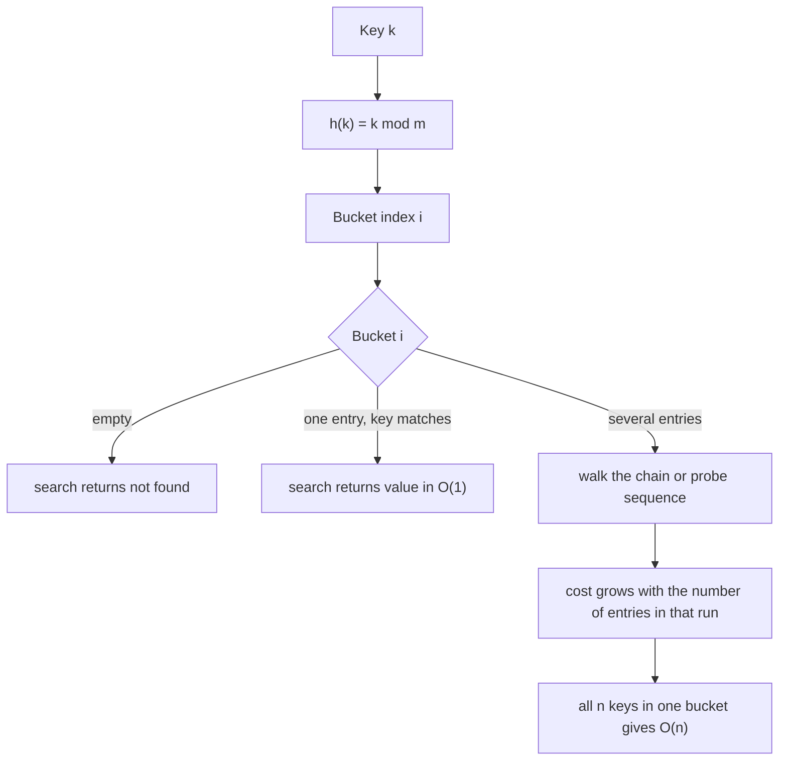

# Hash tables: the map ADT and hash functions

> [!info] An idea to get · 25 min · study Sun 11 Oct
> You will be able to state what insert, search and delete must do, compare the four implementations on slide 3 of Lecture 2 by their search and insert costs, and explain why hashing reaches O(1) on average. Covers the three properties of a good hash function — deterministic, uniform, fast — and the load factor alpha = n / m. Prevents claiming O(1) in the worst case: with every key landing in one bucket, search is O(n).

## Explainer

Slide 3 of Lecture 2 lists the dictionary (map) ADT as three operations: `insert(key, value)`, `search(key)`, `delete(key)`. That is the whole contract. A map is not a list with nicer syntax — it is a promise that given a key you can get its value back, and the only question that matters on the exam is what each implementation charges you for that promise.

Slide 3 gives the price list:

| Implementation | Search | Insert |
|---|---|---|
| Unsorted array | O(n) | O(1) |
| Sorted array | O(log n) | O(n) |
| Balanced binary search tree | O(log n) | O(log n) |
| Hash table | O(1) average | O(1) average |

Read the table as a trade, not a ranking. An unsorted array inserts in O(1) because you drop the pair at the end and walk away; search is O(n) because nothing about the position tells you where the key is. A sorted array buys O(log n) search with binary search and pays O(n) on insert, because a new key in the middle shifts everything after it. The balanced BST is the only one that refuses to be bad at either — O(log n) both ways — and that is why it costs you pointer bookkeeping and rotations.

The hash table is the odd one out because it is the only row with the word *average*. Nothing about a hash table makes search O(1) by construction. It makes search O(1) **when the keys are spread**, and the rest of this lesson is about what "spread" means and what happens when it fails.

The mechanism is two steps. A hash function turns the key into a bucket index. The table stores the entry in that bucket. Search recomputes the same index and looks only there. If the buckets hold roughly one entry each, that lookup touches one entry and the cost is constant. If every key lands in bucket 0, the lookup walks a list of n entries and the cost is O(n) — the same as the unsorted array, with extra arithmetic on top.

Slide 5 names the three properties a hash function must have: **deterministic** (the same key always gives the same index), **uniform** (keys spread evenly over the buckets), and **fast to compute, using the whole key**. Deterministic is not a nice-to-have. If `h("Ada")` returns 3 on insert and 5 on search, the entry is unreachable and the map is broken, not slow.

Slide 5 also gives the division method, `h(k) = k mod m`, with the warning to choose m prime and not close to a power of 2. The reason is uniformity. With m = 16, `k mod 16` keeps only the low 4 bits of k, so any set of keys that agrees in those bits — student IDs ending in 00, timestamps on a 16 ms tick — piles into one bucket. A prime m mixes all the bits of k into the index instead.

The last quantity is the **load factor** α = n / m, where n is the number of entries and m is the number of buckets. Slide 13 uses it to split the two collision strategies: separate chaining keeps entries in lists outside the array and lets α exceed 1, while open addressing keeps everything inside the array and must stay below 1. Both give O(1) average and O(n) worst case — slide 13 states both columns explicitly.

> [!quote]- Source: L2 · Slide 3
> "Operations: insert(key, value), search(key), delete(key)"
>
> The dictionary (map) ADT Operations: insert(key, value), search(key), delete(key) Implementation Search Insert Unsorted array O(n) O(1) Sorted array O(log n) O(n) Balanced binary search tree O(log n) O(log n) Hash table O(1) average O(1) average
> [Open the page](<../sources/CSC2103-L02-hash-tables.pdf#page=3>)

> [!quote]- Source: L2 · Slide 5
> "What makes a good hash function"
>
> What makes a good hash function Deterministic: the same key always gives the same index Uniform: spreads keys evenly over the buckets Fast to compute, and uses the whole key Division method: h(k) = k mod m; choose m prime, not close to a power of 2 Multiplication method: h(k) = ⌊m · (kA mod 1)⌋ with 0 < A < 1 (Knuth suggests A ≈ (√5 − 1)/2 ≈ 0.618) Strings: polynomial hash, for example h = h · 31 + code(c) for each character
> [Open the page](<../sources/CSC2103-L02-hash-tables.pdf#page=5>)

> [!quote]- Source: L2 · Slide 13
> "Where entries live lists outside the array inside the array"
>
> Chaining vs open addressing Separate chaining Open addressing Where entries live lists outside the array inside the array Load factor can exceed 1 must stay below 1 Deletion simple: remove from the list needs a tombstone ("deleted" marker) so probe sequences stay intact Cache behaviour pointer chasing good (contiguous probes) Average search / insert / delete O(1) O(1) Worst case O(n) O(n)
> [Open the page](<../sources/CSC2103-L02-hash-tables.pdf#page=13>)

## Diagram



*One hash function, three outcomes. The O(1) average lives on the middle branch; the O(n) worst case lives on the bottom one.*

> [!abstract]- Text version
> A flowchart: a key k is hashed by h(k) = k mod m to a bucket index. If the bucket is empty, search returns not found. If it holds one entry whose key matches, search returns the value in constant time. If it holds several entries, the search walks the chain or probe sequence, and the cost grows with the number of entries in that run; when all n keys land in one bucket the cost is O(n).

> [!quote]- Source: L2 · Slide 3
> "Operations: insert(key, value), search(key), delete(key)"
>
> The dictionary (map) ADT Operations: insert(key, value), search(key), delete(key) Implementation Search Insert Unsorted array O(n) O(1) Sorted array O(log n) O(n) Balanced binary search tree O(log n) O(log n) Hash table O(1) average O(1) average
> [Open the page](<../sources/CSC2103-L02-hash-tables.pdf#page=3>)

> [!quote]- Source: L2 · Slide 5
> "What makes a good hash function"
>
> What makes a good hash function Deterministic: the same key always gives the same index Uniform: spreads keys evenly over the buckets Fast to compute, and uses the whole key Division method: h(k) = k mod m; choose m prime, not close to a power of 2 Multiplication method: h(k) = ⌊m · (kA mod 1)⌋ with 0 < A < 1 (Knuth suggests A ≈ (√5 − 1)/2 ≈ 0.618) Strings: polynomial hash, for example h = h · 31 + code(c) for each character
> [Open the page](<../sources/CSC2103-L02-hash-tables.pdf#page=5>)

> [!quote]- Source: L2 · Slide 9
> "m = 7, h(k) = k mod 7"
>
> Chaining example m = 7, h(k) = k mod 7 Insert 50, 700, 76, 85, 92, 73, 101 (new entries go to the end of the chain) 50 → 1, 700 → 0, 76 → 6, 85 → 1, 92 → 1, 73 → 3, 101 → 3 Bucket Chain 0 700 1 50 → 85 → 92 2 (empty) 3 73 → 101 4 (empty) 5 (empty) 6 76
> [Open the page](<../sources/CSC2103-L02-hash-tables.pdf#page=9>)

> [!quote]- Source: L2 · Slide 11
> "m = 10, h(k) = k mod 10"
>
> Linear probing example m = 10, h(k) = k mod 10 Insert 89, 18, 49, 58, 69 49 → 9 taken, try 0: 2 probes 58 → 8, 9, 0 taken, try 1: 4 probes 69 → 9, 0, 1 taken, try 2: 4 probes Primary clustering: occupied runs grow and attract more collisions Slot Key 0 49 1 58 2 69 3 to 7 (empty) 8 18 9 89
> [Open the page](<../sources/CSC2103-L02-hash-tables.pdf#page=11>)

## Analogy

A hash table is a cloakroom with m numbered hooks. The hash function is the rule the attendant uses to decide which hook your coat goes on: `h(k) = k mod m`. Hand over a coat and the attendant computes the hook, hangs the coat, and writes nothing down. Come back with the same ticket and the attendant recomputes the same hook and finds your coat immediately — that is the O(1) average.

When two coats hash to the same hook, the attendant hangs the second coat on the same hook (chaining, slide 9: 50, 85 and 92 all hang on hook 1) or walks along the rail to the next free hook (open addressing, slide 11: 49 wants hook 9, finds it taken, takes hook 0). Either way you now have to look at more than one coat.

If every coat hashes to hook 1, the attendant stands at hook 1 and lifts coats one at a time until yours appears. That is O(n), and no amount of arithmetic changes it.

> [!warning] Where it breaks down
> The cloakroom has a physical rail, so a full hook is obvious and the attendant can see the whole row at a glance. A hash table has no such view: open addressing can only follow the probe sequence one slot at a time, which is why deleting an entry needs a tombstone (slide 13) rather than simply removing the coat — pulling a coat off the rail would break the chain of slots that later searches must walk through.

> [!quote]- Source: L2 · Slide 3
> "Operations: insert(key, value), search(key), delete(key)"
>
> The dictionary (map) ADT Operations: insert(key, value), search(key), delete(key) Implementation Search Insert Unsorted array O(n) O(1) Sorted array O(log n) O(n) Balanced binary search tree O(log n) O(log n) Hash table O(1) average O(1) average
> [Open the page](<../sources/CSC2103-L02-hash-tables.pdf#page=3>)

> [!quote]- Source: L2 · Slide 9
> "m = 7, h(k) = k mod 7"
>
> Chaining example m = 7, h(k) = k mod 7 Insert 50, 700, 76, 85, 92, 73, 101 (new entries go to the end of the chain) 50 → 1, 700 → 0, 76 → 6, 85 → 1, 92 → 1, 73 → 3, 101 → 3 Bucket Chain 0 700 1 50 → 85 → 92 2 (empty) 3 73 → 101 4 (empty) 5 (empty) 6 76
> [Open the page](<../sources/CSC2103-L02-hash-tables.pdf#page=9>)

> [!quote]- Source: L2 · Slide 11
> "m = 10, h(k) = k mod 10"
>
> Linear probing example m = 10, h(k) = k mod 10 Insert 89, 18, 49, 58, 69 49 → 9 taken, try 0: 2 probes 58 → 8, 9, 0 taken, try 1: 4 probes 69 → 9, 0, 1 taken, try 2: 4 probes Primary clustering: occupied runs grow and attract more collisions Slot Key 0 49 1 58 2 69 3 to 7 (empty) 8 18 9 89
> [Open the page](<../sources/CSC2103-L02-hash-tables.pdf#page=11>)

> [!quote]- Source: L2 · Slide 13
> "Where entries live lists outside the array inside the array"
>
> Chaining vs open addressing Separate chaining Open addressing Where entries live lists outside the array inside the array Load factor can exceed 1 must stay below 1 Deletion simple: remove from the list needs a tombstone ("deleted" marker) so probe sequences stay intact Cache behaviour pointer chasing good (contiguous probes) Average search / insert / delete O(1) O(1) Worst case O(n) O(n)
> [Open the page](<../sources/CSC2103-L02-hash-tables.pdf#page=13>)

## Insert 44, 57, 91, 18, 83 into m = 7 with h(k) = k mod 7, then search for 18

Chaining, m = 7, new entries go to the end of the chain (slide 9's convention).

| Key | k mod 7 | Bucket after insert |
|---|---|---|
| 44 | 44 − 42 = 2 | 2: 44 |
| 57 | 57 − 56 = 1 | 1: 57 |
| 91 | 91 − 91 = 0 | 0: 91 |
| 18 | 18 − 14 = 4 | 4: 18 |
| 83 | 83 − 77 = 6 | 6: 83 |

Every key landed in its own bucket, so α = 5/7 ≈ 0.71 and every search costs one comparison.

Now add 64 and 36, both of which collide:

| Key | k mod 7 | Bucket after insert |
|---|---|---|
| 64 | 64 − 63 = 1 | 1: 57 → 64 |
| 36 | 36 − 35 = 1 | 1: 57 → 64 → 36 |

`search(18)`: compute 18 mod 7 = 4, look at bucket 4, compare 18 with 18, return the value. **1 comparison.**

`search(36)`: compute 36 mod 7 = 1, look at bucket 1, compare 36 with 57 (no), compare 36 with 64 (no), compare 36 with 36 (yes). **3 comparisons.**

`search(50)`: compute 50 mod 7 = 1, walk the whole chain 57, 64, 36 and find nothing. **3 comparisons and a failed search** — the worst case for a lookup is a miss, because you must exhaust the chain to be sure.

With n = 7 and m = 7, α = 1.0. The average chain length is 1, but the longest chain is 3, and that is the number the exam will ask you to count.

> [!quote]- Source: L2 · Slide 5
> "What makes a good hash function"
>
> What makes a good hash function Deterministic: the same key always gives the same index Uniform: spreads keys evenly over the buckets Fast to compute, and uses the whole key Division method: h(k) = k mod m; choose m prime, not close to a power of 2 Multiplication method: h(k) = ⌊m · (kA mod 1)⌋ with 0 < A < 1 (Knuth suggests A ≈ (√5 − 1)/2 ≈ 0.618) Strings: polynomial hash, for example h = h · 31 + code(c) for each character
> [Open the page](<../sources/CSC2103-L02-hash-tables.pdf#page=5>)

> [!quote]- Source: L2 · Slide 9
> "m = 7, h(k) = k mod 7"
>
> Chaining example m = 7, h(k) = k mod 7 Insert 50, 700, 76, 85, 92, 73, 101 (new entries go to the end of the chain) 50 → 1, 700 → 0, 76 → 6, 85 → 1, 92 → 1, 73 → 3, 101 → 3 Bucket Chain 0 700 1 50 → 85 → 92 2 (empty) 3 73 → 101 4 (empty) 5 (empty) 6 76
> [Open the page](<../sources/CSC2103-L02-hash-tables.pdf#page=9>)

## Step by step

Trace a linear-probing insertion the way you will on paper, with slide 11's example: insert 89, 18, 49, 58, 69 into m = 10 with h(k) = k mod 10. Probe h(k), then h(k)+1, h(k)+2, wrapping past 9 back to 0, and count every slot you examine, the first one included.

### 1. Write the empty table and the rule

Draw slots 0 to 9. Write the rule at the top: `h(k) = k mod 10`, probe forward, wrap at 9 back to 0. Every probe is one slot examined, including the first.

> [!check] Check
> Ten empty slots, numbered 0 to 9.

### 2. Insert 89 and 18

89 mod 10 = 9: slot 9 is empty, so place 89 there. 18 mod 10 = 8: slot 8 is empty, so place 18 there. **1 probe each.**

> [!check] Check
> Slot 8 holds 18 and slot 9 holds 89.

### 3. Insert 49: the first collision

49 mod 10 = 9. Slot 9 holds 89, so probe on: wrap to slot 0, which is empty. Place 49 at slot 0. **2 probes** (slots 9, 0).

> [!warning]
> Count the home slot too. 49 has one collision but needs 2 probes; slide 11 writes it as '49 → 9 taken, try 0: 2 probes'.

> [!check] Check
> Slot 0 holds 49.

### 4. Insert 58: walk the run

58 mod 10 = 8. Slots 8 (18), 9 (89) and 0 (49) are taken, so the next try is slot 1, which is empty. Place 58 at slot 1. **4 probes** (slots 8, 9, 0, 1).

> [!check] Check
> Slot 1 holds 58.

### 5. Insert 69: the run grows again

69 mod 10 = 9. Slots 9 (89), 0 (49) and 1 (58) are taken, so try slot 2: empty. Place 69 at slot 2. **4 probes** (slots 9, 0, 1, 2).

> [!warning]
> This is primary clustering: the occupied run 8, 9, 0, 1 caught 69 and grew to 8, 9, 0, 1, 2. Any key that hashes into a run lands at its end and makes it longer.

> [!check] Check
> Slot 2 holds 69.

### 6. Write the final table

Final table: 0 → 49, 1 → 58, 2 → 69, 3 to 7 empty, 8 → 18, 9 → 89, exactly as on slide 11. Probes per insert: 1, 1, 2, 4, 4. Load factor α = 5/10 = 0.5.

> [!check] Check
> Five keys placed, slots 3 to 7 empty, and you can state the probe count of every insert.

> [!quote]- Source: L2 · Slide 11
> "m = 10, h(k) = k mod 10"
>
> Linear probing example m = 10, h(k) = k mod 10 Insert 89, 18, 49, 58, 69 49 → 9 taken, try 0: 2 probes 58 → 8, 9, 0 taken, try 1: 4 probes 69 → 9, 0, 1 taken, try 2: 4 probes Primary clustering: occupied runs grow and attract more collisions Slot Key 0 49 1 58 2 69 3 to 7 (empty) 8 18 9 89
> [Open the page](<../sources/CSC2103-L02-hash-tables.pdf#page=11>)

## A common mix-up

> [!failure] The belief
> A hash table search is O(1), so it is always at least as fast as a balanced BST.

**Why it seems right.** Slide 3 prints "Hash table — Search: O(1) average" right next to "Balanced binary search tree — Search: O(log n)", and the average is the case you see in every example you have traced. The examples on slides 9 and 11 use small prime m and a handful of keys, so chains stay short and the average really is close to one comparison.

> [!success] What is true
> Slide 13 lists the worst case for both chaining and open addressing as O(n), and the average only holds when the hash function is uniform and α is kept in check. If every key hashes to the same bucket, search walks all n entries — strictly worse than a balanced BST's guaranteed O(log n), because you also paid the hash computation. The balanced BST's O(log n) is a worst-case bound; the hash table's O(1) is an average that depends on a property of your hash function, not on the data structure alone. On an exam, "O(1)" written without "average" for a hash table is a lost mark.

> [!quote]- Source: L2 · Slide 3
> "Operations: insert(key, value), search(key), delete(key)"
>
> The dictionary (map) ADT Operations: insert(key, value), search(key), delete(key) Implementation Search Insert Unsorted array O(n) O(1) Sorted array O(log n) O(n) Balanced binary search tree O(log n) O(log n) Hash table O(1) average O(1) average
> [Open the page](<../sources/CSC2103-L02-hash-tables.pdf#page=3>)

> [!quote]- Source: L2 · Slide 13
> "Where entries live lists outside the array inside the array"
>
> Chaining vs open addressing Separate chaining Open addressing Where entries live lists outside the array inside the array Load factor can exceed 1 must stay below 1 Deletion simple: remove from the list needs a tombstone ("deleted" marker) so probe sequences stay intact Cache behaviour pointer chasing good (contiguous probes) Average search / insert / delete O(1) O(1) Worst case O(n) O(n)
> [Open the page](<../sources/CSC2103-L02-hash-tables.pdf#page=13>)

> [!quote]- Source: L2 · Slide 9
> "m = 7, h(k) = k mod 7"
>
> Chaining example m = 7, h(k) = k mod 7 Insert 50, 700, 76, 85, 92, 73, 101 (new entries go to the end of the chain) 50 → 1, 700 → 0, 76 → 6, 85 → 1, 92 → 1, 73 → 3, 101 → 3 Bucket Chain 0 700 1 50 → 85 → 92 2 (empty) 3 73 → 101 4 (empty) 5 (empty) 6 76
> [Open the page](<../sources/CSC2103-L02-hash-tables.pdf#page=9>)

> [!quote]- Source: L2 · Slide 11
> "m = 10, h(k) = k mod 10"
>
> Linear probing example m = 10, h(k) = k mod 10 Insert 89, 18, 49, 58, 69 49 → 9 taken, try 0: 2 probes 58 → 8, 9, 0 taken, try 1: 4 probes 69 → 9, 0, 1 taken, try 2: 4 probes Primary clustering: occupied runs grow and attract more collisions Slot Key 0 49 1 58 2 69 3 to 7 (empty) 8 18 9 89
> [Open the page](<../sources/CSC2103-L02-hash-tables.pdf#page=11>)

## Exercise

Write `buildChains(keys, m)` in JavaScript. It takes an array of integer keys and the bucket count `m`, and returns an array of length `m`. Element `i` is an array holding every key `k` from `keys` with `k % m === i`, in the order those keys appeared in `keys`.

Use `k % m` for the hash. Push each key onto the end of its bucket's array, so the chain reads left to right in insertion order — slide 9's convention. Do not sort the keys and do not deduplicate them.
**Done looks like:** `buildChains([50, 700, 76, 85, 92, 73, 101], 7)[1]` returns `[50,85,92]`.

```js
function buildChains(keys, m) {
  // Return an array of length m. Each element is an array of the keys
  // that hash to that bucket, in insertion order.
  // Use h(k) = k mod m. New entries go to the end of the chain.
}
```

Tests:

- slide 9 chain for bucket 1: `buildChains([50, 700, 76, 85, 92, 73, 101], 7)[1]` → `[50,85,92]`
- slide 9 chain for bucket 3: `buildChains([50, 700, 76, 85, 92, 73, 101], 7)[3]` → `[73,101]`
- every bucket exists, empty ones included: `buildChains([50, 700, 76, 85, 92, 73, 101], 7).length` → `7`
- empty input still returns m buckets: `buildChains([], 5).length` → `5`
- duplicate keys both stay in the chain: `buildChains([12, 19, 12], 7)[5]` → `[12,19,12]`

> [!tip]- Hints
> - Build the outer array first: `Array.from({ length: m }, () => [])` gives you m independent empty arrays. `new Array(m).fill([])` does not — every slot would share one array.
> - For each key, compute `k % m` and push the key onto `buckets[k % m]`.
> - Check the empty-input test: your loop over `keys` never runs, but the outer array must still have length m.

> [!question] Q1 · code
> Write `buildChains(keys, m)` in JavaScript. It returns an array of length `m`; element `i` is the array of keys `k` from `keys` with `k % m === i`, in insertion order, duplicates kept. Empty buckets are empty arrays, not missing slots.

> [!success]- Answer
> Run the tests in the course page.

> [!quote]- Source: L2 · Slide 5
> "What makes a good hash function"
>
> What makes a good hash function Deterministic: the same key always gives the same index Uniform: spreads keys evenly over the buckets Fast to compute, and uses the whole key Division method: h(k) = k mod m; choose m prime, not close to a power of 2 Multiplication method: h(k) = ⌊m · (kA mod 1)⌋ with 0 < A < 1 (Knuth suggests A ≈ (√5 − 1)/2 ≈ 0.618) Strings: polynomial hash, for example h = h · 31 + code(c) for each character
> [Open the page](<../sources/CSC2103-L02-hash-tables.pdf#page=5>)

> [!quote]- Source: L2 · Slide 9
> "m = 7, h(k) = k mod 7"
>
> Chaining example m = 7, h(k) = k mod 7 Insert 50, 700, 76, 85, 92, 73, 101 (new entries go to the end of the chain) 50 → 1, 700 → 0, 76 → 6, 85 → 1, 92 → 1, 73 → 3, 101 → 3 Bucket Chain 0 700 1 50 → 85 → 92 2 (empty) 3 73 → 101 4 (empty) 5 (empty) 6 76
> [Open the page](<../sources/CSC2103-L02-hash-tables.pdf#page=9>)

## Check yourself

One trace, one explanation, one trade-off. Answer from the slides, not from memory of a library.

> [!question] Q2 · ordering
> Keys 24, 34, 50, 44, 89, 99 are inserted in that order into an initially empty table of size m = 10 using h(k) = k mod 10 and linear probing, probing h(k), h(k)+1, h(k)+2 and wrapping past 9 back to 0. Put the keys in the order of the slots they end up in, from slot 0 upward.
>
> Put in order:
> - a) 24
> - b) 34
> - c) 50
> - d) 44
> - e) 89
> - f) 99

> [!success]- Answer
> c) 50 → f) 99 → a) 24 → b) 34 → d) 44 → e) 89
>
> 24 → slot 4. 34 → 4 is taken, so slot 5. 50 → slot 0. 44 → 4 and 5 are taken, so slot 6. 89 → slot 9. 99 → 9 is taken, wrap to 0 (taken by 50), so slot 1. Reading the occupied slots from 0 upward: 50 (0), 99 (1), 24 (4), 34 (5), 44 (6), 89 (9).

> [!quote]- Source: L2 · Slide 11
> "49 → 9 taken, try 0: 2 probes"
>
> Linear probing example m = 10, h(k) = k mod 10 Insert 89, 18, 49, 58, 69 49 → 9 taken, try 0: 2 probes 58 → 8, 9, 0 taken, try 1: 4 probes 69 → 9, 0, 1 taken, try 2: 4 probes Primary clustering: occupied runs grow and attract more collisions Slot Key 0 49 1 58 2 69 3 to 7 (empty) 8 18 9 89
> [Open the page](<../sources/CSC2103-L02-hash-tables.pdf#page=11>)

> [!question] Q3 · short answer
> Explain what primary clustering is and why linear probing produces it. Then state one way double hashing reduces it.

> [!success]- Answer
> Primary clustering is the growth of contiguous runs of occupied slots. Linear probing causes it because every key that hashes into a run probes forward one slot at a time and lands at the end of that run, lengthening it, so the run attracts still more keys. Double hashing reduces it by making the step size depend on the key, so two keys that collide at the same slot probe different sequences instead of both walking the same consecutive slots.
>
> Occupied runs grow because linear probing walks consecutive slots, and slide 11 shows this with 89 in slot 9, 49 in slot 0, 58 in slot 1 and 69 in slot 2. Double hashing varies the step per key, so colliding keys do not share one probe sequence.

> [!quote]- Source: L2 · Slide 11
> "Primary clustering: occupied runs grow and attract more collisions"
>
> Linear probing example m = 10, h(k) = k mod 10 Insert 89, 18, 49, 58, 69 49 → 9 taken, try 0: 2 probes 58 → 8, 9, 0 taken, try 1: 4 probes 69 → 9, 0, 1 taken, try 2: 4 probes Primary clustering: occupied runs grow and attract more collisions Slot Key 0 49 1 58 2 69 3 to 7 (empty) 8 18 9 89
> [Open the page](<../sources/CSC2103-L02-hash-tables.pdf#page=11>)

> [!question] Q4 · mcq
> A hash table uses separate chaining with m = 8 buckets and holds n = 20 entries. A classmate says the table is over-full and must be resized before any more inserts. Which statement is correct?
>
> - a) The classmate is right: α = 2.5 exceeds 1, and no hash table may exceed α = 1.
> - b) The classmate is wrong: with chaining α may exceed 1, and the cost is longer chains and a higher average probe count.
> - c) The classmate is right: α = 2.5 means 2.5 buckets are already full and the next insert will fail.
> - d) The classmate is wrong: α measures only the number of empty buckets, which is still 8 − 20.

> [!success]- Answer
> b) The classmate is wrong: with chaining α may exceed 1, and the cost is longer chains and a higher average probe count.
>
> Slide 13 puts the α ≤ 1 limit on open addressing only, because there every entry must occupy a slot in the array. Separate chaining stores entries in lists outside the array, so α can exceed 1; the cost is that the average chain length is α = 20/8 = 2.5, which raises the average search cost even though it stays O(1) average.

> [!quote]- Source: L2 · Slide 13
> "Load factor can exceed 1 must stay below 1"
>
> Chaining vs open addressing Separate chaining Open addressing Where entries live lists outside the array inside the array Load factor can exceed 1 must stay below 1 Deletion simple: remove from the list needs a tombstone ("deleted" marker) so probe sequences stay intact Cache behaviour pointer chasing good (contiguous probes) Average search / insert / delete O(1) O(1) Worst case O(n) O(n)
> [Open the page](<../sources/CSC2103-L02-hash-tables.pdf#page=13>)

> [!question] Q5 · numeric
> Slide 9 inserts 50, 700, 76, 85, 92, 73, 101 into a chained table with m = 7 and h(k) = k mod 7, adding each new entry at the end of its chain. A search for 57, which is not in the table, compares 57 with every key in its chain. How many key comparisons does it make? Give your answer in comparisons.

> [!success]- Answer
> 3 comparisons
>
> 57 mod 7 = 1, because 57 = 8 × 7 + 1. Bucket 1 holds the chain 50 → 85 → 92, and 57 is not in it, so the search compares 57 with all three keys before it reaches the end of the chain: 3 comparisons.

> [!quote]- Source: L2 · Slide 9
> "Bucket Chain 0 700 1 50 → 85 → 92"
>
> Chaining example m = 7, h(k) = k mod 7 Insert 50, 700, 76, 85, 92, 73, 101 (new entries go to the end of the chain) 50 → 1, 700 → 0, 76 → 6, 85 → 1, 92 → 1, 73 → 3, 101 → 3 Bucket Chain 0 700 1 50 → 85 → 92 2 (empty) 3 73 → 101 4 (empty) 5 (empty) 6 76
> [Open the page](<../sources/CSC2103-L02-hash-tables.pdf#page=9>)

> [!quote]- Source: L2 · Slide 3
> "Operations: insert(key, value), search(key), delete(key)"
>
> The dictionary (map) ADT Operations: insert(key, value), search(key), delete(key) Implementation Search Insert Unsorted array O(n) O(1) Sorted array O(log n) O(n) Balanced binary search tree O(log n) O(log n) Hash table O(1) average O(1) average
> [Open the page](<../sources/CSC2103-L02-hash-tables.pdf#page=3>)

> [!quote]- Source: L2 · Slide 5
> "What makes a good hash function"
>
> What makes a good hash function Deterministic: the same key always gives the same index Uniform: spreads keys evenly over the buckets Fast to compute, and uses the whole key Division method: h(k) = k mod m; choose m prime, not close to a power of 2 Multiplication method: h(k) = ⌊m · (kA mod 1)⌋ with 0 < A < 1 (Knuth suggests A ≈ (√5 − 1)/2 ≈ 0.618) Strings: polynomial hash, for example h = h · 31 + code(c) for each character
> [Open the page](<../sources/CSC2103-L02-hash-tables.pdf#page=5>)

> [!quote]- Source: L2 · Slide 9
> "m = 7, h(k) = k mod 7"
>
> Chaining example m = 7, h(k) = k mod 7 Insert 50, 700, 76, 85, 92, 73, 101 (new entries go to the end of the chain) 50 → 1, 700 → 0, 76 → 6, 85 → 1, 92 → 1, 73 → 3, 101 → 3 Bucket Chain 0 700 1 50 → 85 → 92 2 (empty) 3 73 → 101 4 (empty) 5 (empty) 6 76
> [Open the page](<../sources/CSC2103-L02-hash-tables.pdf#page=9>)

> [!quote]- Source: L2 · Slide 11
> "m = 10, h(k) = k mod 10"
>
> Linear probing example m = 10, h(k) = k mod 10 Insert 89, 18, 49, 58, 69 49 → 9 taken, try 0: 2 probes 58 → 8, 9, 0 taken, try 1: 4 probes 69 → 9, 0, 1 taken, try 2: 4 probes Primary clustering: occupied runs grow and attract more collisions Slot Key 0 49 1 58 2 69 3 to 7 (empty) 8 18 9 89
> [Open the page](<../sources/CSC2103-L02-hash-tables.pdf#page=11>)

> [!quote]- Source: L2 · Slide 13
> "Where entries live lists outside the array inside the array"
>
> Chaining vs open addressing Separate chaining Open addressing Where entries live lists outside the array inside the array Load factor can exceed 1 must stay below 1 Deletion simple: remove from the list needs a tombstone ("deleted" marker) so probe sequences stay intact Cache behaviour pointer chasing good (contiguous probes) Average search / insert / delete O(1) O(1) Worst case O(n) O(n)
> [Open the page](<../sources/CSC2103-L02-hash-tables.pdf#page=13>)

## Reflect

> [!question] Reflect
> Last year's paper asks you to state the number of probes needed to insert a key into a linear-probing table. Before you move on, write down the one sentence you would give a classmate who counts only the collisions and forgets to count the first probe. Then check it against the probe counts you wrote in the walkthrough.

> [!quote]- Source: L2 · Slide 11
> "m = 10, h(k) = k mod 10"
>
> Linear probing example m = 10, h(k) = k mod 10 Insert 89, 18, 49, 58, 69 49 → 9 taken, try 0: 2 probes 58 → 8, 9, 0 taken, try 1: 4 probes 69 → 9, 0, 1 taken, try 2: 4 probes Primary clustering: occupied runs grow and attract more collisions Slot Key 0 49 1 58 2 69 3 to 7 (empty) 8 18 9 89
> [Open the page](<../sources/CSC2103-L02-hash-tables.pdf#page=11>)

---

*Made with BiliMind from your own files. Course: CSC2103 Data Structures final.*
