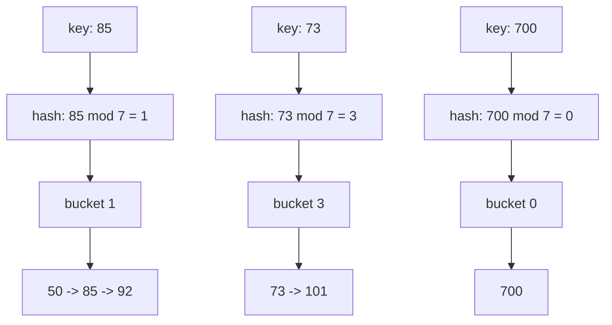

# Hash tables: from keys to buckets

> [!info] An idea to get · 30 min · study Mon 12 Oct
> You will be able to trace insert, search and delete for a hash table that uses chaining or linear probing, and compute its load factor. Covers the dictionary ADT from slide 3 of Lecture 2, what makes a hash function good, and the m = 7 chaining and m = 10 probing worked examples from slides 9–11. Prevents choosing a hash function that ignores most buckets or pushing load factor past 0.75 in open addressing.

## Explainer

You've seen arrays and linked lists store things in a straight line. A hash table throws away the line. It gives every key a number — the bucket — and drops the value into that bucket, so a search becomes one jump instead of a walk. That is the whole trick, and it is why the dictionary ADT on slide 3 of Lecture 2 lists hash tables as O(1) average for insert, search and delete.

The dictionary ADT has three operations: insert(key, value), search(key), delete(key). A hash table implements them with an array of m buckets and a hash function that maps a key to an index: index = hash(key) mod m. Slide 4 shows the simplest version: with m = 10 and h(k) = k mod 10, the key 23 lands in bucket 3, 47 in bucket 7, 81 in bucket 1. If every key lands in its own bucket, search is a single array access.

The catch: keys collide. Two different keys can map to the same bucket. The two ways to survive collisions are the two designs you must know for the exam:

- **Separate chaining** (slide 9): each bucket holds a linked list. New entries go to the end of the chain. Load factor can exceed 1.
- **Open addressing** (slide 10): every entry lives inside the bucket array itself. On a collision you follow a probe sequence until you find an empty slot. Load factor must stay below 1.

What makes a hash function good (slide 5): deterministic — same key, same index; uniform — spreads keys evenly; fast and uses the whole key. The division method h(k) = k mod m works best when m is prime and not close to a power of 2. Strings use a polynomial hash: h = h · 31 + code(c) for each character.

The load factor α = n / m (slide 7) decides how fast operations run. As α grows, collisions grow. Open addressing slows down badly as α approaches 1 — slide 12 shows unsuccessful search taking 50.5 probes at α = 0.90. That is why tables resize: allocate a bigger table (often double) and re-insert every entry. Java's HashMap resizes when α exceeds 0.75. Chaining tolerates α between 1 and 3.

You already know how to trace a linked list; now you trace where each key lands and what happens when two land in the same place.

> [!quote]- Source: L2 · Slide 3
> "Operations: insert(key, value), search(key), delete(key)"
>
> The dictionary (map) ADT Operations: insert(key, value), search(key), delete(key) Implementation Search Insert Unsorted array O(n) O(1) Sorted array O(log n) O(n) Balanced binary search tree O(log n) O(log n) Hash table O(1) average O(1) average
> [Open the page](<../sources/CSC2103-L02-hash-tables.pdf#page=3>)

> [!quote]- Source: L2 · Slide 4
> "An array of m buckets (slots)"
>
> Hash table: the idea An array of m buckets (slots) A hash function turns a key into an index: index = hash(key) mod m Example: m = 10, h(k) = k mod 10 23 → bucket 3 47 → bucket 7 81 → bucket 1 If every key gets its own bucket, search is a single array access
> [Open the page](<../sources/CSC2103-L02-hash-tables.pdf#page=4>)

> [!quote]- Source: L2 · Slide 5
> "What makes a good hash function"
>
> What makes a good hash function Deterministic: the same key always gives the same index Uniform: spreads keys evenly over the buckets Fast to compute, and uses the whole key Division method: h(k) = k mod m; choose m prime, not close to a power of 2 Multiplication method: h(k) = ⌊m · (kA mod 1)⌋ with 0 < A < 1 (Knuth suggests A ≈ (√5 − 1)/2 ≈ 0.618) Strings: polynomial hash, for example h = h · 31 + code(c) for each character
> [Open the page](<../sources/CSC2103-L02-hash-tables.pdf#page=5>)

> [!quote]- Source: L2 · Slide 7
> "Load factor α = n / m (n entries, m buckets)"
>
> Load factor Load factor α = n / m (n entries, m buckets) As α grows, collisions grow and operations slow down Typical thresholds: about 0.6 to 0.75 for open addressing; between 1 and 3 for separate chaining Java's HashMap resizes when α exceeds its default load factor of 0.75 Resize (rehash): allocate a bigger table (often double) and re-insert every entry: O(n), but O(1) amortised per insert
> [Open the page](<../sources/CSC2103-L02-hash-tables.pdf#page=7>)

> [!quote]- Source: L2 · Slide 9
> "m = 7, h(k) = k mod 7"
>
> Chaining example m = 7, h(k) = k mod 7 Insert 50, 700, 76, 85, 92, 73, 101 (new entries go to the end of the chain) 50 → 1, 700 → 0, 76 → 6, 85 → 1, 92 → 1, 73 → 3, 101 → 3 Bucket Chain 0 700 1 50 → 85 → 92 2 (empty) 3 73 → 101 4 (empty) 5 (empty) 6 76
> [Open the page](<../sources/CSC2103-L02-hash-tables.pdf#page=9>)

> [!quote]- Source: L2 · Slide 10
> "Every entry is stored in the bucket array itself; needs α ≤ 1"
>
> Open addressing Every entry is stored in the bucket array itself; needs α ≤ 1 On a collision, follow a probe sequence h(k, 0), h(k, 1), h(k, 2), … until an empty slot Linear probing: h(k, i) = (h(k) + i) mod m Quadratic probing: h(k, i) = (h(k) + c₁i + c₂i²) mod m Double hashing: h(k, i) = (h₁(k) + i · h₂(k)) mod m, where h₂(k) is never 0
> [Open the page](<../sources/CSC2103-L02-hash-tables.pdf#page=10>)

> [!quote]- Source: L2 · Slide 11
> "m = 10, h(k) = k mod 10"
>
> Linear probing example m = 10, h(k) = k mod 10 Insert 89, 18, 49, 58, 69 49 → 9 taken, try 0: 2 probes 58 → 8, 9, 0 taken, try 1: 4 probes 69 → 9, 0, 1 taken, try 2: 4 probes Primary clustering: occupied runs grow and attract more collisions Slot Key 0 49 1 58 2 69 3 to 7 (empty) 8 18 9 89
> [Open the page](<../sources/CSC2103-L02-hash-tables.pdf#page=11>)

> [!quote]- Source: L2 · Slide 12
> "Expected probes with linear probing"
>
> Expected probes with linear probing Knuth's estimates for a table with load factor α: successful search ≈ ½ (1 + 1/(1 − α)) unsuccessful search (or insert) ≈ ½ (1 + 1/(1 − α)²) Load factor α Successful Unsuccessful 0.50 1.5 2.5 0.75 2.5 8.5 0.90 5.5 50.5 Probes explode as α approaches 1: keep α well below 1 with open addressing.
> [Open the page](<../sources/CSC2103-L02-hash-tables.pdf#page=12>)

> [!quote]- Source: L2 · Slide 13
> "Where entries live lists outside the array inside the array"
>
> Chaining vs open addressing Separate chaining Open addressing Where entries live lists outside the array inside the array Load factor can exceed 1 must stay below 1 Deletion simple: remove from the list needs a tombstone ("deleted" marker) so probe sequences stay intact Cache behaviour pointer chasing good (contiguous probes) Average search / insert / delete O(1) O(1) Worst case O(n) O(n)
> [Open the page](<../sources/CSC2103-L02-hash-tables.pdf#page=13>)

## Diagram



*Chaining with m = 7, from slide 9. Each bucket holds a chain; new keys go to the end.*

> [!abstract]- Text version
> Flowchart showing three keys hashing to buckets 1, 3 and 0, with chains 50->85->92, 73->101 and 700.

> [!quote]- Source: L2 · Slide 9
> "m = 7, h(k) = k mod 7"
>
> Chaining example m = 7, h(k) = k mod 7 Insert 50, 700, 76, 85, 92, 73, 101 (new entries go to the end of the chain) 50 → 1, 700 → 0, 76 → 6, 85 → 1, 92 → 1, 73 → 3, 101 → 3 Bucket Chain 0 700 1 50 → 85 → 92 2 (empty) 3 73 → 101 4 (empty) 5 (empty) 6 76
> [Open the page](<../sources/CSC2103-L02-hash-tables.pdf#page=9>)

## Analogy

Think of a hash table as a coat check in a theatre. The attendant has m numbered hooks. When you hand over your coat, they compute a number from your name (the hash) and hang the coat on that hook. Later you say your name, they recompute the number, walk straight to the hook, and grab your coat. That is O(1) — no searching through a pile.

When two people get the same hook number, the attendant has two options. Chaining: they put a rail next to the hook and hang both coats on it, one behind the other. Open addressing: they walk to the next empty hook and put the second coat there — but then when you come back, they have to check the first hook, then the next, then the next, until they find yours.

The load factor is how many coats per hook. If the theatre is nearly empty, the attendant almost always finds the right hook immediately. If it is packed, they spend all night walking down the row of hooks — that is the probe explosion.

> [!warning] Where it breaks down
> A real coat check attendant can remember where they put a coat that was moved to a different hook. A hash table cannot: the probe sequence is deterministic and the only memory is the array itself. Also, real names are not uniformly distributed, which is exactly why hash functions need to be uniform — the coat check does not have that problem.

> [!quote]- Source: L2 · Slide 15
> "Hash tables give O(1) average search, insert and delete; O(n) in the worst case"
>
> Summary and tutorial Hash tables give O(1) average search, insert and delete; O(n) in the worst case Collisions: chaining (lists per bucket) or open addressing (probe the array) Keep the load factor low and resize by doubling Tutorial 2: (1) Insert 10, 22, 31, 4, 15, 28, 17, 88, 59 into a table of size 11 with h(k) = k mod 11 using linear probing, then using chaining. (2) Why must h₂(k) never be 0 in double hashing? (3) Compute the expected unsuccessful-search probes for α = 0.8.
> [Open the page](<../sources/CSC2103-L02-hash-tables.pdf#page=15>)

> [!quote]- Source: L2 · Slide 5
> "What makes a good hash function"
>
> What makes a good hash function Deterministic: the same key always gives the same index Uniform: spreads keys evenly over the buckets Fast to compute, and uses the whole key Division method: h(k) = k mod m; choose m prime, not close to a power of 2 Multiplication method: h(k) = ⌊m · (kA mod 1)⌋ with 0 < A < 1 (Knuth suggests A ≈ (√5 − 1)/2 ≈ 0.618) Strings: polynomial hash, for example h = h · 31 + code(c) for each character
> [Open the page](<../sources/CSC2103-L02-hash-tables.pdf#page=5>)

## Step by step

Trace the linear probing example from slide 11: m = 10, h(k) = k mod 10, insert 89, 18, 49, 58, 69. This is the exact skill Q2b on last year's paper tests.

### 1. Insert 89

89 mod 10 = 9. Slot 9 is empty.

> [!check] Check
> Slot 9 holds 89.

### 2. Insert 18

18 mod 10 = 8. Slot 8 is empty.

> [!check] Check
> Slot 8 holds 18.

### 3. Insert 49 — first collision

49 mod 10 = 9, but slot 9 is taken. Probe i=1: slot 0 is empty. 2 probes total.

> [!warning]
> Remember to count the initial attempt as probe 1.

> [!check] Check
> Slot 0 holds 49.

### 4. Insert 58 — a longer probe

58 mod 10 = 8, taken. i=1: slot 9 taken. i=2: slot 0 taken. i=3: slot 1 empty. 4 probes.

> [!warning]
> Do not skip a slot just because it holds a key that hashed elsewhere.

> [!check] Check
> Slot 1 holds 58.

### 5. Insert 69

69 mod 10 = 9, taken. i=1: slot 0 taken. i=2: slot 1 taken. i=3: slot 2 empty. 4 probes.

> [!check] Check
> Slot 2 holds 69. Final table: 0:49, 1:58, 2:69, 8:18, 9:89.

> [!quote]- Source: L2 · Slide 11
> "m = 10, h(k) = k mod 10"
>
> Linear probing example m = 10, h(k) = k mod 10 Insert 89, 18, 49, 58, 69 49 → 9 taken, try 0: 2 probes 58 → 8, 9, 0 taken, try 1: 4 probes 69 → 9, 0, 1 taken, try 2: 4 probes Primary clustering: occupied runs grow and attract more collisions Slot Key 0 49 1 58 2 69 3 to 7 (empty) 8 18 9 89
> [Open the page](<../sources/CSC2103-L02-hash-tables.pdf#page=11>)

## A common mix-up

> [!failure] The belief
> A good hash function just needs to be fast to compute — any function that turns a key into a number will do.

**Why it seems right.** The hash function is just a calculation; the table does the real work. If the function is fast, the whole operation feels fast.

> [!success] What is true
> Slide 5 requires a good hash function to be uniform — spread keys evenly over the buckets. If h(k) = k mod 10 and all your keys end in 0, every key lands in bucket 0 and the table degrades to a single linked list: O(n) search. A fast hash that ignores most buckets is worse than a slower one that spreads keys out.

> [!quote]- Source: L2 · Slide 5
> "What makes a good hash function"
>
> What makes a good hash function Deterministic: the same key always gives the same index Uniform: spreads keys evenly over the buckets Fast to compute, and uses the whole key Division method: h(k) = k mod m; choose m prime, not close to a power of 2 Multiplication method: h(k) = ⌊m · (kA mod 1)⌋ with 0 < A < 1 (Knuth suggests A ≈ (√5 − 1)/2 ≈ 0.618) Strings: polynomial hash, for example h = h · 31 + code(c) for each character
> [Open the page](<../sources/CSC2103-L02-hash-tables.pdf#page=5>)

## Chaining with m = 7 — slide 9 traced

Insert 50, 700, 76, 85, 92, 73, 101 into a table with m = 7, h(k) = k mod 7. New entries go to the end of the chain.

- 50 mod 7 = 1 → bucket 1: [50]
- 700 mod 7 = 0 → bucket 0: [700]
- 76 mod 7 = 6 → bucket 6: [76]
- 85 mod 7 = 1 → bucket 1: [50, 85]
- 92 mod 7 = 1 → bucket 1: [50, 85, 92]
- 73 mod 7 = 3 → bucket 3: [73]
- 101 mod 7 = 3 → bucket 3: [73, 101]

Final chains: bucket 0: 700; bucket 1: 50 → 85 → 92; bucket 3: 73 → 101; bucket 6: 76. Buckets 2, 4, 5 empty.

Search for 92: hash once, walk the chain — 3 comparisons. No probing, no tombstones.

> [!quote]- Source: L2 · Slide 9
> "m = 7, h(k) = k mod 7"
>
> Chaining example m = 7, h(k) = k mod 7 Insert 50, 700, 76, 85, 92, 73, 101 (new entries go to the end of the chain) 50 → 1, 700 → 0, 76 → 6, 85 → 1, 92 → 1, 73 → 3, 101 → 3 Bucket Chain 0 700 1 50 → 85 → 92 2 (empty) 3 73 → 101 4 (empty) 5 (empty) 6 76
> [Open the page](<../sources/CSC2103-L02-hash-tables.pdf#page=9>)

## Comparison

Slide 13 lays out the two collision strategies side by side. The choice matters for deletion, load factor and cache behaviour.

| | Where entries live | Load factor | Deletion | Cache behaviour | Worst case |
|---|---|---|---|---|---|
| **Separate chaining** | lists outside the array | can exceed 1 | simple: remove from the list | pointer chasing | O(n) |
| **Open addressing** | inside the array | must stay below 1 | needs a tombstone marker | good: contiguous probes | O(n) |

- **Separate chaining** is best for when you expect many collisions or need simple deletion without tombstones.

- **Open addressing** is best for when the table stays small and you want to avoid pointer chasing and memory overhead.

> [!quote]- Source: L2 · Slide 13
> "Where entries live lists outside the array inside the array"
>
> Chaining vs open addressing Separate chaining Open addressing Where entries live lists outside the array inside the array Load factor can exceed 1 must stay below 1 Deletion simple: remove from the list needs a tombstone ("deleted" marker) so probe sequences stay intact Cache behaviour pointer chasing good (contiguous probes) Average search / insert / delete O(1) O(1) Worst case O(n) O(n)
> [Open the page](<../sources/CSC2103-L02-hash-tables.pdf#page=13>)

## Check yourself

Check the core mechanics before you move on.

> [!question] Q1 · mcq
> A hash table uses linear probing with m = 10 and h(k) = k mod 10. Keys 89, 18, 49, 58, 69 are inserted in that order. How many probes does inserting 69 take?
>
> - a) 1
> - b) 2
> - c) 3
> - d) 4

> [!success]- Answer
> d) 4
>
> 69 hashes to 9, which is occupied, then 0 and 1 are occupied, so 69 lands in slot 2 after 4 probes.

> [!quote]- Source: L2 · Slide 11
> "69 → 9, 0, 1 taken, try 2: 4 probes"
>
> Linear probing example m = 10, h(k) = k mod 10 Insert 89, 18, 49, 58, 69 49 → 9 taken, try 0: 2 probes 58 → 8, 9, 0 taken, try 1: 4 probes 69 → 9, 0, 1 taken, try 2: 4 probes Primary clustering: occupied runs grow and attract more collisions Slot Key 0 49 1 58 2 69 3 to 7 (empty) 8 18 9 89
> [Open the page](<../sources/CSC2103-L02-hash-tables.pdf#page=11>)

> [!question] Q2 · numeric
> For linear probing, the expected number of probes for an unsuccessful search is approximately ½(1 + 1/(1 − α)²). Compute this value for α = 0.8. Give your answer to one decimal place.
>
> *Beyond your slides: the Checker found no support for this in your files.*

> [!success]- Answer
> 13 probes (± 0.1)
>
> With α = 0.8, the denominator (1−α)² is 0.04, so 1/0.04 = 25, giving (1+25)/2 = 13 probes.

> [!quote]- Source: L2 · Slide 15
> "(3) Compute the expected unsuccessful-search probes for α = 0.8."
>
> Summary and tutorial Hash tables give O(1) average search, insert and delete; O(n) in the worst case Collisions: chaining (lists per bucket) or open addressing (probe the array) Keep the load factor low and resize by doubling Tutorial 2: (1) Insert 10, 22, 31, 4, 15, 28, 17, 88, 59 into a table of size 11 with h(k) = k mod 11 using linear probing, then using chaining. (2) Why must h₂(k) never be 0 in double hashing? (3) Compute the expected unsuccessful-search probes for α = 0.8.
> [Open the page](<../sources/CSC2103-L02-hash-tables.pdf#page=15>)

> [!question] Q3 · short answer
> Explain what primary clustering is and why it occurs with linear probing. Then describe how double hashing reduces it.
>
> *Beyond your slides: the Checker found no support for this in your files.*

> [!success]- Answer
> Primary clustering is the tendency of linear probing to form long contiguous runs of occupied slots. It occurs because when a collision happens, the probe sequence only moves to the next slot, so any key that hashes into the run extends it. Double hashing reduces it because the probe step size depends on a second hash function h₂(k), so keys that collide at the same slot take different probe paths and do not all pile up in the same run.
>
> | Criterion | Excellent | Acceptable |
> |---|---|---|
> | Defines primary clustering as contiguous occupied runs | States that primary clustering is the formation of long runs of occupied slots in the array. | Mentions clustering or runs but does not clearly tie it to contiguous occupied slots. |
> | Explains why linear probing causes it | Explains that linear probing only moves to the next slot, so any collision extends the run. | Mentions probing to the next slot but does not connect it to run growth. |
> | Describes how double hashing reduces it | States that double hashing uses a second hash function to vary the probe step, so colliding keys spread out instead of forming one run. | Mentions a second hash function but does not explain how it breaks up runs. |

> [!quote]- Source: L2 · Slide 11
> "Primary clustering: occupied runs grow and attract more collisions"
>
> Linear probing example m = 10, h(k) = k mod 10 Insert 89, 18, 49, 58, 69 49 → 9 taken, try 0: 2 probes 58 → 8, 9, 0 taken, try 1: 4 probes 69 → 9, 0, 1 taken, try 2: 4 probes Primary clustering: occupied runs grow and attract more collisions Slot Key 0 49 1 58 2 69 3 to 7 (empty) 8 18 9 89
> [Open the page](<../sources/CSC2103-L02-hash-tables.pdf#page=11>)

> [!question] Q4 · mcq
> An open-addressing hash table uses linear probing. At load factor α = 0.5 the expected probes for an unsuccessful search are about 2.5, using ½(1 + 1/(1−α)²). At α = 0.9 the same formula gives about 50.5. By what factor does the probe count grow?
>
> - a) about 5x
> - b) about 10x
> - c) about 20x
> - d) about 50x
>
> *Beyond your slides: the Checker found no support for this in your files.*

> [!success]- Answer
> c) about 20x
>
> 50.5 / 2.5 = 20.2, so the probe count grows about 20x. This is why slide 12 warns that open addressing degrades badly as α approaches 1.

> [!quote]- Source: L2 · Slide 15
> "Collisions: chaining (lists per bucket) or open addressing (probe the array)"
>
> Summary and tutorial Hash tables give O(1) average search, insert and delete; O(n) in the worst case Collisions: chaining (lists per bucket) or open addressing (probe the array) Keep the load factor low and resize by doubling Tutorial 2: (1) Insert 10, 22, 31, 4, 15, 28, 17, 88, 59 into a table of size 11 with h(k) = k mod 11 using linear probing, then using chaining. (2) Why must h₂(k) never be 0 in double hashing? (3) Compute the expected unsuccessful-search probes for α = 0.8.
> [Open the page](<../sources/CSC2103-L02-hash-tables.pdf#page=15>)

> [!quote]- Source: L2 · Slide 11
> "m = 10, h(k) = k mod 10"
>
> Linear probing example m = 10, h(k) = k mod 10 Insert 89, 18, 49, 58, 69 49 → 9 taken, try 0: 2 probes 58 → 8, 9, 0 taken, try 1: 4 probes 69 → 9, 0, 1 taken, try 2: 4 probes Primary clustering: occupied runs grow and attract more collisions Slot Key 0 49 1 58 2 69 3 to 7 (empty) 8 18 9 89
> [Open the page](<../sources/CSC2103-L02-hash-tables.pdf#page=11>)

> [!quote]- Source: L2 · Slide 15
> "Hash tables give O(1) average search, insert and delete; O(n) in the worst case"
>
> Summary and tutorial Hash tables give O(1) average search, insert and delete; O(n) in the worst case Collisions: chaining (lists per bucket) or open addressing (probe the array) Keep the load factor low and resize by doubling Tutorial 2: (1) Insert 10, 22, 31, 4, 15, 28, 17, 88, 59 into a table of size 11 with h(k) = k mod 11 using linear probing, then using chaining. (2) Why must h₂(k) never be 0 in double hashing? (3) Compute the expected unsuccessful-search probes for α = 0.8.
> [Open the page](<../sources/CSC2103-L02-hash-tables.pdf#page=15>)

## Exercise

Write a function `hashIndex(key, m)` that computes the bucket index for a string key using the polynomial hash from slide 5: start h at 0, then for each character c in the key, set h = (h * 31 + charCode(c)) >>> 0 (unsigned 32-bit). Finally return h % m. Your function must be deterministic and use the whole key. Test it on 'cat' with m = 7 and on 'dog' with m = 7.

```js
function hashIndex(key, m) {
  // Polynomial hash: h = h * 31 + charCode, then mod m
  // TODO
}
```

Tests:

- cat maps to a bucket: `hashIndex('cat', 7)` → `3`
- dog maps to a different bucket: `hashIndex('dog', 7)` → `6`
- deterministic: `hashIndex('cat', 7)` → `3`
- modulo m: `hashIndex('zzzzzz', 5)` → `2`

> [!tip]- Hints
> - Start with let h = 0; then loop over the string's characters.
> - For each character, do h = (h * 31 + ch.charCodeAt(0)) >>> 0.
> - After the loop, return h % m.

> [!question] Q5 · code
> Implement the polynomial hash function as described in the code block. Your function must be deterministic and use the whole key.

> [!success]- Answer
> Run the tests in the course page.
>
> The function applies the polynomial hash and reduces modulo m.

> [!quote]- Source: L2 · Slide 5
> "What makes a good hash function"
>
> What makes a good hash function Deterministic: the same key always gives the same index Uniform: spreads keys evenly over the buckets Fast to compute, and uses the whole key Division method: h(k) = k mod m; choose m prime, not close to a power of 2 Multiplication method: h(k) = ⌊m · (kA mod 1)⌋ with 0 < A < 1 (Knuth suggests A ≈ (√5 − 1)/2 ≈ 0.618) Strings: polynomial hash, for example h = h · 31 + code(c) for each character
> [Open the page](<../sources/CSC2103-L02-hash-tables.pdf#page=5>)

> [!quote]- Source: L2 · Slide 14
> "A chained hash map in JavaScript"
>
> A chained hash map in JavaScript class HashMap { constructor(m = 8) { this.buckets = Array.from({ length: m }, () => []); this.size = 0; } index(key) { let h = 0; for (const ch of String(key)) h = (h * 31 + ch.charCodeAt(0)) >>> 0; return h % this.buckets.length; } get(key) { for (const [k, v] of this.buckets[this.index(key)]) if (k === key) return v; return undefined; } set(key, value) { const chain = this.buckets[this.index(key)]; for (const e of chain) if (e[0] === key) { e[1] = value; return; } chain.push([key, value]); if (++this.size / this.buckets.length > 0.75) this.resize(); } resize() { const entries = this.buckets.flat(); this.buckets = Array.from({ length: this.buckets.length …
> [Open the page](<../sources/CSC2103-L02-hash-tables.pdf#page=14>)

## Reflect

> [!question] Reflect
> Look at the chaining example on slide 9. Why do you think the slide chose m = 7, a prime, rather than m = 8? What would happen to the distribution of these particular keys if m were 8?

> [!quote]- Source: L2 · Slide 5
> "What makes a good hash function"
>
> What makes a good hash function Deterministic: the same key always gives the same index Uniform: spreads keys evenly over the buckets Fast to compute, and uses the whole key Division method: h(k) = k mod m; choose m prime, not close to a power of 2 Multiplication method: h(k) = ⌊m · (kA mod 1)⌋ with 0 < A < 1 (Knuth suggests A ≈ (√5 − 1)/2 ≈ 0.618) Strings: polynomial hash, for example h = h · 31 + code(c) for each character
> [Open the page](<../sources/CSC2103-L02-hash-tables.pdf#page=5>)

> [!quote]- Source: L2 · Slide 9
> "m = 7, h(k) = k mod 7"
>
> Chaining example m = 7, h(k) = k mod 7 Insert 50, 700, 76, 85, 92, 73, 101 (new entries go to the end of the chain) 50 → 1, 700 → 0, 76 → 6, 85 → 1, 92 → 1, 73 → 3, 101 → 3 Bucket Chain 0 700 1 50 → 85 → 92 2 (empty) 3 73 → 101 4 (empty) 5 (empty) 6 76
> [Open the page](<../sources/CSC2103-L02-hash-tables.pdf#page=9>)

---

*Made with BiliMind from your own files. Course: Data structures final prep.*
