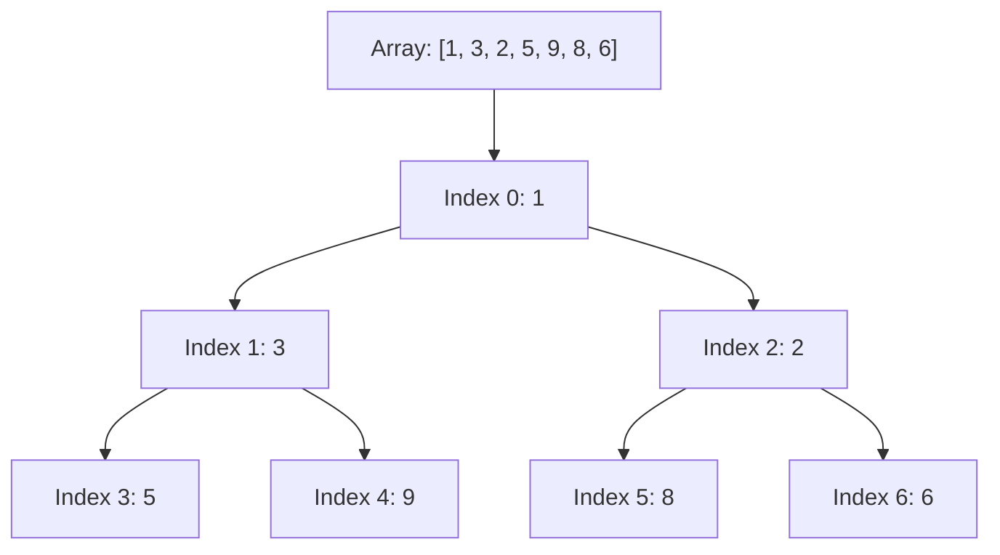

# Binary heaps, priority queues and heapsort

> [!info] A skill you do · 30 min · study Tue 13 Oct
> You will be able to trace insert with sift-up and extract-min with sift-down on an array-backed heap, and explain why build-heap is O(n). Covers the complete-tree shape and array layout from slide 4 of Lecture 4, the sift code in slides 6–8, Floyd's bottom-up build, and the heapsort steps on slide 11. Prevents treating build-heap as n inserts, which gives O(n log n), not the O(n) of the bottom-up method.

## Explainer

Your final is Wednesday 9am, and last year's paper asks you to trace heaps by hand. The good news: a heap is the simplest tree there is, because it lives inside a flat array. The shape property from slide 4 of Lecture 4 says the tree is complete — every level full except the last, which fills from the left — and that shape is exactly what the array indices encode. The heap property (min-heap: every parent ≤ its children) is what lets you find the minimum instantly at index 0.

You already traced hash tables bucket by bucket; a heap trace is the same kind of mechanical work, but the rule is even stricter: after every insert or extract-min, the array must still be a complete tree with the heap property. Two operations do all the work — sift-up for insert (slide 6) and sift-down for extract-min (slide 8). Master those two loops and the whole node is yours.

The trap this node exists to prevent: treating build-heap as n inserts. Slide 10 shows the bottom-up method (Floyd, 1964) that runs in O(n), and the exam's Q3e asks you to explain the difference. You will trace it, then build it, then explain it.

> [!quote]- Source: L4 · Slide 4
> "Introduced by J. W. J. Williams in 1964 as the data structure for heapsort"
>
> Binary heap Introduced by J. W. J. Williams in 1964 as the data structure for heapsort Shape property: a complete binary tree: every level full except possibly the last, which fills from the left Heap property: min-heap: every parent ≤ its children, so the minimum is at the root max-heap: every parent ≥ its children, so the maximum is at the root A heap is not sorted: siblings have no order between them
> [Open the page](<../sources/CSC2103-L04-binary-heaps.pdf#page=4>)

> [!quote]- Source: L4 · Slide 6
> "heap.push(x); // keep the shape: add at the end"
>
> Insert: sift-up function insert(heap, x) { heap.push(x); // keep the shape: add at the end let i = heap.length - 1; while (i > 0) { const p = Math.floor((i - 1) / 2); if (heap[p] <= heap[i]) break; // heap property holds [heap[p], heap[i]] = [heap[i], heap[p]]; i = p; // move up one level } } At most one swap per level: O(log n) worst case (O(1) on average)
> [Open the page](<../sources/CSC2103-L04-binary-heaps.pdf#page=6>)

> [!quote]- Source: L4 · Slide 7
> "Start: [1, 3, 6, 5, 9, 8]; insert 2"
>
> Insert walkthrough Start: [1, 3, 6, 5, 9, 8]; insert 2 Place 2 at index 6; its parent is index 2 (value 6) 2 < 6: swap → [1, 3, 2, 5, 9, 8, 6] Now at index 2; parent is index 0 (value 1); 2 > 1: stop Result: [1, 3, 2, 5, 9, 8, 6]
> [Open the page](<../sources/CSC2103-L04-binary-heaps.pdf#page=7>)

> [!quote]- Source: L4 · Slide 8
> "if (heap.length > 0) {"
>
> Extract-min: sift-down function extractMin(heap) { const min = heap[0]; const last = heap.pop(); if (heap.length > 0) { heap[0] = last; // move the last leaf to the root let i = 0; while (true) { const l = 2 * i + 1, r = l + 1; let s = i; // index of the smallest of i, l, r if (l < heap.length && heap[l] < heap[s]) s = l; if (r < heap.length && heap[r] < heap[s]) s = r; if (s === i) break; [heap[s], heap[i]] = [heap[i], heap[s]]; i = s; } } return min; }
> [Open the page](<../sources/CSC2103-L04-binary-heaps.pdf#page=8>)

> [!quote]- Source: L4 · Slide 9
> "Start: [1, 3, 2, 5, 9, 8, 6]; remove the root 1"
>
> Extract-min walkthrough Start: [1, 3, 2, 5, 9, 8, 6]; remove the root 1 Move the last element (6) to the root → [6, 3, 2, 5, 9, 8] Children of index 0 are 3 and 2; the smaller is 2: swap → [2, 3, 6, 5, 9, 8] Index 2 has one child, 8; 6 < 8: stop Result: [2, 3, 6, 5, 9, 8], cost O(log n)
> [Open the page](<../sources/CSC2103-L04-binary-heaps.pdf#page=9>)

> [!quote]- Source: L4 · Slide 10
> "Bottom-up (Floyd, 1964): for i from ⌊n/2⌋ − 1 down to 0, sift-down(i)"
>
> Build-heap in O(n) Bottom-up (Floyd, 1964): for i from ⌊n/2⌋ − 1 down to 0, sift-down(i) Leaves are already heaps; most nodes are near the bottom and sift down only a little The sum of all node heights is O(n), so build-heap is O(n) Inserting n keys one at a time is O(n log n) in the worst case Example (min-heap): [9, 4, 7, 1, 2, 6] → [9, 4, 6, 1, 2, 7] → [9, 1, 6, 4, 2, 7] → [1, 2, 6, 4, 9, 7]
> [Open the page](<../sources/CSC2103-L04-binary-heaps.pdf#page=10>)

> [!quote]- Source: L4 · Slide 11
> "Build a max-heap from the array: O(n)"
>
> Heapsort 1. Build a max-heap from the array: O(n) 2. Repeat n − 1 times: swap the root with the last element of the heap, shrink the heap by one, sift-down the new root Runs in O(n log n) in every case Sorts in place (O(1) extra memory) but is not stable
> [Open the page](<../sources/CSC2103-L04-binary-heaps.pdf#page=11>)

## Step by step

Trace insert and extract-min on the exact arrays from your slides, then run Floyd's build-heap. Do each step on paper; the array after each step is what the exam wants.

### 1. Insert 2 into [1, 3, 6, 5, 9, 8] (min-heap)

Push 2 to the end: index 6. Its parent is index 2 (value 6). 2 < 6, so swap → [1, 3, 2, 5, 9, 8, 6]. Now at index 2; parent is index 0 (value 1). 2 > 1, stop.

> [!warning]
> Forgetting to compare with the parent after the swap — you must move up one level each time.

> [!check] Check
> Array is [1, 3, 2, 5, 9, 8, 6]; every parent ≤ its children.

### 2. Extract-min from [1, 3, 2, 5, 9, 8, 6]

Save root 1. Pop the last element (6) and put it at index 0 → [6, 3, 2, 5, 9, 8]. Sift down: children of index 0 are 3 and 2; the smaller is 2, swap → [2, 3, 6, 5, 9, 8]. Index 2 has one child, 8; 6 < 8, stop.

> [!warning]
> Swapping with the larger child instead of the smaller — always pick the smaller child in a min-heap.

> [!check] Check
> Final array [2, 3, 6, 5, 9, 8]; the minimum 2 is at the root.

### 3. Build a min-heap from [9, 4, 7, 1, 2, 6] bottom-up

n = 6, so start at index ⌊6/2⌋−1 = 2. Sift-down at index 2: children 5 and 6 (values 2 and 6); smaller is 2, swap → [9, 4, 6, 1, 2, 7]. Next index 1: children 3 and 4 (values 1 and 2); smaller is 1, swap → [9, 1, 6, 4, 2, 7]. Next index 0: children 1 and 2 (values 1 and 6); smaller is 1, swap → [1, 9, 6, 4, 2, 7]; sift down again: children of index 1 are 3 and 4 (values 4 and 2); smaller is 2, swap → [1, 2, 6, 4, 9, 7].

> [!warning]
> Skipping the second sift-down after the root swap — the new root may need to travel more than one level.

> [!check] Check
> Final array [1, 2, 6, 4, 9, 7] is a min-heap.

### 4. Heapsort: build a max-heap, then extract n−1 times

Build a max-heap (same bottom-up, but sift up the larger child). Then repeat n−1 times: swap root with the last element, shrink the heap by one, sift-down the new root. Each extraction puts the current maximum at the end, so the array sorts in place.

> [!warning]
> Forgetting to shrink the heap after each swap — the sorted tail must never be sifted again.

> [!check] Check
> After n−1 extractions the array is sorted ascending.

> [!quote]- Source: L4 · Slide 6
> "heap.push(x); // keep the shape: add at the end"
>
> Insert: sift-up function insert(heap, x) { heap.push(x); // keep the shape: add at the end let i = heap.length - 1; while (i > 0) { const p = Math.floor((i - 1) / 2); if (heap[p] <= heap[i]) break; // heap property holds [heap[p], heap[i]] = [heap[i], heap[p]]; i = p; // move up one level } } At most one swap per level: O(log n) worst case (O(1) on average)
> [Open the page](<../sources/CSC2103-L04-binary-heaps.pdf#page=6>)

> [!quote]- Source: L4 · Slide 7
> "Start: [1, 3, 6, 5, 9, 8]; insert 2"
>
> Insert walkthrough Start: [1, 3, 6, 5, 9, 8]; insert 2 Place 2 at index 6; its parent is index 2 (value 6) 2 < 6: swap → [1, 3, 2, 5, 9, 8, 6] Now at index 2; parent is index 0 (value 1); 2 > 1: stop Result: [1, 3, 2, 5, 9, 8, 6]
> [Open the page](<../sources/CSC2103-L04-binary-heaps.pdf#page=7>)

> [!quote]- Source: L4 · Slide 8
> "if (heap.length > 0) {"
>
> Extract-min: sift-down function extractMin(heap) { const min = heap[0]; const last = heap.pop(); if (heap.length > 0) { heap[0] = last; // move the last leaf to the root let i = 0; while (true) { const l = 2 * i + 1, r = l + 1; let s = i; // index of the smallest of i, l, r if (l < heap.length && heap[l] < heap[s]) s = l; if (r < heap.length && heap[r] < heap[s]) s = r; if (s === i) break; [heap[s], heap[i]] = [heap[i], heap[s]]; i = s; } } return min; }
> [Open the page](<../sources/CSC2103-L04-binary-heaps.pdf#page=8>)

> [!quote]- Source: L4 · Slide 9
> "Start: [1, 3, 2, 5, 9, 8, 6]; remove the root 1"
>
> Extract-min walkthrough Start: [1, 3, 2, 5, 9, 8, 6]; remove the root 1 Move the last element (6) to the root → [6, 3, 2, 5, 9, 8] Children of index 0 are 3 and 2; the smaller is 2: swap → [2, 3, 6, 5, 9, 8] Index 2 has one child, 8; 6 < 8: stop Result: [2, 3, 6, 5, 9, 8], cost O(log n)
> [Open the page](<../sources/CSC2103-L04-binary-heaps.pdf#page=9>)

> [!quote]- Source: L4 · Slide 10
> "Bottom-up (Floyd, 1964): for i from ⌊n/2⌋ − 1 down to 0, sift-down(i)"
>
> Build-heap in O(n) Bottom-up (Floyd, 1964): for i from ⌊n/2⌋ − 1 down to 0, sift-down(i) Leaves are already heaps; most nodes are near the bottom and sift down only a little The sum of all node heights is O(n), so build-heap is O(n) Inserting n keys one at a time is O(n log n) in the worst case Example (min-heap): [9, 4, 7, 1, 2, 6] → [9, 4, 6, 1, 2, 7] → [9, 1, 6, 4, 2, 7] → [1, 2, 6, 4, 9, 7]
> [Open the page](<../sources/CSC2103-L04-binary-heaps.pdf#page=10>)

> [!quote]- Source: L4 · Slide 11
> "Build a max-heap from the array: O(n)"
>
> Heapsort 1. Build a max-heap from the array: O(n) 2. Repeat n − 1 times: swap the root with the last element of the heap, shrink the heap by one, sift-down the new root Runs in O(n log n) in every case Sorts in place (O(1) extra memory) but is not stable
> [Open the page](<../sources/CSC2103-L04-binary-heaps.pdf#page=11>)

## Checklist

**Heap trace checklist**

- [ ] Array is complete: no gaps before the last level
  - *The shape property must hold after every operation.*
- [ ] Every parent ≤ its children (min-heap)
  - *The heap property is what makes find-min O(1).*
- [ ] Insert: new key placed at the end, then sifted up
  - *Adding at the end preserves the shape; sifting restores the heap property.*
- [ ] Extract-min: last element moved to root, then sifted down
  - *Moving the last leaf keeps the tree complete; sifting down restores order.*
- [ ] Sift-down always swaps with the smaller child (min-heap)
  - *Swapping with the larger child would violate the heap property.*
- [ ] Build-heap starts at index ⌊n/2⌋−1 and goes down to 0
  - *Leaves are already heaps; only internal nodes need sifting.*
- [ ] Heapsort swaps root with last, shrinks heap, sifts down
  - *Each extraction places the max at the end, sorting in place.*

> [!note]
> Keep this open while you trace; tick each line only when the array on your paper satisfies it.

> [!quote]- Source: L4 · Slide 4
> "Introduced by J. W. J. Williams in 1964 as the data structure for heapsort"
>
> Binary heap Introduced by J. W. J. Williams in 1964 as the data structure for heapsort Shape property: a complete binary tree: every level full except possibly the last, which fills from the left Heap property: min-heap: every parent ≤ its children, so the minimum is at the root max-heap: every parent ≥ its children, so the maximum is at the root A heap is not sorted: siblings have no order between them
> [Open the page](<../sources/CSC2103-L04-binary-heaps.pdf#page=4>)

> [!quote]- Source: L4 · Slide 6
> "heap.push(x); // keep the shape: add at the end"
>
> Insert: sift-up function insert(heap, x) { heap.push(x); // keep the shape: add at the end let i = heap.length - 1; while (i > 0) { const p = Math.floor((i - 1) / 2); if (heap[p] <= heap[i]) break; // heap property holds [heap[p], heap[i]] = [heap[i], heap[p]]; i = p; // move up one level } } At most one swap per level: O(log n) worst case (O(1) on average)
> [Open the page](<../sources/CSC2103-L04-binary-heaps.pdf#page=6>)

> [!quote]- Source: L4 · Slide 8
> "if (heap.length > 0) {"
>
> Extract-min: sift-down function extractMin(heap) { const min = heap[0]; const last = heap.pop(); if (heap.length > 0) { heap[0] = last; // move the last leaf to the root let i = 0; while (true) { const l = 2 * i + 1, r = l + 1; let s = i; // index of the smallest of i, l, r if (l < heap.length && heap[l] < heap[s]) s = l; if (r < heap.length && heap[r] < heap[s]) s = r; if (s === i) break; [heap[s], heap[i]] = [heap[i], heap[s]]; i = s; } } return min; }
> [Open the page](<../sources/CSC2103-L04-binary-heaps.pdf#page=8>)

> [!quote]- Source: L4 · Slide 10
> "Bottom-up (Floyd, 1964): for i from ⌊n/2⌋ − 1 down to 0, sift-down(i)"
>
> Build-heap in O(n) Bottom-up (Floyd, 1964): for i from ⌊n/2⌋ − 1 down to 0, sift-down(i) Leaves are already heaps; most nodes are near the bottom and sift down only a little The sum of all node heights is O(n), so build-heap is O(n) Inserting n keys one at a time is O(n log n) in the worst case Example (min-heap): [9, 4, 7, 1, 2, 6] → [9, 4, 6, 1, 2, 7] → [9, 1, 6, 4, 2, 7] → [1, 2, 6, 4, 9, 7]
> [Open the page](<../sources/CSC2103-L04-binary-heaps.pdf#page=10>)

> [!quote]- Source: L4 · Slide 11
> "Build a max-heap from the array: O(n)"
>
> Heapsort 1. Build a max-heap from the array: O(n) 2. Repeat n − 1 times: swap the root with the last element of the heap, shrink the heap by one, sift-down the new root Runs in O(n log n) in every case Sorts in place (O(1) extra memory) but is not stable
> [Open the page](<../sources/CSC2103-L04-binary-heaps.pdf#page=11>)

## Build-heap trace on [9, 4, 7, 1, 2, 6]

Slide 10 shows the steps; here is the full working.

n = 6, so the first internal node is at index ⌊6/2⌋−1 = 2.

- i = 2 (value 7): children at 5 and 6 are 2 and 6; smaller is 2 → swap → [9, 4, 6, 1, 2, 7]
- i = 1 (value 4): children at 3 and 4 are 1 and 2; smaller is 1 → swap → [9, 1, 6, 4, 2, 7]
- i = 0 (value 9): children at 1 and 2 are 1 and 6; smaller is 1 → swap → [1, 9, 6, 4, 2, 7]; now sift down from index 1: children at 3 and 4 are 4 and 2; smaller is 2 → swap → [1, 2, 6, 4, 9, 7]

Final min-heap: [1, 2, 6, 4, 9, 7]. Each parent ≤ its children: 1 ≤ 2, 1 ≤ 6, 2 ≤ 4, 2 ≤ 9, 6 ≤ 7.

> [!quote]- Source: L4 · Slide 10
> "Bottom-up (Floyd, 1964): for i from ⌊n/2⌋ − 1 down to 0, sift-down(i)"
>
> Build-heap in O(n) Bottom-up (Floyd, 1964): for i from ⌊n/2⌋ − 1 down to 0, sift-down(i) Leaves are already heaps; most nodes are near the bottom and sift down only a little The sum of all node heights is O(n), so build-heap is O(n) Inserting n keys one at a time is O(n log n) in the worst case Example (min-heap): [9, 4, 7, 1, 2, 6] → [9, 4, 6, 1, 2, 7] → [9, 1, 6, 4, 2, 7] → [1, 2, 6, 4, 9, 7]
> [Open the page](<../sources/CSC2103-L04-binary-heaps.pdf#page=10>)

## Exercise

Write the `insert` function for a min-heap stored as an array. It takes the current heap array and a value x, pushes x to the end, and sifts it up until the heap property holds. Mutate the array in place; the function does not need to return anything. Example: `insert([1, 3, 6, 5, 9, 8], 2)` should leave the array as `[1, 3, 2, 5, 9, 8, 6]`.

```js
function insert(heap, x) {
  // push x to the end, then sift up
}
```

Tests:

- inserts into empty heap: `(() => { const h = []; insert(h, 5); return h; })()` → `[5]`
- inserts smaller than root: `(() => { const h = [3, 5]; insert(h, 1); return h; })()` → `[1,5,3]`
- inserts larger than root: `(() => { const h = [1, 3, 6, 5, 9, 8]; insert(h, 2); return h; })()` → `[1,3,2,5,9,8,6]`
- inserts equal to parent (no swap): `(() => { const h = [2, 4]; insert(h, 2); return h; })()` → `[2,4,2]`

> [!tip]- Hints
> - Push x to the end, then set i to the last index.
> - While i > 0, compare with parent at Math.floor((i-1)/2).
> - If parent is greater, swap and move i to the parent; otherwise stop.

> [!question] Q1 · code
> Implement the insert function for a min-heap as described in the code block.

> [!success]- Answer
> Run the tests in the course page.

> [!quote]- Source: L4 · Slide 6
> "heap.push(x); // keep the shape: add at the end"
>
> Insert: sift-up function insert(heap, x) { heap.push(x); // keep the shape: add at the end let i = heap.length - 1; while (i > 0) { const p = Math.floor((i - 1) / 2); if (heap[p] <= heap[i]) break; // heap property holds [heap[p], heap[i]] = [heap[i], heap[p]]; i = p; // move up one level } } At most one swap per level: O(log n) worst case (O(1) on average)
> [Open the page](<../sources/CSC2103-L04-binary-heaps.pdf#page=6>)

## Diagram



*The min-heap from slide 7's insert walkthrough, shown as a tree with array indices.*

> [!abstract]- Text version
> A complete binary tree with root 1, children 3 and 2, grandchildren 5, 9, 8, 6, showing the array indices 0 to 6.

> [!quote]- Source: L4 · Slide 7
> "Start: [1, 3, 6, 5, 9, 8]; insert 2"
>
> Insert walkthrough Start: [1, 3, 6, 5, 9, 8]; insert 2 Place 2 at index 6; its parent is index 2 (value 6) 2 < 6: swap → [1, 3, 2, 5, 9, 8, 6] Now at index 2; parent is index 0 (value 1); 2 > 1: stop Result: [1, 3, 2, 5, 9, 8, 6]
> [Open the page](<../sources/CSC2103-L04-binary-heaps.pdf#page=7>)

## Check yourself

Check yourself on the heap rules before the exam.

> [!question] Q2 · mcq
> Which of the following arrays represents a valid min-heap?
>
> - a) [1, 3, 2, 5, 9, 8, 6]
> - b) [1, 3, 2, 5, 0, 8, 6]
> - c) [1, 2, 3, 4, 5, 6, 0]
> - d) [1, 1, 2, 3, 5, 8, 13]
>
> *Beyond your slides: the Checker found no support for this in your files.*

> [!success]- Answer
> a) [1, 3, 2, 5, 9, 8, 6]
>
> In a min-heap every parent must be ≤ its children. Option a satisfies this for all parents; the others each have a parent greater than a child.

> [!quote]- Source: L4 · Slide 4
> "min-heap: every parent ≤ its children, so the minimum is at the root"
>
> Binary heap Introduced by J. W. J. Williams in 1964 as the data structure for heapsort Shape property: a complete binary tree: every level full except possibly the last, which fills from the left Heap property: min-heap: every parent ≤ its children, so the minimum is at the root max-heap: every parent ≥ its children, so the maximum is at the root A heap is not sorted: siblings have no order between them
> [Open the page](<../sources/CSC2103-L04-binary-heaps.pdf#page=4>)

> [!question] Q3 · ordering
> Put the steps of Floyd's build-heap algorithm in the correct order.
>
> Put in order:
> - b) Set i = ⌊n/2⌋ − 1.
> - c) While i ≥ 0, sift-down at index i.
> - d) Decrement i by 1.
> - a) Start with the array of n keys.

> [!success]- Answer
> a) Start with the array of n keys. → b) Set i = ⌊n/2⌋ − 1. → c) While i ≥ 0, sift-down at index i. → d) Decrement i by 1.
>
> Build-heap starts from the last internal node and sifts down each node, moving leftward to the root.

> [!quote]- Source: L4 · Slide 10
> "for i from ⌊n/2⌋ − 1 down to 0, sift-down(i)"
>
> Build-heap in O(n) Bottom-up (Floyd, 1964): for i from ⌊n/2⌋ − 1 down to 0, sift-down(i) Leaves are already heaps; most nodes are near the bottom and sift down only a little The sum of all node heights is O(n), so build-heap is O(n) Inserting n keys one at a time is O(n log n) in the worst case Example (min-heap): [9, 4, 7, 1, 2, 6] → [9, 4, 6, 1, 2, 7] → [9, 1, 6, 4, 2, 7] → [1, 2, 6, 4, 9, 7]
> [Open the page](<../sources/CSC2103-L04-binary-heaps.pdf#page=10>)

> [!question] Q4 · numeric
> In a min-heap stored as an array, what is the index of the parent of the element at index 9? (Use 0-based indexing.)

> [!success]- Answer
> 4
>
> The parent index is floor((i−1)/2), so for i=9 it is floor(8/2)=4.

> [!quote]- Source: L4 · Slide 13
> "Heap = complete binary tree + heap property, stored in an array"
>
> Summary and tutorial Heap = complete binary tree + heap property, stored in an array insert and extract-min are O(log n); find-min is O(1); build-heap is O(n) Heapsort: O(n log n), in place, not stable Tutorial 4: (1) Insert 20, 15, 30, 5, 10, 25 into an empty min-heap and show the array after each insert. (2) Perform two extract-min operations on the result. (3) Use a min-heap of size k to find the k largest numbers in a stream of n numbers. What is the running time?
> [Open the page](<../sources/CSC2103-L04-binary-heaps.pdf#page=13>)

> [!question] Q5 · short answer
> Explain why building a heap bottom-up from n unordered keys takes O(n) time, while inserting the n keys one at a time takes O(n log n) time in the worst case.

> [!success]- Answer
> Bottom-up build sifts down each internal node; the sum of all node heights in a complete tree is O(n), so the total work is O(n). Repeated inserts each sift up O(log n) levels, so n inserts cost O(n log n) in the worst case.
>
> The sum of all node heights is O(n), so build-heap is O(n) Inserting n keys one at a time is O(n log n) in the worst case
>
> | Criterion | Excellent | Acceptable |
> |---|---|---|
> | States the bottom-up build's cost as the sum of node heights | Explicitly says the sum of all node heights in a complete tree is O(n), and that most nodes are near the bottom so they sift down only a little. | Mentions that most nodes are near the bottom and sift down little, but does not connect to the sum of heights. |
> | States the per-insert cost and the total for n inserts | Says each insert can sift up O(log n) levels, so n inserts cost O(n log n) in the worst case. | Says each insert is O(log n) but does not multiply by n. |
> | Contrasts the two methods directly | Explicitly contrasts bottom-up build with repeated inserts and explains why the former avoids the log factor. | Describes both methods but does not explicitly contrast their costs. |

> [!quote]- Source: L4 · Slide 10
> "The sum of all node heights is O(n), so build-heap is O(n) Inserting n keys one at a time is O(n log n) in the worst case"
>
> Build-heap in O(n) Bottom-up (Floyd, 1964): for i from ⌊n/2⌋ − 1 down to 0, sift-down(i) Leaves are already heaps; most nodes are near the bottom and sift down only a little The sum of all node heights is O(n), so build-heap is O(n) Inserting n keys one at a time is O(n log n) in the worst case Example (min-heap): [9, 4, 7, 1, 2, 6] → [9, 4, 6, 1, 2, 7] → [9, 1, 6, 4, 2, 7] → [1, 2, 6, 4, 9, 7]
> [Open the page](<../sources/CSC2103-L04-binary-heaps.pdf#page=10>)

> [!quote]- Source: L4 · Slide 4
> "Introduced by J. W. J. Williams in 1964 as the data structure for heapsort"
>
> Binary heap Introduced by J. W. J. Williams in 1964 as the data structure for heapsort Shape property: a complete binary tree: every level full except possibly the last, which fills from the left Heap property: min-heap: every parent ≤ its children, so the minimum is at the root max-heap: every parent ≥ its children, so the maximum is at the root A heap is not sorted: siblings have no order between them
> [Open the page](<../sources/CSC2103-L04-binary-heaps.pdf#page=4>)

> [!quote]- Source: L4 · Slide 10
> "Bottom-up (Floyd, 1964): for i from ⌊n/2⌋ − 1 down to 0, sift-down(i)"
>
> Build-heap in O(n) Bottom-up (Floyd, 1964): for i from ⌊n/2⌋ − 1 down to 0, sift-down(i) Leaves are already heaps; most nodes are near the bottom and sift down only a little The sum of all node heights is O(n), so build-heap is O(n) Inserting n keys one at a time is O(n log n) in the worst case Example (min-heap): [9, 4, 7, 1, 2, 6] → [9, 4, 6, 1, 2, 7] → [9, 1, 6, 4, 2, 7] → [1, 2, 6, 4, 9, 7]
> [Open the page](<../sources/CSC2103-L04-binary-heaps.pdf#page=10>)

> [!quote]- Source: L4 · Slide 13
> "Heap = complete binary tree + heap property, stored in an array"
>
> Summary and tutorial Heap = complete binary tree + heap property, stored in an array insert and extract-min are O(log n); find-min is O(1); build-heap is O(n) Heapsort: O(n log n), in place, not stable Tutorial 4: (1) Insert 20, 15, 30, 5, 10, 25 into an empty min-heap and show the array after each insert. (2) Perform two extract-min operations on the result. (3) Use a min-heap of size k to find the k largest numbers in a stream of n numbers. What is the running time?
> [Open the page](<../sources/CSC2103-L04-binary-heaps.pdf#page=13>)

---

*Made with BiliMind from your own files. Course: Data structures final prep.*
